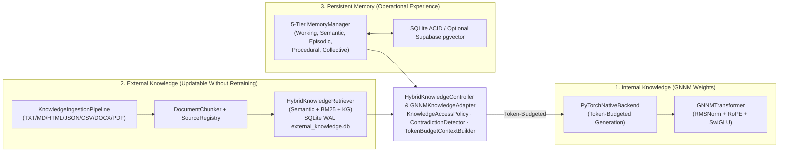
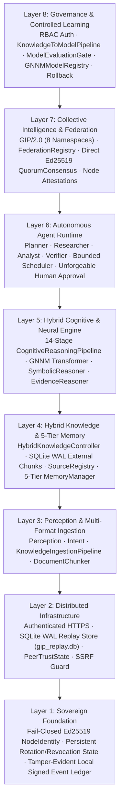

# GajahMada AI 2.0 — System & Hybrid Knowledge Architecture (`ARCHITECTURE.md`)

## 1. Architectural Philosophy & Design Guarantees

**GajahMada AI 2.0** is a sovereign, offline-first **Hybrid Knowledge & Distributed Intelligence** platform. Every subsystem adheres to six verifiable engineering guarantees:

1. **Zero Mandatory Cloud AI Dependencies:** Core reasoning, hybrid retrieval, persistent memory, cryptographic identity, and local `GNNM` neural inference run 100% offline.
2. **Three-System Knowledge Separation:** **Internal Knowledge** (GNNM parameters), **External Knowledge** (ingested documents & Knowledge Graph), and **Persistent Memory** (5-tier operational experience) are kept logically distinct and coordinated through a unified `HybridKnowledgeController`.
3. **Honest Capability Reporting:** `ModelRouter` and `/api/v2/intelligence/diagnose` report actual loaded weights (`neural_inference_active: True/False`) and never present deterministic fallbacks as neural inference.
4. **Fail-Closed Security & Retrieval-Boundary Authorization:** Access control (`MemoryAuthorizationService` + `KnowledgeAccessPolicy`) is enforced at retrieval and API boundaries before context construction, never merely via prompt instructions.
5. **Isolated, Evaluation-Gated Model Learning:** Document ingestion and chat never mutate model weights. Internalizing verified knowledge into GNNM requires filtered datasets, isolated checkpoint training, passing `ModelEvaluationGate`, and explicit operator approval in `GNNMModelRegistry`.
6. **Tamper-Evident Local Auditability:** Operational and governance events are sealed in a local tamper-evident signed event ledger (`AIBlockchain` Schema v2) with strict non-genesis Ed25519 verification and atomic backup recovery.

---

## 2. Three-System Hybrid Knowledge Architecture

### Key Integration Contracts
- **Retrieval-Boundary Authorization (`gajahmada_ai/knowledge/access_policy.py`):** Wraps `MemoryAuthorizationService` to enforce the explicit visibility matrix (`PRIVATE`/`LOCAL` → `admin`/`operator` only; `SHARED` → authenticated roles; `COLLECTIVE`/`PUBLIC` → public read) plus `owner_agent_id` and `owner_node_id` isolation.
- **Pluggable Offline Embeddings (`gajahmada_ai/knowledge/embedding.py`):** `HashEmbeddingProvider` (`deterministic-hash-384d` v1.0.0) remains the zero-dependency fallback alongside `NativeSemanticEmbeddingProvider` (`gajahmada-native-semantic-384d` v2.0.0 bilingual ID/EN encoder). Vectors are strictly checked for `(encoder_id, encoder_version, dimension)` compatibility before similarity computation, with reversible re-embedding via `EmbeddingMigrationManager`.
- **Token-Budget Context Construction (`gajahmada_ai/knowledge/context_builder.py` & `neural/pytorch_backend.py`):** Reserves tokens for system instructions, user question, and generated output against GNNM's `max_seq_len`, isolates retrieved text inside `<untrusted_retrieved_data>` delimiters, redacts prompt-injection directives, and prioritizes highest-relevance chunks.

---

## 3. Eight-Layer Platform Stack

---

## 4. Isolated Knowledge-to-Model Learning Pipeline

To prevent catastrophic forgetting, data poisoning, or accidental overwriting of production weights, internalizing knowledge into GNNM follows a strictly isolated offline/admin-gated pipeline:

1. **Filtering (`gajahmada_ai/learning/knowledge_filter.py`):** `TrainingKnowledgeFilter` blocks `UNVERIFIED`, `MODEL_ASSESSED`, `DISPUTED`, `REJECTED`, prompt-injection patterns, restricted/missing licenses, corrupted OCR, duplicates, and untrusted peer/agent sources. Disputed items remain preserved in external retrieval with labels.
2. **Dataset Separation (`gajahmada_ai/learning/dataset_builder.py`):** `KnowledgeDatasetBuilder` emits distinct SHA-256 checksummed JSONL manifests for **Continued Pretraining** vs. **Supervised Fine-Tuning (SFT)**.
3. **Isolated Training (`gajahmada_ai/learning/training_pipeline.py`):** `KnowledgeToModelPipeline` clones `base_checkpoint_dir` into a fresh versioned run workspace (`knowledge_store/training_runs/<run_id>/`) and executes reproducible-seed training via `GNNMTrainer`.
4. **Evaluation Gate (`gajahmada_ai/learning/evaluation_gate.py`):** `ModelEvaluationGate` tests ID/EN language quality, grounded faithfulness, citation accuracy, hallucination rate, perplexity ratio vs. baseline, and prompt-injection resilience.
5. **Versioned Promotion & Rollback (`gajahmada_ai/learning/model_registry.py`):** Candidates failing the gate transition to `REJECTED` without affecting production. Passing candidates become `APPROVED` and require explicit `operator_approved=True` via `POST /api/v2/learning/promote/{version_id}` to become `ACTIVE`, with one-call rollback via `POST /api/v2/learning/rollback`.

---

## 5. Security Hardening & Tamper-Evident Ledger Integrity

- **Zero Signing Oracle & Fail-Closed Auth (`gajahmada_ai/security/auth.py`):** `/security/sign-verify` uses an isolated ephemeral keypair + domain-separated nonce. Admin keys are 256-bit cryptographically random secrets persisted to `admin_api.key` (`0600`, rotatable). All state-mutating v1/v2 routes and internal operational endpoints (`/api/v2/reasoning`, `/api/v2/agents`, `/api/v2/learning/*`, `/api/v2/knowledge/ingest`, `/api/v2/knowledge/sources`) fail closed (`401`/`403`) behind `SlidingWindowRateLimiter` (`429`) and configurable CORS.
- **Fail-Closed Key Management (`gajahmada_ai/security/crypto.py`):** Private keys are written atomically (`0600` + `fsync` + `os.replace`) and raise `KeyPersistenceError` on failure. Dual-signed rotation certificates and revocation records persist in `node_key.pem.state.json` and synchronize via `GIP-IDENTITY`.
- **GIP/2.0 Peer Trust & Cryptographic Consensus (`gajahmada_ai/network/`):** Explicit `PeerTrustState` lifecycle (`UNKNOWN → PENDING → AUTHENTICATED → TRUSTED → REVOKED`), SSRF validation, atomic SQLite WAL replay nonce store (`gip_replay.db`), direct Ed25519 verification + independent evidence checks inside `QuorumConsensusManager`, and `>= 2` Ed25519-signed `node_attestations` required for `INDEPENDENTLY_VERIFIED` knowledge promotion.
- **Tamper-Evident Local Signed Event Ledger (`gajahmada_ai/blockchain/chain.py`):** Local hash-chained, Ed25519-signed audit ledger (not a public BFT distributed consensus blockchain). Schema v2 hashes every event field canonically, strictly rejects unsigned or spoofed `"Genesis Node"` non-genesis blocks (`index > 0`), persists atomically (`tmp + fsync + .bak + os.replace`), and halts in `LEDGER_CORRUPTED` mode on tampering with explicit `recover_from_backup()`.
- **Optional Cloud Persistence (`supabase/schema.sql`):** `public.knowledge_records` (`vector(384)` + `match_knowledge` RPC) and `public.ledger_blocks` protected by Row Level Security (public publishable keys can only `SELECT` `COLLECTIVE` rows; all public writes return `401 / 42501`).

---

## 6. Dual-Mode Web UI, SDK & Deployment

- **Web UI (`interface/html/`):** Homepage (`/`) with compact Command Center over fullscreen 3D Network Graph + full 8-panel Cyberdeck Dashboard (`/dashboard` & `/ui`) with session-scoped **`🔑 AUTH`** control. Includes Google Search Console SEO metadata (Schema.org `@graph` JSON-LD, OpenGraph, Twitter Cards, canonical URLs, `/sitemap.xml`, `/robots.txt`, and `/manifest.json`) targeting `https://gajahmada.vercel.app`.
- **Official Python SDK (`sdk/gajahmada_sdk/`):** Provides `GajahMadaClient`, `NodeKeyPair`, and `build_signed_gip_message` aligned with [docs/GIP_2_0_RFC.md](docs/GIP_2_0_RFC.md).
- **Verification:** **57/57 automated tests passing** (`python3 -m pytest -q`) and reproducible ecosystem benchmarks recorded in [docs/BENCHMARK_REPORT.json](docs/BENCHMARK_REPORT.json).
