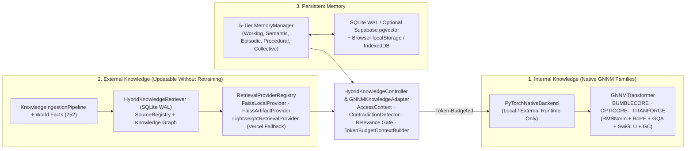
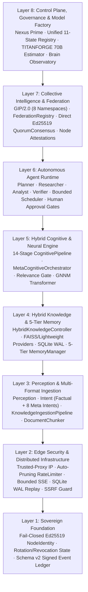

# GajahMada AI 2.0 — System & Platform Architecture (`ARCHITECTURE.md`)

## 1. Architectural Philosophy & Design Guarantees

**GajahMada AI 2.0 — One Intelligence. Many Forms.** is an independent, offline-first **Hybrid Knowledge & Native GNNM Intelligence Platform**. Every subsystem enforces seven verifiable engineering guarantees:

1. **Zero Mandatory Commercial AI Dependencies:** Core reasoning, hybrid retrieval, persistent memory, cryptographic identity, and local `GNNM` neural inference operate independently without OpenAI, Gemini, or Claude APIs.
2. **Separation of Control Plane and Large-Scale Training:** **Vercel Free** hosts the lightweight FastAPI control plane, Brain Observatory, Model Factory metadata, Nexus Prime routing, and Hybrid Knowledge UI. Large-scale model training (`TITANFORGE 70B` / `120B+`) and native `FAISS CPU` binaries remain cleanly separated for local or external GPU infrastructure.
3. **Three-System Knowledge Separation:** **Internal Knowledge** (`GNNM` weights), **External Knowledge** (ingested documents, Knowledge Graph, & curated offline facts), and **Persistent Memory** (5-tier server memory + browser-local `localStorage`/`IndexedDB`) are logically separated and coordinated by `HybridKnowledgeController`.
4. **Honest Capability & Status Reporting:** `ModelRouter`, `/api/v2/intelligence/diagnose`, and `/api/v2/platform/status` report actual loaded weights (`NATIVE MODEL INFERENCE: UNAVAILABLE IN CURRENT RUNTIME` when inactive) and explicit provider statuses (`ACTIVE | AVAILABLE_LOCALLY | NOT_CONFIGURED | INCOMPATIBLE_RUNTIME | DISABLED`).
5. **Fail-Closed Security & Edge Hardening:** Canonical `AccessContext` enforces 9-scope memory authorization directly inside `MemoryManager.retrieve()` and retrieval providers. Anonymous `/ai/chat` never poisons shared RAG; public config/log endpoints redact sensitive fields; rate limiting uses trusted-proxy IP resolution with auto-pruning; SSE streams enforce per-IP and global connection caps.
6. **Isolated, Evaluation-Gated Model Learning:** Chat and ingestion never mutate model weights. Internalization requires filtered datasets, isolated checkpoint training, passing `ModelEvaluationGate` (`gm-eval-v2.1`), SHA-256 verification, and explicit operator approval.
7. **Tamper-Evident Local Auditability:** Operational and governance events are sealed in a local hash-chained Ed25519-signed event ledger (`AIBlockchain` Schema v2) with atomic persistence and backup recovery.

---

## 2. Three-System Hybrid Knowledge & Retrieval Provider Architecture

### Key Integration Contracts
- **Retrieval Provider Abstraction (`gajahmada_ai/knowledge/providers.py`):** Preserves `FAISS CPU` (`FaissLocalProvider`, `FaissArtifactProvider`) for local development and compatible servers while falling back transparently to `LightweightRetrievalProvider` (`uses_faiss: False`) on Vercel Free.
- **Question–Answer Relevance Gate (`gajahmada_ai/cognition/answer_relevance.py`):** Scores candidate answers against question focus terms (ordinals, dates, numbers, qualifiers) and selects the responsive passage from evidence or curated facts (`world_facts.py`), declining honestly rather than emitting off-topic summaries.
- **Canonical `AccessContext` & Direct Memory Authorization (`gajahmada_ai/security/context.py`, `memory/authorization.py`):** Propagates immutable actor identity across all 9 scopes (`PRIVATE`, `SESSION`, `AGENT`, `ORGANIZATION`, `LOCAL`, `SHARED`, `DISTRIBUTED_SHARED`, `COLLECTIVE`, `PUBLIC`) fail-closed. See [docs/MEMORY_SECURITY_MODEL.md](docs/MEMORY_SECURITY_MODEL.md).
- **Honest Offline Embeddings (`gajahmada_ai/knowledge/embedding.py`):** Strict `(encoder_id, encoder_version, dimension)` compatibility enforcement and reversible re-embedding via `EmbeddingMigrationManager`. See [docs/EMBEDDING_ARCHITECTURE.md](docs/EMBEDDING_ARCHITECTURE.md).

---

## 3. Eight-Layer Platform Stack & Nexus Prime

---

## 4. GNNM Model Families, BumbleCore 300M (Release 2.6), TITANFORGE 70B & Model Factory

- **Modular Config & Exact Accounting (`gajahmada_ai/gnnm/config.py`):** Supports Dense and Experimental MoE architectures with verified exact analytical parameter counts (`BUMBLECORE` 12M/100M/**`300M` = `303,350,784` params**, `OPTICORE` 1B/3B/7B, `TITANFORGE` 30B / **`70B` = `70,549,512,192` params** / 120B) and planned specializations (`NEUROX`, `CODESTRIKE`, `KNOWTRON`).
- **BumbleCore 300M Release 2.6 Training Integrity Hardening (`gajahmada_ai/gnnm/bumblecore/`):**
  - **Checkpoint Trust Layer (`checkpoint_trust.py`):** Verifies PyTorch tensor keys, shapes, dtypes, exact parameter count, finite values (no NaN/Inf), live SHA-256 provenance hashes (`model.pt`, `config.json`, `tokenizer.json`, `dataset_manifest.json`), and Ed25519 manifest signatures.
  - **Exact Token Budget & Reproducible Resume (`trainer.py`):** Enforces zero-overshoot `target_tokens` stopping via tail-padding + `-100` target masking and 7-dimension exact resume (weights, optimizer, scheduler state, cursor, token counters, RNGs, hardware topology, and config/dataset/tokenizer/budget hash guards).
  - **True Streaming Engine & Dataset Governance (`streaming_loader.py`, `dataset_governance.py`):** Line-by-line JSONL streaming with bounded shuffle buffer, SQLite WAL deduplication (`fingerprints.db`), safe path-traversal/symlink guards, mandatory split hashes, and cross-split document/source leakage rejection.
  - **Independent Benchmark Suite, Evidence-Based Gates & HF Export (`evaluation.py`, `gate_evidence.py`, `export.py`):** 15-case bilingual held-out benchmark with training-leakage detection, zero hardcoded booleans across Release Gates A–G (honestly reporting `PRETRAINING_STATUS = NOT_STARTED` at `GATE_C_PRETRAINING_CHECKPOINT_VALIDATED`), Model Card schema validation, untrained/smoke upload guards, and full tensor/dtype/logit/Safetensors parity.
- **Analytical Resource Estimator (`gajahmada_ai/gnnm/resource_estimator.py`):** Computes theoretical FP32/BF16/FP16/INT8/INT4 inference VRAM, mixed-precision AdamW sharded training memory, checkpoint storage, FLOPs, and GPU cluster sizing with zero GPUs.
- **Distributed Training Preparation (`gajahmada_ai/gnnm/distributed_prep.py`):** Modular data pipeline spec and DDP/FSDP/TP/PP readiness validation; explicitly blocks execution inside Vercel Free and never simulates multi-GPU success.
- **Unified 11-State Model Registry (`gajahmada_ai/platform/model_factory.py` & `learning/model_registry.py`):** Tracks `PLANNED` → `ARCHITECTURE_DESIGNED` → `CONFIGURATION_VALIDATED` → `DATASET_PREPARATION` → `READY_FOR_TRAINING` → `TRAINING` → `TRAINING_COMPLETED` → `EVALUATION` → `APPROVED` → `PRODUCTION` / `DEPRECATED`, reconciling strictly with real on-disk checkpoints and live SHA-256 hashes. See [docs/GNNM_ARCHITECTURE.md](docs/GNNM_ARCHITECTURE.md), [docs/GNNM_BUMBLECORE_ARCHITECTURE.md](docs/GNNM_BUMBLECORE_ARCHITECTURE.md), and [docs/MODEL_REGISTRY_AND_PROMOTION.md](docs/MODEL_REGISTRY_AND_PROMOTION.md).

---

## 5. Security Hardening & Edge Controls

- **Zero Cross-User Leakage:** Anonymous `/ai/chat` never writes Q&A to shared legacy RAG (`docs.json`) and filters legacy Q&A out of anonymous retrieval; `/knowledge/stats`, `/knowledge/search`, `/node/config`, and `/node/logs` redact private/sensitive details for unauthenticated callers; `/ai/embedding` bounds unauthenticated inputs to `4096` characters.
- **Edge Protection (`gajahmada_ai/api/http_utils.py`, `security/rate_limit.py`):** Honors `X-Real-IP` / `X-Forwarded-For` only behind trusted proxies (`VERCEL=1` or `GAJAHMADA_TRUST_PROXY=1`), prunes idle rate-limit buckets every 1,024 calls, and caps concurrent Observatory SSE streams (`3`/IP, `50` global).
- **Cryptographic Identity & Ledger (`gajahmada_ai/security/crypto.py`, `blockchain/chain.py`):** Fail-closed atomic `0600` Ed25519 keys, dual-signed rotation/revocation state, SQLite WAL GIP/2.0 replay store, and strict non-genesis Schema v2 audit ledger verification.

---

## 6. Web Interface, Brain Observatory & Verification

- **Web Surfaces (`interface/html/`):** Homepage (`/`), Cyberdeck Dashboard (`/dashboard`, `/ui`), Brain Observatory (`/brain` and `/brain/{activity,knowledge,memory,reasoning,learning}` — displaying live `/api/v2/platform/bumblecore` actual telemetry & Release Gates A–G without fabricated progress), and Platform Control Plane (`/chat`, `/knowledge`, `/memory`, `/models`, `/models/{family}`, `/model-factory`, `/training`, `/benchmarks`, `/infrastructure`, `/nexus`, `/settings`, `/documentation`).
- **Deployment:** Zero-dependency Vercel Free deployment documented in [docs/VERCEL_DEPLOYMENT_GUIDE.md](docs/VERCEL_DEPLOYMENT_GUIDE.md) (`configs/bumblecore_300m.yaml` bundled for live Gate A & Gate B checks; zero `torch`/CUDA/FAISS in `requirements.txt`).
- **Verification:** **166/166 automated tests passing** (`python3 -m pytest -q`, 6 PyTorch-only tests skipped on Python 3.14) plus **all 5 PyTorch acceptance suites passing in `.venv312`** (`checkpoint_trust`, `exact_token_budget`, `streaming_training_engine`, `exact_resume_reproducibility`, `hf_export_hardening`), clean `node --check`, and reproducible benchmarks in [docs/BENCHMARK_REPORT.json](docs/BENCHMARK_REPORT.json).
