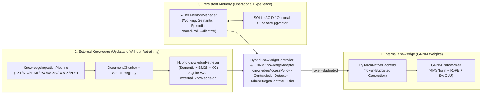
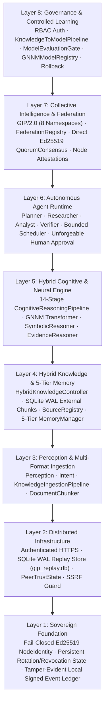

# GajahMada AI 2.0 — System & Hybrid Knowledge Architecture (`ARCHITECTURE.md`)

## 1. Architectural Philosophy & Design Guarantees

**GajahMada AI 2.0** is a sovereign, offline-first **Hybrid Knowledge & Distributed Intelligence** platform. Every subsystem adheres to six verifiable engineering guarantees:

1. **Zero Mandatory Cloud AI Dependencies:** Core reasoning, hybrid retrieval, persistent memory, cryptographic identity, and local `GNNM` neural inference run 100% offline.
2. **Three-System Knowledge Separation:** **Internal Knowledge** (GNNM parameters), **External Knowledge** (ingested documents & Knowledge Graph), and **Persistent Memory** (5-tier operational experience) are kept logically distinct and coordinated through a unified `HybridKnowledgeController`.
3. **Honest Capability Reporting:** `ModelRouter` and `/api/v2/intelligence/diagnose` report actual loaded weights (`neural_inference_active: True/False`) and never present deterministic fallbacks as neural inference.
4. **Fail-Closed Security & Retrieval-Boundary Authorization:** Access control (`MemoryAuthorizationService` + `KnowledgeAccessPolicy`) is enforced at retrieval and API boundaries before context construction, never merely via prompt instructions.
5. **Isolated, Evaluation-Gated Model Learning:** Document ingestion and chat never mutate model weights. Internalizing verified knowledge into GNNM requires filtered datasets, isolated checkpoint training, passing `ModelEvaluationGate`, and explicit operator approval in `GNNMModelRegistry`.
6. **Tamper-Evident Local Auditability:** Operational and governance events are sealed in a local tamper-evident signed event ledger (`AIBlockchain` Schema v2) with strict non-genesis Ed25519 verification and atomic backup recovery.

---

## 2. Three-System Hybrid Knowledge Architecture

### Key Integration Contracts
- **Canonical `AccessContext` & Direct Memory Authorization (`gajahmada_ai/security/context.py`, `memory/authorization.py`, `knowledge/access_policy.py`):** Immutable `AccessContext` (`actor_id`, `actor_role`, `organization_id`, `agent_id`, `session_id`, `request_id`) propagates end-to-end into `CognitiveReasoningPipeline`, `HybridKnowledgeController`, `HybridKnowledgeRetriever`, and directly inside `MemoryManager.retrieve()`. Enforces all 9 scopes (`PRIVATE`, `SESSION`, `AGENT`, `ORGANIZATION`, `LOCAL`, `SHARED`, `DISTRIBUTED_SHARED`, `COLLECTIVE`, `PUBLIC`) fail-closed and logs privacy-safe `MEMORY_ACCESS_DENIED` events. See [docs/MEMORY_SECURITY_MODEL.md](docs/MEMORY_SECURITY_MODEL.md).
- **Honest Offline Embeddings (`gajahmada_ai/knowledge/embedding.py`):** `HashEmbeddingProvider` (`deterministic-hash-384d` v1.0.0) remains the zero-dependency fallback alongside `NativeSemanticEmbeddingProvider` (explicitly marked `is_learned_model: False`, `heuristic_semantic_projection`), plus fail-closed `LocalLearnedEmbeddingProvider` / `FutureGNNMEmbeddingProvider` interfaces. Vectors are strictly checked for `(encoder_id, encoder_version, dimension)` compatibility before similarity computation, with reversible re-embedding via `EmbeddingMigrationManager`. See [docs/EMBEDDING_ARCHITECTURE.md](docs/EMBEDDING_ARCHITECTURE.md).
- **Concurrency-Safe Token-Budget Context Construction (`gajahmada_ai/knowledge/context_builder.py`, `controller.py`, & `neural/pytorch_backend.py`):** `GNNMKnowledgeAdapter` creates an immutable per-request `TokenBudgetContextBuilder` (zero shared-state mutation under concurrent requests), reserves tokens for system, question, and generated output against GNNM's `max_seq_len`, isolates retrieved text inside `<untrusted_retrieved_data>` delimiters, redacts prompt-injection directives, and prioritizes highest-relevance chunks. See [docs/HYBRID_KNOWLEDGE_ARCHITECTURE.md](docs/HYBRID_KNOWLEDGE_ARCHITECTURE.md).

---

## 3. Eight-Layer Platform Stack

---

## 4. Isolated Knowledge-to-Model Learning Pipeline

To prevent catastrophic forgetting, data poisoning, or accidental overwriting of production weights, internalizing knowledge into GNNM follows a strictly isolated offline/admin-gated pipeline:

1. **Filtering (`gajahmada_ai/learning/knowledge_filter.py`):** `TrainingKnowledgeFilter` blocks `UNVERIFIED`, `MODEL_ASSESSED`, `DISPUTED`, `REJECTED`, prompt-injection patterns, restricted/missing licenses, corrupted OCR, duplicates, and untrusted peer/agent sources. Disputed items remain preserved in external retrieval with labels.
2. **Dataset Separation (`gajahmada_ai/learning/dataset_builder.py`):** `KnowledgeDatasetBuilder` emits distinct SHA-256 checksummed JSONL manifests for **Continued Pretraining** vs. **Supervised Fine-Tuning (SFT)**.
3. **Strict-Integrity Isolated Training (`gajahmada_ai/learning/training_pipeline.py`):** `KnowledgeToModelPipeline` verifies base checkpoint SHA-256 (`CHECKPOINT_MISSING` if invalid), checks PyTorch availability (`TRAINING_NOT_EXECUTED` if absent — never faking `APPROVED`), clones `base_checkpoint_dir` into a fresh versioned run workspace, executes reproducible-seed `GNNMTrainer` updates, verifies candidate SHA-256 & `weights_changed`, and runs a real `GNNMInferenceEngine` smoke check before entering `EVALUATING`. See [docs/GNNM_LEARNING_PIPELINE.md](docs/GNNM_LEARNING_PIPELINE.md).
4. **6-Dimension Evaluation Gate (`gajahmada_ai/learning/evaluation_gate.py`):** `ModelEvaluationGate` (`gm-eval-v2.1`) tests functional stability, ID/EN/mixed language quality, grounded faithfulness, citation accuracy, abstention on insufficient evidence, reasoning, prompt-injection resilience, train/val leakage detection, and baseline regression deltas. See [docs/EVALUATION_FRAMEWORK.md](docs/EVALUATION_FRAMEWORK.md).
5. **Runtime-Coupled Promotion & Rollback (`gajahmada_ai/learning/model_registry.py`):** Enforces strict transitions (`DEVELOPMENT → TRAINING → EVALUATING → APPROVED → ACTIVE` / `REJECTED` / `ARCHIVED`), verifies live SHA-256 before promotion, stages & smoke-tests on a fresh `PyTorchNativeBackend`, and switches `ModelRouter` atomically with instant `rollback()`. See [docs/MODEL_REGISTRY_AND_PROMOTION.md](docs/MODEL_REGISTRY_AND_PROMOTION.md).

---

## 5. Security Hardening & Tamper-Evident Ledger Integrity

- **Zero Signing Oracle & Fail-Closed Auth (`gajahmada_ai/security/auth.py`):** `/security/sign-verify` uses an isolated ephemeral keypair + domain-separated nonce. Admin keys are 256-bit cryptographically random secrets persisted to `admin_api.key` (`0600`, rotatable). All state-mutating v1/v2 routes and internal operational endpoints (`/api/v2/reasoning`, `/api/v2/agents`, `/api/v2/learning/*`, `/api/v2/knowledge/ingest`, `/api/v2/knowledge/sources`) fail closed (`401`/`403`) behind `SlidingWindowRateLimiter` (`429`) and configurable CORS.
- **Fail-Closed Key Management (`gajahmada_ai/security/crypto.py`):** Private keys are written atomically (`0600` + `fsync` + `os.replace`) and raise `KeyPersistenceError` on failure. Dual-signed rotation certificates and revocation records persist in `node_key.pem.state.json` and synchronize via `GIP-IDENTITY`.
- **GIP/2.0 Peer Trust, Signed Knowledge Envelopes & Cryptographic Consensus (`gajahmada_ai/network/`):** Explicit `PeerTrustState` lifecycle (`UNKNOWN → PENDING → AUTHENTICATED → TRUSTED → REVOKED`), SSRF validation, atomic SQLite WAL replay nonce store (`gip_replay.db`), direct Ed25519 verification + independent evidence checks inside `QuorumConsensusManager`, `SignedKnowledgeEnvelope` (`count_independent_operators` deduplicating same-org keys), and `>= 2` Ed25519-signed `node_attestations` required for `INDEPENDENTLY_VERIFIED` knowledge promotion. See [docs/DISTRIBUTED_KNOWLEDGE_TRUST.md](docs/DISTRIBUTED_KNOWLEDGE_TRUST.md).
- **Privacy-Safe Observability & Subsystem Health (`gajahmada_ai/security/observability.py`):** `LifecycleObservabilityLogger` scrubs prompts/private memory and hashes actor IDs; `GET /api/v2/system/health/subsystems` honestly classifies all 9 subsystems as `HEALTHY | DEGRADED | UNAVAILABLE | NOT_CONFIGURED`.
- **Tamper-Evident Local Signed Event Ledger (`gajahmada_ai/blockchain/chain.py`):** Local hash-chained, Ed25519-signed audit ledger (not a public BFT distributed consensus blockchain). Schema v2 hashes every event field canonically, strictly rejects unsigned or spoofed `"Genesis Node"` non-genesis blocks (`index > 0`), persists atomically (`tmp + fsync + .bak + os.replace`), and halts in `LEDGER_CORRUPTED` mode on tampering with explicit `recover_from_backup()`.
- **Optional Cloud Persistence (`supabase/schema.sql`):** `public.knowledge_records` (`vector(384)` + `match_knowledge` RPC) and `public.ledger_blocks` protected by Row Level Security (public publishable keys can only `SELECT` `COLLECTIVE` rows; all public writes return `401 / 42501`).

---

## 6. Dual-Mode Web UI, SDK & Deployment

- **Web UI (`interface/html/`):** Homepage (`/`) with compact Command Center over fullscreen 3D Network Graph + full 8-panel Cyberdeck Dashboard (`/dashboard` & `/ui`) with session-scoped **`🔑 AUTH`**, **`🧠 HYBRID KNOWLEDGE`** studio modal, and **`🎓 GNNM LAB`** (Training, Model Registry Promotion/Rollback, & Federation) modal. Includes Google Search Console SEO metadata (Schema.org `@graph` JSON-LD, OpenGraph, Twitter Cards, canonical URLs, `/sitemap.xml`, `/robots.txt`, and `/manifest.json`) targeting `https://gajahmada.vercel.app`.
- **Official Python SDK (`sdk/gajahmada_sdk/`):** Provides `GajahMadaClient`, `NodeKeyPair`, and `build_signed_gip_message` aligned with [docs/GIP_2_0_RFC.md](docs/GIP_2_0_RFC.md).
- **Verification:** **61/61 automated tests passing** (`python3 -m pytest -q`) plus live PyTorch E2E training, SHA-256 verification, evaluation gate, and atomic `ModelRouter` promotion/rollback verified on `.venv312`; reproducible ecosystem benchmarks recorded in [docs/BENCHMARK_REPORT.json](docs/BENCHMARK_REPORT.json).
