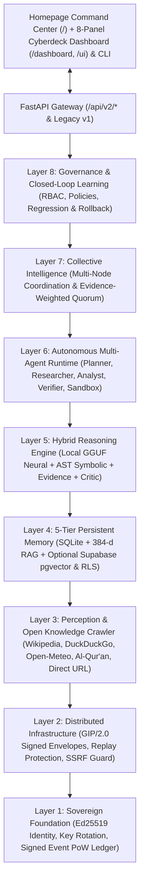

# GajahMada 2.0 — Sovereign Hybrid Distributed Intelligence Architecture

## 1. Architectural Vision & 7 Verified Sovereign Principles
**GajahMada 2.0** is a sovereign, independent, hybrid, distributed intelligence node that runs on **Localhost** (full neural-symbolic mode via `.venv312` + local GGUF) and **Vercel Serverless** (hybrid symbolic + live crawler + persistent Supabase `pgvector`).

| # | Sovereign Principle | Implementation |
| :-: | :--- | :--- |
| 1 | **Independent Cognitive Engine per Node** | Each `SovereignPeerNode` runs its own 14-stage `CognitiveReasoningPipeline` offline without any central API. |
| 2 | **Private Persistent Memory per Node** | Local ACID SQLite (`gajahmada_v2.db`) + `PRIVATE`/`LOCAL` visibility isolation enforced across GIP/2.0 & Supabase RLS. |
| 3 | **Active Neural-Symbolic Reasoning** | Local GGUF (`qwen2.5-1.5b-instruct-q4_k_m.gguf` via `llama-cpp-python`) + deterministic AST Symbolic & Evidence Reasoners. |
| 4 | **Experience-Based Strategy Adaptation** | Closed-loop `record_outcome_and_adapt()` extracts verified `PROCEDURAL` strategies & tunes `retrieval_top_k` with regression testing & rollback. |
| 5 | **Open Protocol Cooperation (`GIP/2.0`)** | 8-namespace canonical JSON protocol signed with Ed25519, clock-skew guard, nonce replay cache, & SSRF protection. |
| 6 | **Independent Cross-Node Verification** | `QuorumConsensusManager` verifies Ed25519 signatures & `provenance_hash`, rejecting unbacked majority claims. |
| 7 | **No Single Central Authority** | No mandatory master node; each node owns its Ed25519 identity, policies, revocation list, and storage. |

---

## 2. 8-Layer Architecture Overview

---

## 3. Core Modules (`gajahmada_ai/`)

| Layer / Domain | Module Path | Responsibility |
| :--- | :--- | :--- |
| **API Gateway** | `gajahmada_ai/api/server.py`, `v2_routes.py` | FastAPI REST v1 & v2 endpoints, Homepage `/`, Dashboard `/dashboard` & `/ui`, closed-loop chat orchestration |
| **Cognitive Pipeline** | `gajahmada_ai/cognition/` | 14-stage pipeline (`perception`, `intent`, `decomposition`, `hypotheses`, `metacognition`, `decision`, `reasoning`) |
| **Neural Abstraction** | `gajahmada_ai/neural/` | Provider-independent `LlamaCppBackend` (GGUF auto-discovery + concise-by-default prompt), `OnnxBackend`, `PyTorchNativeBackend`, `ModelRouter` |
| **Symbolic & Evidence** | `gajahmada_ai/reasoning/` | `SymbolicReasoner` (AST math, forward-chaining, syllogisms), `ContradictionDetector`, `EvidenceReasoner`, `HybridInferenceCombiner` |
| **5-Tier Memory** | `gajahmada_ai/memory/` | Working, Semantic, Episodic, Procedural, & Collective memory + Knowledge Graph, Versioning, & Provenance |
| **Hybrid Storage** | `gajahmada_ai/storage/` | `RelationalMemoryStore` (SQLite/PostgreSQL), `SupabaseKnowledgeStore` (`pgvector` 384-d + `ledger_blocks` + RLS), `ContentAddressedObjectStore` |
| **Open Knowledge** | `gajahmada_ai/knowledge/` | `LocalKnowledge` (FAISS/L2 384-d RAG), `open_knowledge.py` (multi-source crawler + live weather + 114-Surah Al-Qur'an), `indonesia_corpus.py` |
| **Autonomous Agents** | `gajahmada_ai/agents/`, `execution/` | `PlannerAgent`, `ResearcherAgent`, `AnalystAgent`, `VerifierAgent`, `AutonomousTaskScheduler`, `SandboxedExecutor` |
| **Closed-Loop Learning** | `gajahmada_ai/learning/` | `FeedbackCollector`, `ExperienceExtractor`, `StrategyAdapter` (versioned + rollback), `LearningExperimentManager` |
| **P2P & Collective** | `gajahmada_ai/network/` | `GIP/2.0` protocol validator, `SovereignPeerNode`, `CollectiveCoordinator`, `KnowledgeSynchronizer`, `QuorumConsensusManager` |
| **Security & Ledger** | `gajahmada_ai/security/`, `blockchain/` | Ed25519 (RFC 8032) `NodeIdentity`, key rotation, RBAC `AuthManager`, SSRF guard, rate limiter, `AIBlockchain` signed PoW event ledger |
| **CLI & Web Interface** | `gajahmada_ai/cli/main.py`, `interface/html/` | CLI v1/v2 + Dual-mode Web UI: Homepage Command Center over fullscreen 3D Network (turbo spin while Brain thinks) & 8-panel Cyberdeck Dashboard |

---

## 4. Hybrid Storage & Supabase `pgvector` + RLS Design
- **Local-First Primary:** Every node operates independently using local SQLite (`knowledge_store/gajahmada_v2.db`) and `LocalKnowledge` 384-d vectors.
- **Optional Cloud Persistence (`supabase/schema.sql`):**
  - `public.knowledge_records`: content-addressed by `content_hash` (SHA-256), `embedding vector(384)`, `signature` (Ed25519), and `visibility`.
  - `public.ledger_blocks`: persistent Web3 PoW audit trail.
  - `public.match_knowledge`: cosine-similarity semantic search RPC (`<=>`).
  - **Row Level Security (RLS):** Enabled on both tables; public keys (`SUPABASE_PUBLISHABLE_KEY`) have read-only access to `visibility = 'COLLECTIVE'` and are blocked (`401 / 42501`) from writes; only backend services holding `SUPABASE_SECRET_KEY` may write.

---

## 5. Dual-Mode Web UI Architecture (`interface/html/`)
- **Homepage (`/` — `body.view-home`):** Fullscreen interactive **3D Network & Architecture Graph** background with a compact, crystal-clear **30%-opacity (no-blur)** floating Command Center in the center (responsive on desktop & mobile). While the Brain processes a query or `/crawl`, the 3D Network accelerates smoothly (~16× angular velocity) with heightened glow and returns smoothly to calm idle rotation once answered.
- **Dashboard (`/dashboard` & `/ui` — `body.view-dashboard`):** Full 8-panel Tactical Cyberdeck HUD (System Logs & Live Config, 3D Network Graph, Command Interface, Module Dependencies, Web3 Consensus Cycle, Modular Matrix, P2P Mesh, System Performance & Ledger) with instant toggle back to Homepage without losing chat state.

---

## 6. Key REST & Web3 API Endpoints
- **UI & Health:** `GET /` (Homepage), `GET /dashboard` & `GET /ui` (Cyberdeck Dashboard), `GET /health`, `GET /api/status`
- **v2 Cognitive & Governance (`/api/v2/*`):**
  - `/api/v2/intelligence/diagnose`, `/api/v2/intelligence/ask`, `/api/v2/reasoning/{id}`
  - `/api/v2/memory` (GET/POST/PUT/versions/backup), `/api/v2/knowledge`
  - `/api/v2/agents`, `/api/v2/agents/run`, `/api/v2/agents/tasks/{id}/approve`
  - `/api/v2/network`, `/api/v2/network/gip`, `/api/v2/nodes/register`
  - `/api/v2/system/health`, `/api/v2/system/rotate-key`, `/api/v2/system/learning/experiment`
- **v1 Compatible Routes:** `POST /ai/chat`, `POST /ai/ingest`, `POST /ai/embedding`, `GET /knowledge/stats`, `POST /knowledge/search`, `POST /knowledge/crawl`, `GET /node/info`, `GET /node/metrics`, `GET /node/chain`, `POST /node/chain/mine`, `POST /node/chain/verify`, `POST /security/sign-verify`, `GET/POST/DELETE /node/peers`, `POST /node/sync`, `POST /node/broadcast`, `GET/POST /node/config`, `GET/DELETE /node/logs`.
