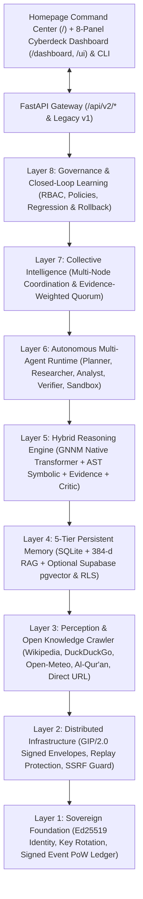

# GajahMada 2.0 — Sovereign Hybrid Distributed Intelligence Architecture

## 1. Architectural Vision & 7 Verified Sovereign Principles
**GajahMada 2.0** is a sovereign, independent, hybrid, distributed intelligence node that runs on **Localhost** (full neural-symbolic mode via `.venv312` + native **GNNM** PyTorch Transformer) and **Vercel Serverless** (hybrid symbolic + live crawler + persistent Supabase `pgvector`).

| # | Sovereign Principle | Implementation |
| :-: | :--- | :--- |
| 1 | **Independent Cognitive Engine per Node** | Each `SovereignPeerNode` runs its own 14-stage `CognitiveReasoningPipeline` offline without any central API. |
| 2 | **Private Persistent Memory per Node** | Local ACID SQLite (`gajahmada_v2.db`) + `PRIVATE`/`LOCAL` visibility isolation enforced across GIP/2.0 & Supabase RLS. |
| 3 | **Active Neural-Symbolic Reasoning** | **GajahMada Native Neural Model (`GNNM`)** (from-scratch Decoder-Only Transformer in PyTorch: `RMSNorm` + `RoPE` + `SwiGLU` + Byte-Level BPE) + deterministic AST Symbolic & Evidence Reasoners. |
| 4 | **Experience-Based Strategy Adaptation** | Closed-loop `record_outcome_and_adapt()` extracts verified `PROCEDURAL` strategies & tunes `retrieval_top_k` with regression testing & rollback. |
| 5 | **Open Protocol Cooperation (`GIP/2.0`)** | 8-namespace canonical JSON protocol signed with Ed25519, clock-skew guard, nonce replay cache, & SSRF protection. |
| 6 | **Independent Cross-Node Verification** | `QuorumConsensusManager` verifies Ed25519 signatures & `provenance_hash`, rejecting unbacked majority claims. |
| 7 | **No Single Central Authority** | No mandatory master node; each node owns its Ed25519 identity, policies, revocation list, and storage. |

---

## 2. 8-Layer Architecture Overview

---

## 3. Core Modules (`gajahmada_ai/`)

| Layer / Domain | Module Path | Responsibility |
| :--- | :--- | :--- |
| **API Gateway** | `gajahmada_ai/api/server.py`, `v2_routes.py` | FastAPI REST v1 & v2 endpoints, Homepage `/`, Dashboard `/dashboard` & `/ui`, closed-loop chat orchestration |
| **Cognitive Pipeline** | `gajahmada_ai/cognition/` | 14-stage pipeline (`perception`, `intent`, `decomposition`, `hypotheses`, `metacognition`, `decision`, `reasoning`) |
| **Native Model (GNNM)** | `gajahmada_ai/gnnm/`, `scripts/train_gnnm.py` | From-scratch Decoder-Only Transformer (`RMSNorm` + `RoPE` + Causal Attention + `SwiGLU`), lossless byte-level BPE tokenizer, `.jsonl`/`.txt` corpus builder, SFT (`-100` prompt masking), validation perplexity, & `GNNMInferenceEngine` (auto-discovered by `PyTorchNativeBackend`) |
| **Neural Abstraction** | `gajahmada_ai/neural/` | Provider-independent `PyTorchNativeBackend` (primary **GNNM** loader auto-discovering `./models/gnnm-*`), `OnnxBackend`, and `ModelRouter` |
| **Symbolic & Evidence** | `gajahmada_ai/reasoning/` | `SymbolicReasoner` (AST math, forward-chaining, syllogisms), `ContradictionDetector`, `EvidenceReasoner`, `HybridInferenceCombiner` |
| **5-Tier Memory** | `gajahmada_ai/memory/` | Working, Semantic, Episodic, Procedural, & Collective memory + `MemoryAuthorizationService` (anti-leak PRIVATE gate), Knowledge Graph, Versioning, & Provenance |
| **Hybrid Storage** | `gajahmada_ai/storage/` | `RelationalMemoryStore` (SQLite/PostgreSQL), `SupabaseKnowledgeStore` (`pgvector` 384-d + `ledger_blocks` + RLS), `ContentAddressedObjectStore` |
| **Open Knowledge** | `gajahmada_ai/knowledge/` | `LocalKnowledge` (FAISS/L2 384-d RAG), `open_knowledge.py` (multi-source crawler into Quarantine + live weather + 114-Surah Al-Qur'an), `indonesia_corpus.py` |
| **Autonomous Agents** | `gajahmada_ai/agents/`, `execution/` | `PlannerAgent`, `ResearcherAgent`, `AnalystAgent`, `VerifierAgent`, `AutonomousTaskScheduler`, `SandboxedExecutor` (unforgeable authenticated human approval) |
| **Closed-Loop Learning** | `gajahmada_ai/learning/` | `FeedbackCollector`, `ExperienceExtractor`, `StrategyAdapter` (versioned + rollback), `LearningExperimentManager` |
| **P2P & Collective** | `gajahmada_ai/network/` | Full 8-namespace `GIP/2.0` protocol + peer authorization, `SovereignPeerNode`, `CollectiveCoordinator`, `KnowledgeSynchronizer`, `QuorumConsensusManager` |
| **Security & Ledger** | `gajahmada_ai/security/`, `blockchain/` | Ed25519 (RFC 8032) `NodeIdentity`, random/rotatable admin key `AuthManager` (fail-closed v1/v2), active rate-limit middleware, SSRF guard, `AIBlockchain` v2 canonical-hash full-envelope ledger + atomic persistence + `LEDGER_CORRUPTED` recovery |
| **CLI & Web Interface** | `gajahmada_ai/cli/main.py`, `interface/html/` | CLI v1/v2 + Dual-mode Web UI: Homepage Command Center over fullscreen 3D Network (turbo spin while Brain thinks) & 8-panel Cyberdeck Dashboard |

---

## 4. Security Hardening, Knowledge Quarantine & Tamper-Evident Ledger Integrity
- **Signing Oracle Eliminated & Fail-Closed Auth:** `POST /security/sign-verify` uses an isolated ephemeral keypair + domain-separated server nonce (`oracle_protected: True`), never exposing the node's private key. Admin key is a 256-bit cryptographically random secret persisted to `admin_api.key` (`0600`, rotatable via `rotate_admin_key()`). All state-mutating v1 & v2 endpoints and internal operational endpoints (`/api/v2/reasoning`, `/api/v2/reasoning/{id}`, `/api/v2/agents`) enforce RBAC (`401`/`403`) by default, protected by active `SlidingWindowRateLimiter` middleware (`429`) and configurable CORS (`GAJAHMADA_ALLOWED_ORIGINS`).
- **Explicit Visibility Access Matrix (`MemoryAuthorizationService`):** Enforces a fail-closed matrix across every read path (`/api/v2/memory`, `/api/v2/memory/{id}/versions`, `/api/v2/knowledge`): `PRIVATE` and `LOCAL` are restricted to `admin`/`operator`, `SHARED` requires authentication, and `COLLECTIVE`/`PUBLIC` allow public read.
- **Fail-Closed Key Management (`gajahmada_ai/security/crypto.py`):** Atomic `0600` private-key persistence (raises `KeyPersistenceError` on failure) plus restart-persistent dual-signed rotation certificates & peer revocation records (`node_key.pem.state.json`), synchronizable via `GIP-IDENTITY`.
- **GIP/2.0 Peer Trust, Persistent Replay Guard & Cryptographic Consensus:** Explicit `PeerTrustState` lifecycle (`UNKNOWN → PENDING → AUTHENTICATED → TRUSTED → REVOKED`), SSRF validation on discovery endpoints, atomic SQLite WAL replay nonce store (`gip_replay.db`), direct Ed25519 verification + independent evidence checks inside `QuorumConsensusManager`, and policy-enforced `quorum_size >= 2`.
- **6-State Epistemic Model & Cryptographic Promotion:** Uses explicit states (`UNVERIFIED`, `MODEL_ASSESSED`, `SOURCE_CORROBORATED`, `INDEPENDENTLY_VERIFIED`, `DISPUTED`, `REJECTED`). Unverified outputs enter `LOCAL` Quarantine; plain `independent_sources` strings can at most reach `SOURCE_CORROBORATED`, while `INDEPENDENTLY_VERIFIED` strictly requires `>= 2` Ed25519-signed `node_attestations` from distinct `TRUSTED` verifiers with distinct `evidence_hash` values.
- **Tamper-Evident Local Signed Event Ledger (`gajahmada_ai/blockchain/chain.py`):** Local tamper-evident signed event ledger (hash-chained, Ed25519-signed, lightweight PoW integrity seal — not a public BFT distributed consensus blockchain). All new blocks are created via `record_event()` using canonical JSON hashing over all fields, strictly enforce full-envelope Ed25519 signatures on every non-genesis block (`index > 0`, eliminating unsigned/spoofed-genesis bypasses), write atomically (`tmp + fsync + .bak + os.replace`), and enter `LEDGER_CORRUPTED` on tampering with explicit `recover_from_backup()`.
- **Optional Cloud Persistence (`supabase/schema.sql`):**
  - `public.knowledge_records` (`content_hash` PK, `embedding vector(384)`, `signature`, `visibility`), `public.ledger_blocks`, and `public.match_knowledge` RPC.
  - **Row Level Security (RLS):** Enabled on both tables; public keys (`SUPABASE_PUBLISHABLE_KEY`) have read-only access to `visibility = 'COLLECTIVE'` and are blocked (`401 / 42501`) from writes; only backend services holding `SUPABASE_SECRET_KEY` may write.

---

## 5. Dual-Mode Web UI Architecture (`interface/html/`)
- **Homepage (`/` — `body.view-home`):** Fullscreen edge-to-edge **3D Network & Architecture Graph** background with a compact, crystal-clear **30%-opacity (no-blur)** floating Command Center in the center (responsive on desktop & mobile with `📊 DASHBOARD` switch). While the Brain processes a query or `/crawl`, the 3D Network accelerates smoothly (~16× angular velocity) with heightened glow and returns smoothly to calm idle rotation once answered.
- **Dashboard (`/dashboard` & `/ui` — `body.view-dashboard`):** Full 8-panel Tactical Cyberdeck HUD (System Logs & Live Config, 3D Network Graph, Command Interface, Module Dependencies, Web3 Consensus Cycle, Modular Matrix, P2P Mesh, System Performance & Ledger) equipped with a session-scoped **`🔑 AUTH`** button for authenticated administrative actions and instant toggle back to Homepage without losing chat state.

---

## 6. Key REST & Web3 API Endpoints
- **UI & Health:** `GET /` (Homepage), `GET /dashboard` & `GET /ui` (Cyberdeck Dashboard), `GET /health`, `GET /api/status`
- **v2 Cognitive & Governance (`/api/v2/*`):**
  - `/api/v2/intelligence/diagnose`, `/api/v2/intelligence/ask`, `/api/v2/reasoning/{id}`
  - `/api/v2/memory` (GET/POST/PUT/versions/backup), `/api/v2/knowledge`, `/api/v2/knowledge/promote/{record_id}`
  - `/api/v2/agents`, `/api/v2/agents/run`, `/api/v2/agents/tasks/{id}/approve`
  - `/api/v2/network`, `/api/v2/network/gip` (all 8 GIP/2.0 namespaces + trust lifecycle), `/api/v2/nodes/register`, `/api/v2/nodes/{node_id}/trust`
  - `/api/v2/system/health`, `/api/v2/system/rotate-key`, `/api/v2/system/learning/experiment`
- **v1 Compatible Routes:** `POST /ai/chat`, `POST /ai/ingest`, `POST /ai/embedding`, `GET /knowledge/stats`, `POST /knowledge/search`, `POST /knowledge/crawl`, `GET /node/info`, `GET /node/metrics`, `GET /node/chain`, `POST /node/chain/mine`, `POST /node/chain/verify`, `POST /security/sign-verify`, `GET/POST/DELETE /node/peers`, `POST /node/sync`, `POST /node/broadcast`, `GET/POST /node/config`, `GET/DELETE /node/logs`.
