<div align="center">


# GajahMada AI Nusantara (v2.0)

### **Sovereign, Independent, Hybrid, Distributed Intelligence Architecture**

*14-Stage Hybrid Cognitive Pipeline · Provider-Independent Local Neural Inference (`llama.cpp` GGUF / ONNX / PyTorch) · Deterministic Symbolic & Live Specialist Resolvers · Autonomous Internet Knowledge Crawler · 5-Tier Persistent Memory (`SQLite` + Optional `Supabase PostgreSQL + pgvector`) · Autonomous Multi-Agent Runtime · GIP/2.0 Cryptographic Mesh Protocol · Ed25519 Signed Event Audit Ledger*

[](https://python.org)
[](gajahmada_ai/api/server.py)
[](supabase/schema.sql)
[](gajahmada_ai/cognition/reasoning.py)
[](gajahmada_ai/network/protocol.py)
[](tests/)

</div>

---

## 🖥️ Live Interface Preview (`/` Homepage & `/dashboard` Cyberdeck HUD)

### 1. Homepage — Focus Command Center & Fullscreen 3D Network (`/`)


### 2. Full 8-Panel Tactical Cyberdeck Dashboard (`/dashboard` & `/ui`)


> **Dual-Mode Live Web Console (`/` & `/dashboard`):** Homepage (`/`) menampilkan **Command Center transparan (30%, tanpa blur)** di atas kanvas **3D Network Graph** layar penuh yang berakselerasi cepat saat Brain berpikir. Klik **`📊 DASHBOARD`** untuk beralih instan ke **8-Panel Tactical Cyberdeck HUD** (`/dashboard` & `/ui`) yang mengendalikan seluruh 8 lapisan arsitektur **GajahMada 2.0** secara real-time.

---

## ✨ Sorotan & Kapabilitas Utama GajahMada 2.0

1. **🧠 14-Stage Hybrid Cognitive Reasoning Pipeline (`gajahmada_ai.cognition` & `reasoning`):**
   - Mengorkestrasi tahapan `PERCEPTION` → `INTENT CLASSIFICATION` → `MEMORY RETRIEVAL` → `PROBLEM DECOMPOSITION` → `HYPOTHESIS GENERATION` → `PARALLEL REASONING (Neural + Symbolic + Evidence)` → `EVIDENCE FUSION` → `METACOGNITIVE CRITIC` → `SUFFICIENCY EVALUATION` → `DECISION`.
   - Menghasilkan objek terstruktur `ReasoningResult` dengan `EpistemicBreakdown` yang secara tegas memisahkan **fakta terverifikasi (`verified_facts`)**, **klaim belum terverifikasi (`unverified_claims`)**, **hipotesis (`hypotheses`)**, **inferensi (`inferences`)**, **opini (`opinions`)**, dan **informasi yang belum diketahui (`unknown_information`)**.
2. **🔌 Provider-Independent Local Neural Abstraction (`gajahmada_ai.neural`):**
   - Mendukung eksekusi model lokal melalui **`LlamaCppBackend` (GGUF `llama.cpp`)**, **`OnnxBackend` (ONNX Runtime)**, dan **`PyTorchNativeBackend`** dengan auto-discovery model `*.gguf` di `./models/` (mis. `qwen2.5-1.5b-instruct-q4_k_m.gguf`).
   - **Ringkas Secara Default:** Jawaban dirancang singkat dan langsung ke inti (1–3 kalimat), dan otomatis menjabarkan secara mendalam hanya jika pertanyaan meminta detail (`detail`, `lengkap`, `rinci`, `uraikan`, `step by step`).
   - **100% Bebas Ketergantungan Cloud AI Terpusat** & **Honest Capability Reporting:** Melaporkan secara jujur status `neural_inference_active` (`True` hanya ketika bobot model neural nyata dimuat).
3. **📐 Deterministic Symbolic, Live Specialists & Autonomous Internet Crawler (`gajahmada_ai.reasoning` & `knowledge.open_knowledge`):**
   - **Symbolic Reasoner:** Evaluasi ekspresi matematika berbasis AST (`sqrt`, `log`, `sin`, `cos`), deduksi logika *forward-chaining*, dan silogisme tanpa LLM.
   - **Autonomous Multi-Source Crawler:** Crawling pengetahuan lintas sumber (**Wikipedia ID/EN**, **DuckDuckGo**, **Open-Meteo Live Weather**, **Katalog 114 Surah & Ayat Al-Qur'an**, dan **Direct URL Crawl** berproteksi anti-SSRF) lengkap dengan daftar **Sumber & Referensi** di akhir jawaban serta asimilasi otomatis ke Brain setiap interaksi.
   - **Evidence & Contradiction Engine:** Pembobotan reliabilitas sumber (*provenance weighting*) dan deteksi kontradiksi otomatis.
4. **🗄️ 5-Tier Persistent Memory & Hybrid Supabase `pgvector` Store (`gajahmada_ai.memory` & `storage`):**
   - Mengimplementasikan 5 tingkat memori (**Working, Semantic, Episodic, Procedural, Collective**) dengan penyimpanan *local-first* **`SQLite` (`gajahmada_v2.db`)** + **384-d Vector Store (`LocalKnowledge`)**.
   - **Integrasi Opsional Supabase (`PostgreSQL + pgvector`):** Melalui `SupabaseKnowledgeStore` (`gajahmada_ai/storage/supabase_store.py`) dan skema `supabase/schema.sql`, node serverless (seperti Vercel) maupun node lokal dapat menyinkronkan memori kolektif ber-ID **`content_hash` (SHA-256)** + tanda tangan **Ed25519**, pencarian vektor `match_knowledge` 384-d, dan blok audit `ledger_blocks` secara persisten tanpa kehilangan independensi lokal.
5. **🤖 Autonomous Multi-Agent Runtime & Unforgeable Approval (`gajahmada_ai.agents` & `execution`):**
   - Empat agen spesialis (**`PlannerAgent`**, **`ResearcherAgent`**, **`AnalystAgent`**, **`VerifierAgent`**) dengan siklus `CREATED` → `PLANNED` → `APPROVED` → `RUNNING` → `WAITING` → `COMPLETED` / `FAILED` / `CANCELLED`.
   - **Persetujuan Manusia Tidak Dapat Dipalsukan:** `human_approved` dihapus dari payload publik `POST /api/v2/agents/run`; persetujuan hanya sah lewat endpoint terautentikasi `POST /api/v2/agents/tasks/{id}/approve` dan dicatat ke ledger bertanda tangan.
6. **🌐 GajahMada Intelligence Protocol (`GIP/2.0`) & Knowledge Quarantine (`gajahmada_ai.network`):**
   - Seluruh **8 namespace GIP/2.0** (`IDENTITY`, `DISCOVERY`, `CAPABILITY`, `TASK`, `KNOWLEDGE`, `VERIFY`, `CONSENSUS`, `SYNC`) aktif di `POST /api/v2/network/gip`, dengan pemisahan antara validasi tanda tangan Ed25519 dan otorisasi peer.
   - **Knowledge Quarantine Pipeline:** Data hasil LLM belum terverifikasi, web crawler, dan `GIP-KNOWLEDGE` dari peer masuk ke **Quarantine (`LOCAL` + `UNVERIFIED`)** terlebih dahulu dan hanya dapat dipromosikan ke `COLLECTIVE` lewat `POST /api/v2/knowledge/promote/{record_id}` setelah lulus cek kontradiksi.
7. **⛓️ Tamper-Evident Signed Event Ledger & Fail-Closed Security (`gajahmada_ai.blockchain` & `security`):**
   - **Blockchain Schema v2:** Canonical JSON hashing mencakup seluruh field (`event_type`, `event_ref`, `metadata`, `timestamp`, `node_id`, `previous_hash`), tanda tangan Ed25519 atas *full event envelope*, *atomic persistence* (`tmp + fsync + .bak + os.replace`), dan mode **`LEDGER_CORRUPTED`** (tidak pernah menghapus ledger rusak secara diam-diam; blok historis v1 tetap kompatibel).
   - **Fail-Closed Auth & Memory Authorization:** Admin key 256-bit acak & dapat dirotasi (tidak pernah diturunkan dari `node_id`), seluruh endpoint mutasi v1/v2 wajib otentikasi (`401`), middleware *rate limiting* aktif (`429`), pembatasan CORS (`GAJAHMADA_ALLOWED_ORIGINS`), serta `MemoryAuthorizationService` yang menutup kebocoran `PRIVATE` record, versi, relasi, dan kontradiksi.
8. **📈 Controlled 3-Level Closed-Loop Learning Subsystem (`gajahmada_ai.learning`):**
   - Mendukung Level 1 (*Validated Knowledge Acquisition*), Level 2 (*Closed-Loop Procedural Strategy Extraction & Dynamic `retrieval_top_k` Adaptation* yang terhubung langsung ke `POST /ai/chat`), dan Level 3 (*Local Model Experiment Governance*).
   - Setiap adaptasi strategi diuji terhadap *Regression Dataset Suite* dan otomatis ditolak (*rollback*) jika menurunkan akurasi.

---

## 🛡️ 7 Prinsip Arsitektur Kecerdasan Berdaulat (7/7 Terverifikasi)

| # | Prinsip Arsitektur | Implementasi & Verifikasi |
| :-: | :--- | :--- |
| **1** | **Cognitive engine independen per node** | Tiap `SovereignPeerNode` menjalankan `CognitiveReasoningPipeline` 14-tahap secara mandiri & offline. |
| **2** | **Persistent memory privat per node** | SQLite ACID lokal (`gajahmada_v2.db`) + isolasi `PRIVATE`/`LOCAL` (terproteksi di GIP/2.0 & Supabase RLS). |
| **3** | **Neural-symbolic reasoning aktif** | Kombinasi model GGUF lokal (`qwen2.5-1.5b-instruct-q4_k_m.gguf` via `.venv312` `llama-cpp-python`) + AST Symbolic + Evidence Reasoner. |
| **4** | **Strategi adaptif berbasis pengalaman** | `record_outcome_and_adapt()` otomatis mengekstrak strategi ke `PROCEDURAL` memory & menyetel `retrieval_top_k` dengan uji regresi + rollback. |
| **5** | **Kerja sama melalui protokol terbuka** | Protokol **GIP/2.0** (8 namespace, JSON kanonik, Ed25519, proteksi *nonce replay* & anti-SSRF). |
| **6** | **Verifikasi independen antar-node** | `QuorumConsensusManager` memverifikasi tanda tangan Ed25519 & `provenance_hash`, serta menolak mayoritas tanpa bukti primer. |
| **7** | **Tanpa pusat pengendali tunggal** | Tidak ada node master wajib; identitas kriptografis, kebijakan, dan penyimpanan dikuasai masing-masing node. |

---

## 🧩 8 Modul Antarmuka Interaktif (`/` Homepage & `/dashboard` Cyberdeck)

Homepage (`/`) menampilkan **Command Center transparan 30% tanpa blur** di atas **3D Network Graph** layar penuh (*edge-to-edge*) yang berputar cepat saat Brain berpikir, dengan tombol **`📊 DASHBOARD`** (desktop & mobile) untuk membuka 8 panel lengkap di `/dashboard` (`/ui`), ditambah tombol **`🔑 AUTH`** (`sessionStorage`) untuk operasi administratif terautentikasi:

| Panel | Nama Modul | Fungsi Nyata & Interaksi |
| :---: | :--- | :--- |
| **`01`** | **System Logs, Module Config & Web3 Pipeline** | • **Module Configuration (Kiri):** Ubah konfigurasi live (`POST /node/config`, *Auth Required*).<br>• **System Logs (Tengah):** *Ring-buffer* log telemetri asli (`GET /node/logs`), tombol **`SYNC`**, **`EXPORT`**, **`CLEAR`** (`DELETE /node/logs`, *Auth Required*).<br>• **6 Kartu Modul (`6/6`):** Uji & diagnostik `API SERVER`, `AI CORE`, `KNOWLEDGE`, `WEB3 CHAIN`, `P2P NETWORK`, `SECURITY`. |
| **`02`** | **3D Network & Architecture Graph** | Graf 3D interaktif 7 klaster `gajahmada_ai.*` (sekaligus latar belakang layar penuh di Homepage `/` dengan akselerasi rotasi saat Brain memproses). |
| **`03`** | **Command Interface (Hero Console)** | Konsol utama penalaran kognitif (`POST /ai/chat`) dengan *RAG context injection*, blok PoW Schema v2 otomatis, tombol **`QUICK EXEC`**, serta **Slash Commands** (`/crawl`, `/status`, `/time`, `/ingest`, `/search`, `/mine`, `/verify`, `/peers`). |
| **`04`** | **Module Dependencies** | Matriks 3 kolom (`APP MODULES`, `DEPENDENCIES`, `REST / WEB3 API`) untuk memeriksa versi paket (`GET /node/dependencies`) dan latensi endpoint. |
| **`05`** | **Web3 Server Arch (Consensus Cycle)** | Cincin donat 6 segmen (`ingest` → `embed` → `infer` → `sign` → `mine` → `gossip`) dengan tombol **`▶ RUN CYCLE`**. |
| **`06`** | **Modular Architecture Matrix** | Grid 4×4 berisi 16 komponen sistem (`AIModelEngine`, `LocalKnowledge`, `AIBlockchain`, `P2PNetwork`, `NodeIdentity`, dll.) dengan *live diagnostic probe*. |
| **`07`** | **Network Status (P2P Mesh)** | Visualisasi topologi *Hub & Spoke* node aktif, tombol **`⚡ BROADCAST`** (`POST /node/broadcast`, *Auth Required*) dan **`+ PEER`** (`POST /node/sync`, *Auth Required*). |
| **`08`** | **System Performance & Ledger** | 7 metrik nyata (`CPU`, `RAM`, `DISK`, `RAG VECTORS`, `ED25519 KEY`, `POW DIFFICULTY`, `WEB3 LEDGER`), tombol **`⛏ MINE BLOCK`** (*Auth Required*), & **`✓ CHAIN VALID`**. |

---

## 🏗️ Arsitektur 8 Lapisan & Alur Penalaran Kognitif

```mermaid
flowchart TD
    UI["Homepage Command Center (/) + 8-Panel Dashboard (/dashboard, /ui) & CLI"] <--> API["FastAPI Gateway<br/>/api/v2/* & Legacy v1 Routes (Fail-Closed RBAC + Rate Limit)"]
    API --> L8["LAYER 8 — INTELLIGENCE GOVERNANCE<br/>RBAC Auth · Execution Policies · Trust Policies · Closed-Loop Learning & Rollback"]
    L8 --> L7["LAYER 7 — COLLECTIVE INTELLIGENCE<br/>Multi-Node Task Negotiation · Delegation · Independent Verification · Quorum Consensus"]
    L7 --> L6["LAYER 6 — AUTONOMOUS AGENT RUNTIME<br/>Planner · Researcher · Analyst · Verifier · Scheduler · Unforgeable Approval"]
    L6 --> L5["LAYER 5 — HYBRID REASONING ENGINE<br/>Local GGUF + GNNM Native Transformer + AST Symbolic + Evidence + Critic"]
    L5 --> L4["LAYER 4 — 5-TIER MEMORY & QUARANTINE ENGINE<br/>SQLite + Optional Supabase pgvector (RLS) · MemoryAuthorizationService · Versioning"]
    L4 --> L3["LAYER 3 — PERCEPTION & OPEN KNOWLEDGE CRAWLER<br/>Input Normalization · Wikipedia · DuckDuckGo · Open-Meteo · Al-Qur'an · Direct URL"]
    L3 --> L2["LAYER 2 — DISTRIBUTED INFRASTRUCTURE (GIP/2.0)<br/>8 Namespaces · PeerTrustState · Ed25519 Envelopes · Replay Protection · SSRF Guard"]
    L2 --> L1["LAYER 1 — SOVEREIGN FOUNDATION<br/>Ed25519 Identity & Key Rotation · Schema v2 Canonical PoW Ledger · Atomic Recovery"]
```



### Struktur Direktori Proyek

```text
gajahmada/
├── main.py                              # Entry point utama (Localhost Uvicorn & Vercel ASGI)
├── config.yaml                          # Konfigurasi node, bootstrap peer, dan path model GGUF
├── .env.example                         # Template variabel lingkungan Supabase (salin ke .env, jangan commit .env)
├── vercel.json                          # Konfigurasi build & routing Vercel Serverless
├── supabase/
│   └── schema.sql                       # Skema PostgreSQL + pgvector (knowledge_records, ledger_blocks, match_knowledge RPC)
├── pytest.ini                           # Konfigurasi test suite Pytest
├── requirements.txt                     # Dependensi inti ringan (Vercel & Localhost)
├── requirements-local.txt               # Dependensi ML penuh opsional (llama-cpp, faiss, sentence-transformers)
├── setup.py                             # Instalasi paket Python & CLI script `gajahmada`
├── run.sh / run.bat                     # Script quick-start Linux/macOS & Windows
├── ARCHITECTURE.md                      # Ringkasan arsitektur sistem
├── docs/                                # Dokumentasi Audit & Arsitektur GajahMada 2.0
│   ├── AUDIT_V2.md                      # Audit lengkap kode sumber & klasifikasi fitur
│   ├── ARCHITECTURE_V2.md               # Spesifikasi 8 lapisan arsitektur & pipa kognitif 14-tahap
│   ├── GNNM_ARCHITECTURE.md             # Blueprint GajahMada Native Neural Model (GNNM-01..GNNM-04)
│   ├── SECURITY_AUDIT.md                # Audit kerentanan keamanan & matriks kontrol keamanan
│   ├── MIGRATION_PLAN.md                # Rencana migrasi & kontrak kompatibilitas v1 -> v2
│   └── ROADMAP.md                       # Roadmap fase implementasi & hasil benchmark nyata
├── scripts/
│   ├── train_gnnm.py                    # CLI scalable Pretraining + Val Perplexity + SFT untuk GNNM
│   └── train_gnnm_01_tiny.py            # Quick-start pretraining lokal GNNM-01-Tiny
├── gajahmada_ai/
│   ├── api/
│   │   ├── server.py                    # FastAPI server (v1 endpoints + mount /api/v2/* + /ui host)
│   │   └── v2_routes.py                 # Router /api/v2/{intelligence,reasoning,memory,agents,network,nodes,knowledge,system}
│   ├── core/
│   │   └── engine.py                    # AIModelEngine (Jembatan kompatibilitas v1 ke ModelRouter & SymbolicReasoner v2)
│   ├── cognition/                       # Pipa Penalaran Kognitif 14-Tahap
│   │   ├── models.py                    # ReasoningResult, EpistemicBreakdown, HypothesisItem, EvidenceItem
│   │   ├── perception.py                # Normalisasi input, deteksi bahasa, ekstraksi entitas & klaim
│   │   ├── intent.py                    # Klasifikasi maksud & domain penalaran
│   │   ├── decomposition.py             # Dekomposisi masalah menjadi sub-objektif terverifikasi
│   │   ├── hypotheses.py                # Generator asumsi & hipotesis
│   │   ├── metacognition.py             # Metacognitive Critic & evaluasi kecukupan bukti
│   │   ├── decision.py                  # Pemisahan epistemik (verified_facts, unverified_claims, hypotheses, inferences, opinions, unknowns)
│   │   └── reasoning.py                 # CognitiveReasoningPipeline utama
│   ├── gnnm/                            # GajahMada Native Neural Model (From-Scratch Decoder-Only Transformer)
│   │   ├── config.py                    # GNNMConfig & preset GNNM-01-Tiny..GNNM-04-1B
│   │   ├── tokenizer.py                 # GNNMBPETokenizer (Byte-Level BPE multilingual lossless)
│   │   ├── dataset.py                   # GNNMCorpusBuilder (SHA-256 deduplication & sequence packing)
│   │   ├── model.py                     # GNNMTransformer (RMSNorm + RoPE + Causal Attention + SwiGLU)
│   │   ├── trainer.py                   # GNNMTrainer (AdamW + cosine LR + checkpoint saver)
│   │   └── inference.py                 # GNNMInferenceEngine (CPU/CUDA autoregressive generator)
│   ├── neural/                          # Abstraksi Inferensi Neural Independen
│   │   ├── interfaces.py                # InferenceBackend ABC, ModelCapabilityMetadata, GenerationResult
│   │   ├── llama_backend.py             # LlamaCppBackend (GGUF) & deterministic 384-d embedder
│   │   ├── onnx_backend.py              # OnnxBackend (ONNX Runtime)
│   │   ├── pytorch_backend.py           # PyTorchNativeBackend
│   │   ├── model_registry.py            # ModelRegistry & version history
│   │   └── router.py                    # Task-based ModelRouter & pelaporan kapabilitas jujur
│   ├── reasoning/                       # Penalaran Simbolik, Batasan & Bukti
│   │   ├── symbolic.py                  # SymbolicReasoner (AST Math, Forward-Chaining Rules, Syllogisms)
│   │   ├── constraints.py               # ConstraintEvaluator
│   │   ├── contradictions.py            # ContradictionDetector (negasi, antonim, konflik numerik)
│   │   ├── evidence.py                  # EvidenceReasoner (bobot reliabilitas sumber & relevansi)
│   │   ├── inference.py                 # HybridInferenceCombiner
│   │   └── evaluator.py                 # ReasoningQualityEvaluator
│   ├── memory/                          # Mesin Memori Persisten 5-Tingkat
│   │   ├── models.py                    # MemoryRecord, MemoryType, SourceProvenance, VerificationStatus, VisibilityPolicy
│   │   ├── authorization.py             # MemoryAuthorizationService (gerbang tunggal otorisasi PRIVATE/LOCAL/COLLECTIVE)
│   │   ├── manager.py                   # MemoryManager terpadu (menegakkan 6 aturan memori GajahMada)
│   │   ├── working.py                   # Tier 1: WorkingMemory
│   │   ├── semantic.py                  # Tier 2: SemanticMemory
│   │   ├── episodic.py                  # Tier 3: EpisodicMemory
│   │   ├── procedural.py                # Tier 4: ProceduralMemory
│   │   ├── collective.py                # Tier 5: CollectiveMemory
│   │   ├── knowledge_graph.py           # KnowledgeGraphManager (relasi entitas)
│   │   ├── provenance.py                # ProvenanceValidator (verifikasi SHA-256 & izin berbagi)
│   │   ├── retrieval.py                 # HybridMemoryRetriever
│   │   ├── versioning.py                # MemoryVersionController (riwayat versi tak berubah)
│   │   └── consolidation.py             # MemoryConsolidator
│   ├── storage/                         # Lapisan Penyimpanan Relasional, Supabase pgvector & Objek
│   │   ├── interfaces.py                # StorageBackend ABC
│   │   ├── postgres.py                  # RelationalMemoryStore (PostgreSQL + pgvector & SQLite ACID fallback)
│   │   ├── supabase_store.py            # SupabaseKnowledgeStore (PostgREST + pgvector 384-d + ledger sync)
│   │   ├── vector_store.py              # SemanticVectorIndex (Cosine & L2 384-d)
│   │   ├── object_store.py              # ContentAddressedObjectStore (SHA-256 JSON snapshots)
│   │   └── migrations/001_initial_v2_schema.sql
│   ├── agents/                          # Runtime Agen Otonom (Layer 6)
│   │   ├── base.py                      # BaseAgent, AgentTask, ExecutionState (CREATED..CANCELLED), ExecutionBudget
│   │   ├── planner.py                   # PlannerAgent
│   │   ├── researcher.py                # ResearcherAgent
│   │   ├── analyst.py                   # AnalystAgent
│   │   ├── verifier.py                  # VerifierAgent
│   │   └── scheduler.py                 # AutonomousTaskScheduler
│   ├── execution/
│   │   └── sandbox.py                   # SandboxedExecutor dengan allowlist tool & human approval gate
│   ├── learning/                        # Pembelajaran Terkontrol 3-Level (Layer 8)
│   │   ├── feedback.py                  # FeedbackCollector
│   │   ├── experience.py                # ExperienceExtractor
│   │   ├── datasets.py                  # RegressionDatasetManager
│   │   ├── evaluator.py                 # LearningExperimentEvaluator
│   │   ├── adaptation.py                # StrategyAdapter dengan rollback instan
│   │   └── experiments.py               # LearningExperimentManager
│   ├── network/                         # Protokol GIP/2.0 & Kecerdasan Kolektif (Layer 2 & 7)
│   │   ├── protocol.py                  # GIPMessage (8 namespace) & GIPProtocolValidator (Replay Protection)
│   │   ├── transport.py                 # AuthenticatedHTTPTransport & TransportBackend
│   │   ├── discovery.py                 # PeerDiscoveryRegistry
│   │   ├── coordinator.py               # SovereignPeerNode & CollectiveCoordinator multi-node
│   │   ├── synchronization.py           # KnowledgeSynchronizer
│   │   ├── consensus.py                 # QuorumConsensusManager
│   │   └── p2p.py                       # P2PNetwork dengan proteksi anti-SSRF
│   ├── blockchain/
│   │   └── chain.py                     # AIBlockchain & Block (Signed Event PoW Audit Ledger)
│   ├── security/                        # Lapisan Keamanan Berdaulat
│   │   ├── crypto.py                    # NodeIdentity Ed25519, rotasi kunci, & pencabutan peer
│   │   ├── auth.py                      # AuthManager RBAC (Admin, Operator, Peer, Reader)
│   │   ├── policies.py                  # GovernancePolicy
│   │   ├── ssrf.py                      # Validator URL/IP/Port anti-SSRF
│   │   ├── rate_limit.py                # SlidingWindowRateLimiter
│   │   └── audit.py                     # SecurityAuditLogger berantai hash SHA-256
│   ├── knowledge/
│   │   ├── rag.py                       # LocalKnowledge (FAISS IndexFlatL2 + JSON Vector Store)
│   │   ├── open_knowledge.py            # Internet Crawler (Wikipedia, DuckDuckGo, Open-Meteo Weather, 114 Surah Al-Qur'an, Direct URL)
│   │   └── indonesia_corpus.py          # Korpus Sejarah Nusantara & Indonesia Modern
│   └── cli/
│       └── main.py                      # CLI commands v1 & v2
├── interface/html/                      # Dual-Mode Web UI: Homepage (/) & 8-Panel Dashboard (/dashboard, /ui)
└── tests/                               # Suite Pengujian Otomatis (33 Automated Tests)
    ├── unit/test_core_and_neural.py
    ├── unit/test_gnnm_foundation.py
    ├── cognition/test_cognitive_pipeline.py
    ├── memory/test_memory_persistence.py
    ├── network/test_gip_and_collective.py
    ├── security/test_security_and_governance.py
    ├── security/test_audit_remediation.py
    ├── integration/test_api_compatibility.py
    └── benchmarks/test_benchmarks.py
```

---

## 🚀 Instalasi & Panduan Menjalankan

### 1. Mode Cepat (Localhost — Berjalan Offline Tanpa GPU / Cloud API)

#### Linux / macOS
```bash
pip install -r requirements.txt
./run.sh
```

#### Windows
```bat
pip install -r requirements.txt
run.bat
```

Buka browser di:
- **Homepage (Command Center + 3D Network):** **[http://localhost:8000/](http://localhost:8000/)**
- **Full 8-Panel Dashboard:** **[http://localhost:8000/dashboard](http://localhost:8000/dashboard)** (atau `/ui`)

---

### 2. Mode Penuh dengan Model GGUF Lokal (`llama-cpp-python`)

Letakkan file model GGUF di `./models/` (mis. `qwen2.5-1.5b-instruct-q4_k_m.gguf`) dan pasang prebuilt CPU wheel `llama-cpp-python` di `.venv312` (cepat, tanpa kompilasi C++):

```bash
uv venv --python 3.12 .venv312
uv pip install --python .venv312/bin/python -r requirements.txt
uv pip install --python .venv312/bin/python llama-cpp-python \
  --extra-index-url https://abetlen.github.io/llama-cpp-python/whl/cpu

mkdir -p models
curl -L -o models/qwen2.5-1.5b-instruct-q4_k_m.gguf \
  https://huggingface.co/Qwen/Qwen2.5-1.5B-Instruct-GGUF/resolve/main/qwen2.5-1.5b-instruct-q4_k_m.gguf

# ./run.sh otomatis mendeteksi .venv312/bin/python dan memuat model GGUF dari config.yaml / ./models/
./run.sh
```

### 3. Integrasi Opsional Supabase (`PostgreSQL + pgvector`) untuk Memori Persisten & Vercel

Agar knowledge Brain dan audit ledger tersimpan permanen di cloud/Vercel sekaligus mendukung pencarian vektor `pgvector` 384-d:

1. Jalankan [supabase/schema.sql](supabase/schema.sql) di **Supabase SQL Editor** (atau via `psql`).
2. Salin `.env.example` menjadi `.env` (untuk lokal) atau tambahkan ke **Vercel → Project Settings → Environment Variables**:
   ```env
   SUPABASE_URL=https://<project-ref>.supabase.co
   SUPABASE_PUBLISHABLE_KEY=<your-publishable-key>
   SUPABASE_SECRET_KEY=<your-secret-key>
   ```
3. **Keamanan RLS (Row Level Security):** Skema `supabase/schema.sql` mengaktifkan RLS pada `knowledge_records` dan `ledger_blocks` — kunci publik (`SUPABASE_PUBLISHABLE_KEY`) hanya dapat membaca baris `visibility = 'COLLECTIVE'` dan **diblokir (`401 / 42501`)** untuk operasi `INSERT/UPDATE/DELETE`; hanya backend dengan `SUPABASE_SECRET_KEY` yang berhak menulis.
4. **Catatan `DATABASE_URL`:** Jika password PostgreSQL mengandung karakter khusus (seperti `@` atau `#`), gunakan URL-encoding (`@` → `%40`, `#` → `%23`).
5. Tanpa `.env`, GajahMada tetap berjalan 100% mandiri menggunakan SQLite lokal (*local-first*).

### 4. Melatih GajahMada Native Neural Model (`GNNM-01-Tiny` → `GNNM-04-1B`) dari Nol

GajahMada menyediakan arsitektur Decoder-Only Transformer buatan sendiri (**RMSNorm + RoPE + Causal Self-Attention + SwiGLU + `std=0.02` init + *repetition penalty***) lengkap dengan *byte-level BPE tokenizer* multilingual, *streaming* `.jsonl`/`.txt` corpus loader, evaluasi *validation perplexity*, serta **Instruction Tuning (SFT)** dengan *prompt loss masking* (`-100`) di [gajahmada_ai/gnnm/](gajahmada_ai/gnnm/) ([docs/GNNM_ARCHITECTURE.md](docs/GNNM_ARCHITECTURE.md)). Checkpoint `./models/gnnm-*` otomatis terdeteksi oleh `PyTorchNativeBackend` & `ModelRouter`.

```bash
uv pip install --python .venv312/bin/python torch --index-url https://download.pytorch.org/whl/cpu

# Proof-of-Concept lokal cepat (Pretrain + Val Perplexity + SFT + metrics.json)
.venv312/bin/python scripts/train_gnnm.py --preset GNNM-01-Tiny --steps 80 --sft-steps 40

# Skala GNNM-01-25M dengan korpus .jsonl/.txt multilingual (disarankan GPU CUDA)
.venv312/bin/python scripts/train_gnnm.py --preset GNNM-01-25M --corpus-dir ./data/corpus --vocab-size 8192 --seq-len 256 --steps 5000 --sft-steps 500
```

---

## 💻 Perintah CLI (`gajahmada`)

### Perintah CLI GajahMada 2.0
```bash
# Inisialisasi identitas Ed25519, database memori 5-tier, dan ledger
python -m gajahmada_ai.cli.main init

# Manajemen siklus hidup node
python -m gajahmada_ai.cli.main node init
python -m gajahmada_ai.cli.main node start --config config.yaml
python -m gajahmada_ai.cli.main node status
python -m gajahmada_ai.cli.main node stop

# Diagnostik kapabilitas & penalaran kognitif hibrida 14-tahap
python -m gajahmada_ai.cli.main intelligence diagnose
python -m gajahmada_ai.cli.main intelligence ask "Hitung sqrt(144) + 25 * 4 dan jelaskan verifikasinya"
python -m gajahmada_ai.cli.main reasoning inspect

# Inspeksi & pencadangan (backup) memori persisten 5-tingkat
python -m gajahmada_ai.cli.main memory inspect
python -m gajahmada_ai.cli.main memory backup

# Eksekusi agen otonom (Planner -> Researcher -> Analyst -> Verifier)
python -m gajahmada_ai.cli.main agent run "Investigasi Sumpah Palapa 1336 M dan warisan Majapahit"

# Protokol jaringan GIP/2.0 & pemeriksaan kesehatan sistem
python -m gajahmada_ai.cli.main network status
python -m gajahmada_ai.cli.main network peers
python -m gajahmada_ai.cli.main network discover
python -m gajahmada_ai.cli.main system health
```

### Perintah CLI v1 (Tetap Kompatibel 100%)
```bash
python -m gajahmada_ai.cli.main start
python -m gajahmada_ai.cli.main join http://127.0.0.1:8001
python -m gajahmada_ai.cli.main node-status
python -m gajahmada_ai.cli.main train-model --note "Audit Konsensus V2"
```

---

## 📡 Referensi REST & Web3 API (`/api/v2/*` & Legacy v1)

### 1. Endpoint GajahMada 2.0 (`/api/v2/*`)

| Metode | Endpoint | Deskripsi |
| :---: | :--- | :--- |
| `GET` | `/api/v2/intelligence/diagnose` | Melaporkan secara jujur status backend neural (`llama.cpp`, `onnx`, `gajahmada-native`), mesin simbolik, memori 5-tier, dan agen terdaftar. |
| `POST` | `/api/v2/intelligence/ask` | Menjalankan pipa penalaran kognitif 14-tahap (akses publik bersifat *read-only*; operator terautentikasi menyimpan ke Quarantine `LOCAL`/`MODEL_ASSESSED`). |
| `GET/POST` | `/api/v2/reasoning` | Mengambil riwayat jejak penalaran atau mengeksekusi penalaran baru. |
| `GET` | `/api/v2/reasoning/{reasoning_id}` | Menginspeksi detail langkah penalaran, hipotesis, bukti, dan kontradiksi untuk `reasoning_id` tertentu. |
| `GET` | `/api/v2/memory` | Menginspeksi statistik 5 tingkat memori, daftar rekaman, & kontradiksi (terfilter oleh `MemoryAuthorizationService`). |
| `POST` | `/api/v2/memory` | *(Auth Required)* Menyimpan rekaman memori baru dengan hash integritas SHA-256, provenans, dan deteksi kontradiksi otomatis. |
| `PUT` | `/api/v2/memory/{record_id}` | *(Auth Required)* Memperbarui/mengoreksi memori sambil menyimpan versi sebelumnya di tabel audit `gm_memory_versions`. |
| `GET` | `/api/v2/memory/{record_id}/versions` | Mengambil riwayat versi memori (`403` untuk akses tanpa otorisasi pada record `PRIVATE`). |
| `POST` | `/api/v2/memory/backup` | *(Auth Required)* Mengekspor *snapshot* memori ke *Content-Addressed Object Store* ber-hash SHA-256. |
| `GET` | `/api/v2/knowledge` | Mencari relasi entitas & kontradiksi pada *Knowledge Graph* (terfilter oleh `MemoryAuthorizationService`). |
| `POST` | `/api/v2/knowledge/promote/{record_id}` | *(Auth Required)* Mempromosikan knowledge dari Quarantine ke `SOURCE_CORROBORATED` / `INDEPENDENTLY_VERIFIED` (`COLLECTIVE`) setelah validasi `independent_sources` & cek kontradiksi. |
| `GET` | `/api/v2/agents` | Menampilkan daftar agen spesialis (`planner`, `researcher`, `analyst`, `verifier`) beserta izin tool dan daftar tugas. |
| `POST` | `/api/v2/agents/run` | *(Auth Required)* Menjalankan objektif melalui runtime agen otonom (`human_approved` selalu `False` saat submit). |
| `POST` | `/api/v2/agents/tasks/{task_id}/approve` | *(Auth Required)* Memberikan persetujuan operator manusia untuk tugas agen `WAITING` + mencatat event bertanda tangan ke ledger. |
| `GET` | `/api/v2/network` | Status protokol `GIP/2.0`, daftar URL peer, node yang ditemukan, dan daftar peer yang dicabut (*revoked*). |
| `POST` | `/api/v2/network/gip` | Endpoint penerima 8 namespace `GIP/2.0` bertanda tangan Ed25519 dengan *PeerTrustState*, SSRF guard, *nonce replay*, & verifikasi per-submission pada `GIP-CONSENSUS`. |
| `GET/POST` | `/api/v2/nodes` / `/api/v2/nodes/register` | Menampilkan identitas node atau *(Auth Required)* mendaftarkan peer GIP baru sebagai `TRUSTED` dengan validasi anti-SSRF. |
| `POST` | `/api/v2/nodes/{node_id}/trust` | *(Auth Required)* Mengubah status kepercayaan peer (`PENDING`, `AUTHENTICATED`, `TRUSTED`, `REVOKED`). |
| `GET` | `/api/v2/system/health` | Laporan kesehatan lengkap: kapabilitas kognitif, penyimpanan relasional, status ledger (`HEALTHY` / `LEDGER_CORRUPTED`), log audit keamanan, & kebijakan. |
| `POST` | `/api/v2/system/rotate-key` | *(Auth Required)* Merotasi kunci privat Ed25519 node dan menerbitkan sertifikat rotasi bertanda tangan ganda. |
| `POST` | `/api/v2/system/learning/experiment` | *(Auth Required)* Mengajukan dan mengevaluasi eksperimen pembelajaran terhadap *regression suite* (otomatis menolak eksperimen yang gagal). |

### 2. Endpoint v1 (Kompatibel + Fail-Closed RBAC untuk Mutasi)

| Metode | Endpoint | Deskripsi |
| :---: | :--- | :--- |
| `GET` | `/`, `/dashboard`, `/ui`, & `/api/status` | Menyajikan Homepage (`/`), Dashboard (`/dashboard`, `/ui`), atau JSON status node (`/?format=json`, `/api/status`). |
| `GET` | `/health` | Pemeriksaan kesehatan layanan (*health check*) termasuk status neural & Supabase. |
| `POST` | `/ai/chat` | Eksekusi pertanyaan melalui 14-Stage Cognitive Pipeline + blok PoW Schema v2 (`record_event()`) + penyimpanan terkarantina. |
| `POST` | `/ai/ingest` | *(Auth Required)* Meng-embed teks dokumen ke vektor 384-d dan menyimpannya ke *Knowledge Store* serta *Semantic Memory*. |
| `POST` | `/ai/embedding` | Menghasilkan vektor embedding 384-dimensi yang dinormalisasi dari teks input. |
| `GET` | `/knowledge/stats` | Menampilkan jumlah dokumen RAG, dimensi vektor, tipe indeks, statistik 5-tier memori, & status Supabase. |
| `POST` | `/knowledge/search` | Pencarian semantik *top-k* dokumen berdasarkan jarak vektor L2 384-d. |
| `POST` | `/knowledge/crawl` | *(Auth Required)* Crawling pengetahuan dari internet & menyimpannya ke Quarantine (`LOCAL` / `UNVERIFIED`). |
| `DELETE` | `/knowledge/docs/{idx}` | *(Auth Required)* Menghapus dokumen tertentu dari *vector store* dan menyinkronkan ulang indeks. |
| `GET` | `/node/info` | Informasi lengkap node (`node_id`, `ledger_status`, `active_neural_backend`, `active_model_id`, `supabase_configured`, memori). |
| `GET` | `/node/metrics` | Telemetri perangkat keras & sistem (`CPU %`, `RAM %`, `Disk Read MB`, status ledger). |
| `GET` | `/node/chain` | Mengambil seluruh daftar blok pada ledger Proof-of-Work Schema v2 beserta status validitasnya. |
| `POST` | `/node/chain/mine` | *(Auth Required)* Menambang blok audit Proof-of-Work Schema v2 baru dengan tanda tangan *full-envelope* Ed25519. |
| `POST` | `/node/chain/verify` | Mengaudit ulang seluruh hash SHA-256 PoW dan memverifikasi tanda tangan *full-envelope* Ed25519 tiap blok. |
| `POST` | `/security/sign-verify` | Uji mandiri (*oracle-protected*) Ed25519 (RFC 8032) menggunakan *ephemeral self-test keypair* terisolasi + server nonce. |
| `GET` | `/node/peers` | Daftar peer P2P yang terhubung. |
| `POST` | `/node/sync` | *(Auth Required)* Mendaftarkan URL node peer baru ke topologi mesh P2P (dilindungi validator anti-SSRF). |
| `DELETE` | `/node/peers?peer=...` | *(Auth Required)* Memutuskan tautan peer dari daftar mesh P2P. |
| `POST` | `/node/broadcast` | *(Auth Required)* Menyiarkan pesan protokol `GIP/2.0` bertanda tangan Ed25519 ke seluruh peer aktif. |
| `GET/POST` | `/node/config` | Membaca atau *(Auth Required pada POST)* memperbarui konfigurasi runtime (`node_name`, `pow_difficulty`, `max_tokens`, `temperature`). |
| `GET` | `/node/dependencies` | Memeriksa versi Python dan status paket pustaka yang terinstal di server. |
| `GET/DELETE` | `/node/logs` | Mengambil atau *(Auth Required pada DELETE)* membersihkan *ring-buffer* log telemetri server. |

---

## 🧪 Pengujian & Kriteria Penerimaan (33 Automated Tests)

Jalankan seluruh 33 suite pengujian otomatis menggunakan `pytest`:

```bash
pytest -v
```

| Test ID | Kriteria Penerimaan | File Pengujian | Status |
| :---: | :--- | :--- | :---: |
| **TEST 1** | GajahMada dapat berjalan tanpa kredensial penyedia AI eksternal. | `tests/unit/test_core_and_neural.py` | ✅ **PASSED** |
| **TEST 2** | Backend neural lokal (`llama.cpp` GGUF) dapat dimuat dan digunakan saat dikonfigurasi. | `tests/unit/test_core_and_neural.py` | ✅ **PASSED** |
| **TEST 3** | Sistem secara eksplisit melaporkan ketika inferensi neural tidak tersedia (`neural_inference_active: False`). | `tests/unit/test_core_and_neural.py` | ✅ **PASSED** |
| **TEST 4** | Penalaran simbolik (matematika AST, aturan logika, silogisme) beroperasi independen tanpa LLM. | `tests/cognition/test_cognitive_pipeline.py` | ✅ **PASSED** |
| **TEST 5** | Pipa kognitif menghasilkan output terstruktur `ReasoningResult` lengkap dengan `EpistemicBreakdown`. | `tests/cognition/test_cognitive_pipeline.py` | ✅ **PASSED** |
| **TEST 6** | Kesimpulan penting menyertakan referensi bukti (`evidence_id` & `provenance_hash`). | `tests/cognition/test_cognitive_pipeline.py` | ✅ **PASSED** |
| **TEST 7** | Memori persisten bertahan melewati *process restart* beserta riwayat versi dan backup. | `tests/memory/test_memory_persistence.py` | ✅ **PASSED** |
| **TEST 8** | Pengetahuan yang saling bertentangan (*contradictions*) tetap disimpan dan diidentifikasi secara otomatis. | `tests/memory/test_memory_persistence.py` | ✅ **PASSED** |
| **TEST 9** | Node beroperasi penuh secara lokal ketika terputus dari jaringan. | `tests/network/test_gip_and_collective.py` | ✅ **PASSED** |
| **TEST 10** | Dua node independen dapat saling mengotentikasi dan bertukar pesan `GIP/2.0` bertanda tangan Ed25519 (serta menolak *replay attack*). | `tests/network/test_gip_and_collective.py` | ✅ **PASSED** |
| **TEST 11** | Tiga node independen dapat mengoordinasikan, memverifikasi tugas terdistribusi, dan menyimpan ke memori kolektif. | `tests/network/test_gip_and_collective.py` | ✅ **PASSED** |
| **TEST 12** | Permintaan administratif tanpa otentikasi ditolak (`HTTP 401`). | `tests/security/test_security_and_governance.py` | ✅ **PASSED** |
| **TEST 13** | Peer jahat tidak dapat mengeksekusi perintah shell, memalsukan tanda tangan, atau membaca/mengubah memori `PRIVATE`. | `tests/security/test_security_and_governance.py` | ✅ **PASSED** |
| **TEST 14** | Eksperimen pembelajaran yang gagal pada uji regresi otomatis ditolak tanpa memengaruhi model/strategi aktif. | `tests/unit/test_core_and_neural.py` | ✅ **PASSED** |
| **TEST 15** | Seluruh perilaku API v1 yang ada tetap kompatibel sepenuhnya. | `tests/integration/test_api_compatibility.py` | ✅ **PASSED** |
| **EXT 16–19** | SSRF & seed guard, Signed Event PoW Ledger, Real Cognitive Benchmarks, & Closed-Loop Experience Strategy Adaptation. | `tests/` | ✅ **PASSED** |
| **AUDIT P0–P5 (20–29)** | Signing oracle eliminated, Fail-closed v1/v2 auth, `MemoryAuthorizationService` anti-leak, unforgeable approval, Blockchain v2 strict full-envelope + `LEDGER_CORRUPTED` recovery, GIP trust lifecycle + verified consensus, Knowledge Quarantine + source-corroborated promotion, & 3-node restart persistence. | `tests/security/test_audit_remediation.py` | ✅ **PASSED** |
| **GNNM (30–33)** | `GNNMConfig` parameter estimator, native byte-level BPE multilingual lossless tokenizer, `.jsonl` deduplication, SFT `-100` prompt loss masking, & `GNNMTransformer` forward/init-loss check. | `tests/unit/test_gnnm_foundation.py` | ✅ **PASSED** |

---

## 💬 Perintah Cepat pada Command Interface (`Panel 03`)

Selain mengetik pertanyaan bahasa alami atau ekspresi matematika/logika, Anda dapat menjalankan perintah sistem langsung di kotak input **Command Interface**:

- `/crawl <topik atau URL>` — *(Auth Required)* Crawling pengetahuan langsung dari internet & menyimpannya ke Quarantine lokal (`LOCAL` / `UNVERIFIED`).
- `/status` — Menampilkan laporan langsung CPU, RAM, Disk, jumlah dokumen RAG, peer P2P, dan tinggi rantai blok.
- `/time` — Menampilkan sinkronisasi waktu sistem sekarang (WIB / ISO-8601).
- `/ingest <teks pengetahuan>` — *(Auth Required)* Meng-embed teks ke vektor 384-d dan menyimpannya ke basis pengetahuan lokal.
- `/search <kueri pencarian>` — Mencari dokumen paling relevan secara semantik dari *vector store* 384-d.
- `/mine <catatan audit>` — *(Auth Required)* Menambang blok Proof-of-Work Schema v2 baru ke dalam Web3 Signed Event Ledger.
- `/verify` — Menjalankan audit kriptografis penuh terhadap rantai blok SHA-256 Schema v2 dan tanda tangan *full-envelope* Ed25519.
- `/peers` — Menampilkan daftar node peer P2P yang terhubung.

---

<div align="center">
  Support and download this repo on GitHub: <a href="https://github.com/hoed/gajahmada-ai">https://github.com/hoed/gajahmada-ai</a>
</div>
