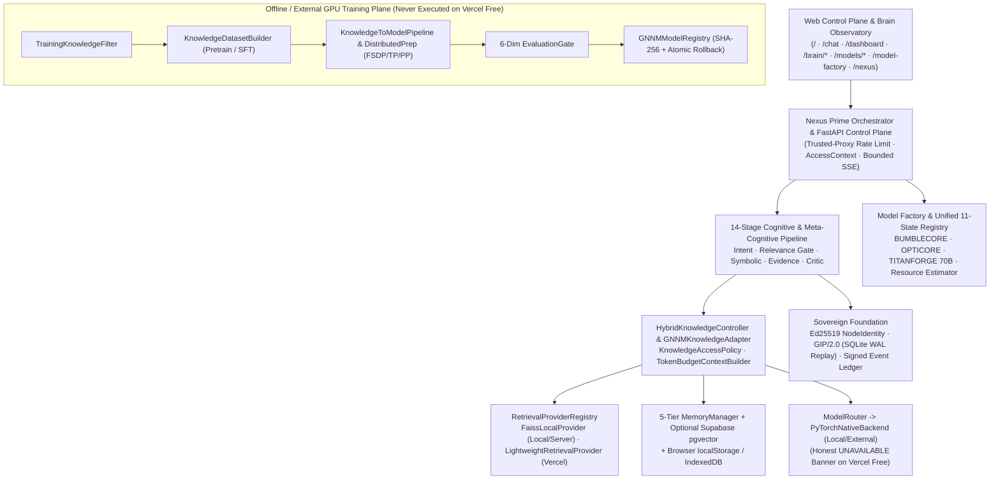
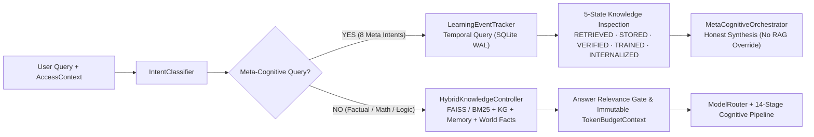
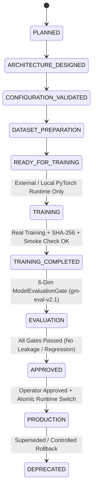
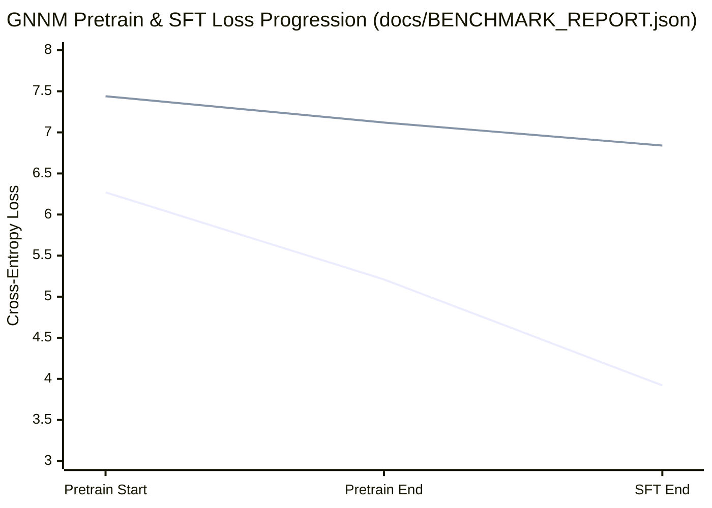
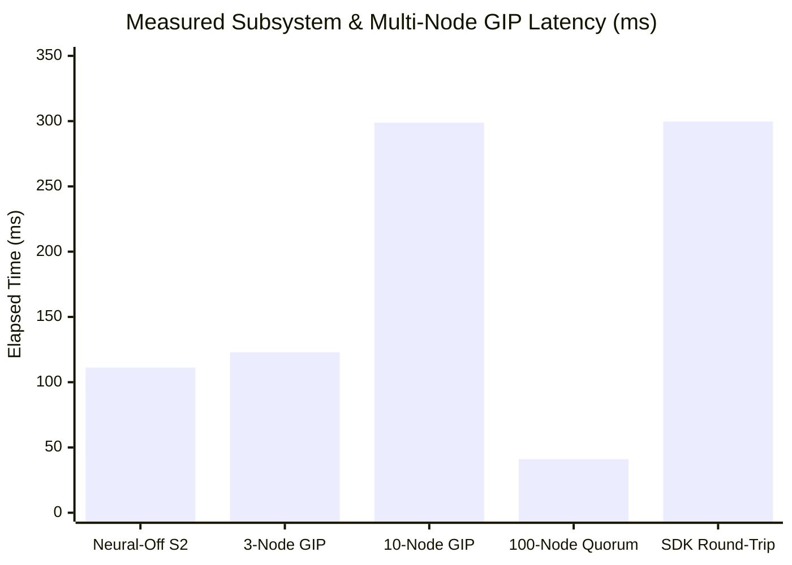

<div align="center">


# GajahMada AI 2.0

### One Intelligence. Many Forms. — Sovereign Hybrid Knowledge & Native GNNM Platform

*Native GNNM Decoder-Only Transformer (`BUMBLECORE` · `OPTICORE` · `TITANFORGE 70B`) · Hybrid External Knowledge (`FAISS CPU` + `SQLite WAL` + BM25 + Knowledge Graph) · 5-Tier Persistent Memory · 14-Stage Cognitive & Meta-Cognitive Engine · Brain Observatory · Model Factory & Nexus Prime · GIP/2.0 Cryptographic Mesh · Tamper-Evident Local Signed Event Ledger*

[](LICENSE)
[](https://www.python.org/)
[](#automated-verification--benchmarks)
[](#installation--quick-start)
[](https://gajahmada.vercel.app/)

[Live Node](https://gajahmada.vercel.app/) · [Brain Observatory](https://gajahmada.vercel.app/brain) · [Model Factory](https://gajahmada.vercel.app/model-factory) · [Architecture](ARCHITECTURE.md) · [GNNM Blueprint](docs/GNNM_ARCHITECTURE.md) · [Hybrid Knowledge](docs/HYBRID_KNOWLEDGE_ARCHITECTURE.md) · [Learning Pipeline](docs/GNNM_LEARNING_PIPELINE.md) · [Model Registry](docs/MODEL_REGISTRY_AND_PROMOTION.md) · [Memory Security](docs/MEMORY_SECURITY_MODEL.md) · [Vercel Free Guide](docs/VERCEL_DEPLOYMENT_GUIDE.md)

</div>

---

## Overview

**GajahMada AI** is an open-source, offline-first **Sovereign Independent Intelligence Platform** engineered without mandatory commercial AI APIs (OpenAI, Gemini, or Claude). It enforces a strict separation between **application control-plane deployment** (lightweight, Vercel Free compatible) and **large-scale native model training** (local or external GPU infrastructure, including **TITANFORGE 70B**).

At its core, GajahMada unifies **three logically separated knowledge systems** under an authorization-aware control plane:

| Knowledge System | Storage & Runtime | Update Mechanism | Core Modules |
| :--- | :--- | :--- | :--- |
| **1. Internal Knowledge** | Native **GNNM** Decoder-Only Transformer weights (`BUMBLECORE`, `OPTICORE`, `TITANFORGE`) | Isolated **Knowledge-to-Model Learning Pipeline** (Filter → Dataset → Trainer → 6-Dim Evaluation Gate → Operator Promotion) | `gajahmada_ai/gnnm/`, `gajahmada_ai/learning/`, `gajahmada_ai/neural/` |
| **2. External Knowledge** | Multi-format documents (TXT, MD, HTML, JSON, CSV, DOCX, PDF), Knowledge Graph, & 252 curated offline world/space facts via **FAISS CPU** (local/server) or `LightweightRetrievalProvider` (Vercel Free) + `SQLite WAL` (`external_knowledge.db`) | Instant ingestion & chunking **without retraining** model weights | `gajahmada_ai/knowledge/` (`providers`, `retriever`, `ingestion`, `chunker`, `embedding`, `source_registry`, `world_facts`) |
| **3. Persistent Memory** | 5-tier operational memory (`working`, `semantic`, `episodic`, `procedural`, `collective`) + browser-local `localStorage` / `IndexedDB` | Direct `AccessContext` 9-scope authorization, epistemic quarantine, & cryptographic `node_attestations` | `gajahmada_ai/memory/`, `gajahmada_ai/storage/` |

### Live Web Surface & Control Plane ([gajahmada.vercel.app](https://gajahmada.vercel.app/))

| Surface | Route(s) | Purpose |
| :--- | :--- | :--- |
| **Command Homepage** | `/` · `/chat` | Focus Command Center over fullscreen 3D Network Graph (`/`) and dedicated Sovereign Chat (`/chat`). |
| **Cyberdeck Dashboard** | `/dashboard` · `/ui` | Scrollable 8-panel operational HUD with session-scoped **`🔑 AUTH`**, **`🧠 HYBRID KNOWLEDGE`**, and **`🎓 GNNM LAB`**. |
| **Brain Observatory** | `/brain` · `/brain/{activity,knowledge,memory,reasoning,learning}` | Interactive dark neural observability console connected 100% to live `/api/v2/observatory/*` & bounded SSE `/stream`. |
| **Model Registry & Families** | `/models` · `/models/{bumblecore,opticore,titanforge,neurox,codestrike,knowtron}` | Unified 11-state Model Registry distinguishing architecture specs, verified local checkpoints, and planned specializations. |
| **Model Factory & Training** | `/model-factory` · `/training` · `/benchmarks` | Interactive architecture editor, analytical parameter calculator, GPU/VRAM resource estimator, distributed prep, & benchmark reports. |
| **Nexus Prime & Ops** | `/nexus` · `/knowledge` · `/memory` · `/infrastructure` · `/settings` · `/documentation` | Capability routing, FAISS CPU vs. lightweight provider diagnostics, browser vs. server storage status, & deployment docs. |

---

## Core Architectural Capabilities

1. **Native `GNNM` Architecture, Model Families & `TITANFORGE 70B` Foundation (`gajahmada_ai/gnnm/` — see [GNNM_ARCHITECTURE.md](docs/GNNM_ARCHITECTURE.md)):**
   - Custom PyTorch Decoder-Only Transformer (**Pre-Norm RMSNorm + RoPE + Grouped/Multi-Head Causal Attention + SwiGLU + Gradient Checkpointing + optional weight tying**) paired with lossless Byte-Level BPE (`GNNMBPETokenizer`).
   - Formalized model families: **BUMBLECORE** (`12M`, `100M`, `300M`), **OPTICORE** (`1B`, `3B`, `7B`), **TITANFORGE** (`30B`, **`70B` = `70,549,512,192` params** Dense + experimental MoE variant, `120B`), and planned specializations (**NEUROX**, **CODESTRIKE**, **KNOWTRON** — never represented as separate trained models without verified artifacts).
   - Pure-Python **Resource Estimator** (`resource_estimator.py`) computing theoretical FP32/BF16/FP16/INT8/INT4 memory, AdamW sharded VRAM, FLOPs, and GPU cluster sizing with zero GPUs, plus **Distributed Training Preparation** (`distributed_prep.py`) for external DDP/FSDP/TP/PP clusters (strictly blocked from executing inside Vercel Free).
   - Verified local CPU checkpoints: `GNNM-01-Tiny` (`918,656` params) and `GNNM-01-12M` (`11,243,520` params). When no weights are loaded, the platform honestly reports `NATIVE MODEL INFERENCE: UNAVAILABLE IN CURRENT RUNTIME`.

2. **Hybrid External Knowledge, Preserved FAISS CPU & Answer Relevance Gate (`gajahmada_ai/knowledge/` & `cognition/` — see [HYBRID_KNOWLEDGE_ARCHITECTURE.md](docs/HYBRID_KNOWLEDGE_ARCHITECTURE.md)):**
   - **FAISS CPU Preserved (`providers.py`):** `FaissLocalProvider` and `FaissArtifactProvider` preserve FAISS CPU `IndexFlatL2` for local/server deployments, while `LightweightRetrievalProvider` provides an honest, non-FAISS pure-Python fallback on Vercel Free (`INCOMPATIBLE_RUNTIME` reported transparently for FAISS on serverless).
   - **10-Step Ingestion & Embedding Governance:** Multi-format ingestion into `SQLite WAL` (`external_knowledge.db`) with `SourceRegistry` SHA-256 lineage, strict encoder compatibility checks, and immutable per-request `TokenBudgetContextBuilder` wrapping retrieved data in `<untrusted_retrieved_data>` delimiters.
   - **Question–Answer Relevance Gate & Curated Offline Fact Base:** `answer_relevance.py` verifies that candidate answers genuinely address question focus terms (ordinals, dates, numbers, qualifiers) before responding, backed by `world_facts.py` (252 stable Indonesia, world, science, and space facts) and honest abstention when data is absent.

3. **14-Stage Cognitive & Meta-Cognitive Engine + Nexus Prime (`gajahmada_ai/cognition/`, `reasoning/`, `platform/nexus.py`):**
   - Combines deterministic `SymbolicReasoner` (AST math & logic), `EvidenceReasoner`, `ContradictionDetector`, `MetacognitiveCritic`, and `MetaCognitiveOrchestrator` (8 meta-cognitive intents querying temporal `LearningEventTracker` history and distinguishing `RETRIEVED`, `STORED`, `VERIFIED`, `TRAINED`, and `INTERNALIZED` knowledge).
   - **Nexus Prime (`platform/nexus.py`)** handles lightweight Vercel-compatible capability routing, provider selection, and task metadata while preserving clean `PLANNED` interfaces for future multi-node distributed orchestration.

4. **Strict-Integrity Learning Pipeline & Unified 11-State Model Registry (`gajahmada_ai/learning/`, `platform/model_factory.py` — see [GNNM_LEARNING_PIPELINE.md](docs/GNNM_LEARNING_PIPELINE.md) & [MODEL_REGISTRY_AND_PROMOTION.md](docs/MODEL_REGISTRY_AND_PROMOTION.md)):**
   - Completely decoupled from live chat and ingestion. `TrainingKnowledgeFilter` rejects unverified, disputed, unlicensed, or injection-tainted records; `KnowledgeToModelPipeline` enforces strict P0 statuses (`CHECKPOINT_MISSING`, `TRAINING_NOT_EXECUTED`, `CHECKPOINT_INVALID`, `EVALUATION_FAILED`, `APPROVED`); `ModelEvaluationGate` (`gm-eval-v2.1`) runs 6-dimension + leakage gates; `GNNMModelRegistry` performs live SHA-256 verification and atomic `ModelRouter` promotion/rollback.
   - Unified Platform Registry tracks all 11 lifecycle states (`PLANNED` → `PRODUCTION` / `DEPRECATED`), reconciled against actual on-disk artifacts.

5. **Security Hardening, Edge Protection & Tamper-Evident Ledger (`gajahmada_ai/security/`, `api/http_utils.py`, `blockchain/` — see [MEMORY_SECURITY_MODEL.md](docs/MEMORY_SECURITY_MODEL.md) & [SECURITY_AUDIT.md](docs/SECURITY_AUDIT.md)):**
   - **Canonical `AccessContext` & 9-Scope Memory Isolation:** Fail-closed authorization across `PRIVATE`, `SESSION`, `AGENT`, `ORGANIZATION`, `LOCAL`, `SHARED`, `DISTRIBUTED_SHARED`, `COLLECTIVE`, and `PUBLIC`.
   - **Zero Cross-User Leakage & Anti-Poisoning:** Anonymous `/ai/chat` never writes into shared legacy RAG (`docs.json`); `/knowledge/stats`, `/knowledge/search`, `/node/config`, and `/node/logs` redact private/sensitive fields for non-admins; `/ai/embedding` bounds unauthenticated input (`4096` chars).
   - **Edge & Cryptographic Controls:** Trusted-proxy IP resolution (`http_utils.py`), auto-pruning `SlidingWindowRateLimiter`, bounded SSE streams (`3`/IP, `50` global), fail-closed Ed25519 `NodeIdentity` (`0600`), SQLite WAL GIP/2.0 replay guard, and tamper-evident Schema v2 local signed event ledger.

---

## System Architecture



### Meta-Cognitive vs. Factual Query Orchestration



### Model Governance & Promotion Lifecycle



### Repository Structure

```text
gajahmada/
├── main.py                              # ASGI entry point (Localhost Uvicorn & Vercel Free)
├── config.yaml                          # Node, bootstrap peer, & native GNNM configuration
├── vercel.json                          # Vercel Free routing (@vercel/python + @vercel/static)
├── requirements.txt                     # Lightweight Vercel-compatible dependencies (<50MB)
├── requirements-local.txt               # Optional local runtime packages (faiss-cpu, torch, etc.)
├── ARCHITECTURE.md                      # Cohesive system, hybrid knowledge, & security architecture
├── docs/
│   ├── VERCEL_DEPLOYMENT_GUIDE.md       # Complete Vercel Free deployment & Hobby plan guide
│   ├── GNNM_ARCHITECTURE.md             # GNNM families (BUMBLECORE/OPTICORE/TITANFORGE 70B)
│   ├── HYBRID_KNOWLEDGE_ARCHITECTURE.md # Three-system hybrid knowledge, FAISS providers, & relevance gate
│   ├── MODEL_REGISTRY_AND_PROMOTION.md  # Unified 11-state registry, SHA-256 checks, & atomic rollback
│   ├── GNNM_LEARNING_PIPELINE.md        # Strict P0 training integrity & checkpoint validation
│   ├── MEMORY_SECURITY_MODEL.md         # Canonical AccessContext & 9-scope direct authorization
│   ├── EMBEDDING_ARCHITECTURE.md        # Hash/heuristic/learned embedding governance & migration
│   ├── EVALUATION_FRAMEWORK.md          # 6-dimension EvaluationGate (gm-eval-v2.1) & leakage checks
│   ├── DISTRIBUTED_KNOWLEDGE_TRUST.md   # SignedKnowledgeEnvelope & org-level independence
│   ├── GIP_2_0_RFC.md                   # Formal GIP/2.0 wire protocol specification
│   ├── BENCHMARK_REPORT.json            # Reproducible Stages 1-5 benchmark report
│   └── SECURITY_AUDIT.md                # Security controls & remediation matrix
├── gajahmada_ai/
│   ├── gnnm/                            # Transformer (RMSNorm/RoPE/GQA/SwiGLU/GC), BPE, trainer, resource_estimator, distributed_prep
│   ├── platform/                        # Unified Model Registry / Model Factory (model_factory.py) & Nexus Prime (nexus.py)
│   ├── knowledge/                       # HybridKnowledgeController, providers.py (FAISS CPU + fallback), retriever, ingestion, world_facts
│   ├── learning/                        # TrainingKnowledgeFilter, DatasetBuilder, TrainingPipeline, EvaluationGate, ModelRegistry, Events
│   ├── memory/ & storage/               # 5-tier MemoryManager, 9-scope Authorization, SQLite WAL, optional Supabase pgvector
│   ├── neural/                          # ModelRouter, PyTorchNativeBackend, OnnxBackend
│   ├── cognition/ & reasoning/          # 14-stage CognitiveReasoningPipeline, answer_relevance, MetaCognitiveOrchestrator, Symbolic/Evidence
│   ├── agents/ & execution/             # Planner, Researcher, Analyst, Verifier, Bounded Scheduler
│   ├── network/ & blockchain/           # GIP/2.0 (SQLite WAL replay), FederationRegistry, QuorumConsensus, Schema v2 Signed Event Ledger
│   ├── security/                        # AccessContext, AuthManager, NodeIdentity (0600 Ed25519), RateLimiter, Observability
│   └── api/                             # server.py, v2_routes.py, observatory_routes.py, platform_routes.py, http_utils.py
├── interface/html/                      # Homepage (/), Cyberdeck (/dashboard), Brain Observatory (/brain*), Platform Pages (platform.html/js)
├── scripts/ & sdk/                      # Training scripts, GIP stress harness, benchmark runner, & Official Python SDK
└── tests/                               # 134 Automated Tests across unit, cognition, knowledge, learning, memory, network, security, platform, integration
```

---

## Installation & Quick Start

### Prerequisites

| Requirement | Minimum | Recommended |
| :--- | :--- | :--- |
| **OS** | Linux, macOS, or Windows 10/11 | Ubuntu 22.04+ / Debian / macOS |
| **Python** | Python `3.10+` | Python `3.12` (for prebuilt PyTorch & FAISS CPU wheels) |
| **RAM / Disk** | 2 GB RAM · 500 MB free disk | 8 GB+ RAM · 2 GB+ disk (for local GNNM checkpoints) |

### Step 1 — Clone & Standard Offline Install (Zero External APIs)

```bash
git clone https://github.com/hoed/gajahmada-ai.git
cd gajahmada-ai

python3 -m venv .venv
source .venv/bin/activate        # Windows: .venv\Scripts\activate
pip install --upgrade pip
pip install -r requirements.txt

# Launch the sovereign node (default port 8000)
./run.sh                         # Windows: run.bat
```

Open in your browser:
- **Homepage:** `http://localhost:8000/` · **Chat:** `http://localhost:8000/chat`
- **Cyberdeck Dashboard:** `http://localhost:8000/dashboard`
- **Brain Observatory:** `http://localhost:8000/brain` (and `/brain/{activity,knowledge,memory,reasoning,learning}`)
- **Model Registry & Model Factory:** `http://localhost:8000/models` · `http://localhost:8000/model-factory`
- **Nexus Prime & Docs:** `http://localhost:8000/nexus` · `http://localhost:8000/docs`

### Step 2 — Optional Local PyTorch (`GNNM`) & `FAISS CPU` Runtime

```bash
uv venv --python 3.12 .venv312
uv pip install --python .venv312/bin/python -r requirements.txt
uv pip install --python .venv312/bin/python torch --index-url https://download.pytorch.org/whl/cpu
# Optional local FAISS CPU vector search:
uv pip install --python .venv312/bin/python faiss-cpu numpy

# Train a verified local GNNM checkpoint from scratch:
.venv312/bin/python scripts/train_gnnm.py --preset GNNM-01-Tiny --steps 80 --sft-steps 40
```

### Step 3 — Operator Authentication (`🔑 AUTH`) & Optional Environment Variables

On first boot, a 256-bit admin key is saved to `knowledge_store/admin_api.key` (`0600`). Paste it into **`🔑 AUTH`** in the web header (stored only in browser `sessionStorage`) or pass `-H "X-API-Key: <key>"` via API. See `.env.example` for optional `SUPABASE_*`, `GAJAHMADA_ALLOWED_ORIGINS`, `GAJAHMADA_TRUST_PROXY`, and `GM_*` feature flags.

### Step 4 — Optional Serverless Deployment (Vercel Free)

See **[docs/VERCEL_DEPLOYMENT_GUIDE.md](docs/VERCEL_DEPLOYMENT_GUIDE.md)** for full instructions, environment variables, storage persistence notices, and the **Vercel Hobby personal/non-commercial plan** requirement.

---

## REST API Surface

| Surface | Key Endpoints | Auth | Purpose |
| :--- | :--- | :---: | :--- |
| **Platform Control Plane** | `GET /api/v2/platform/{status,models,models/{family},providers,nexus,benchmarks}`, `GET /api/v2/platform/factory/{estimator,distributed-plan}`, `POST /api/v2/platform/factory/validate` | Public | Vercel runtime status, unified 11-state Model Registry, TITANFORGE 70B estimator, FAISS provider status, & Nexus Prime. |
| **Brain Observatory** | `GET /api/v2/observatory/{overview,brain,cognition,knowledge/graph,memory,learning,models,agents,nodes,events,stream}` & `GET /api/v2/observatory/requests/{id}/trace` | Scope / RBAC | Real-time subsystem telemetry, paginated KG & 9-scope memory, bounded SSE stream, & RBAC-gated traces. |
| **Intelligence & Memory** | `GET /api/v2/intelligence/diagnose`, `POST /api/v2/intelligence/ask`, `GET/POST /api/v2/memory`, `GET /api/v2/reasoning` | Matrix / **Required** | 14-stage hybrid cognitive reasoning, 5-tier persistent memory, & epistemic traces. |
| **Hybrid Knowledge** | `POST /api/v2/knowledge/{ingest,hybrid-search,promote/{id}}`, `GET /api/v2/knowledge/sources` | Matrix / **Required** | 10-step SQLite WAL ingestion, authorized hybrid search, source registry, & attestation promotion. |
| **Learning & Registry** | `GET /api/v2/learning/registry`, `POST /api/v2/learning/{train,promote/{ver},rollback}` | **Required** | Isolated GNNM training pipeline, 6-dim evaluation gate, & atomic checkpoint promotion/rollback. |
| **Mesh, Agents & Legacy v1** | `/api/v2/network/gip`, `/api/v2/federation`, `/api/v2/agents`, `/ai/chat`, `/knowledge/{stats,search}`, `/node/{info,config,logs,chain}` | RBAC / Redacted | GIP/2.0 cryptographic mesh, bounded agents, & backward-compatible v1 endpoints with anonymous redaction. |

---

## Automated Verification & Benchmarks

```bash
python3 -m pytest -q
python3 scripts/run_ecosystem_benchmarks.py
```

| Test Suite | Coverage | Location | Result |
| :--- | :--- | :--- | :---: |
| **Platform, Model Factory & TITANFORGE 70B (30)** | Dense (`70,549,512,192`) & MoE exact param accounting, 5-precision Resource Estimator, Distributed Prep Vercel guard, FAISS CPU vs. Lightweight fallback, 11-state Registry, Nexus Prime, simulated `VERCEL=1` mode, & all 24 HTML routes. | `tests/platform/` | ✅ **PASSED** |
| **Security, Edge Hardening & Audit Rounds 1–3 (35)** | Zero anonymous RAG poisoning/leakage, redacted `/node/config` & `/node/logs`, bounded `/ai/embedding`, trusted-proxy IP resolution, rate-limit pruning, SSE caps, 9-scope `AccessContext`, signing oracle removal, persistent replay guard, & ledger recovery. | `tests/security/` | ✅ **PASSED** |
| **Hybrid Knowledge & World Facts (22)** | Chunker, offline embeddings + migration, token-budget context & injection defense, SQLite WAL persistence, 252 curated world/space facts, & GSC sitemap validation. | `tests/knowledge/` | ✅ **PASSED** |
| **Cognitive, Relevance Gate, Meta-Cognitive & Memory (17)** | 14-stage pipeline, Stage 2 neural-off 100%, question–answer relevance gate, 8 meta-cognitive temporal intents, & 5-tier memory persistence/versioning. | `tests/cognition/`, `tests/memory/` | ✅ **PASSED** |
| **Core, GNNM Native Model & Learning Pipeline (14)** | Offline boot, analytical param counts, lossless BPE, SFT masking, `TrainingKnowledgeFilter`, `ModelEvaluationGate`, & `GNNMModelRegistry` promotion/rollback. | `tests/unit/`, `tests/learning/` | ✅ **PASSED** |
| **Brain Observatory, API Compat, SDK, GIP & Benchmarks (16)** | `/brain` UI & `/api/v2/observatory/*` RBAC/pagination, 2/3/10/100-node GIP stress & federation, official Python SDK, & live benchmarks. | `tests/integration/`, `tests/network/`, `tests/benchmarks/` | ✅ **PASSED** |

**Total:** **134 passed, 0 failed** (`python3 -m pytest -q`), plus verified PyTorch exact parameter matching + gradient checkpointing (`actual == est == 106,816`) in `.venv312` and clean `node --check` on `brain.js` and `platform.js`.

### Verified GNNM Training Loss Progression (From-Scratch CPU Runs)



### Verified Ecosystem Benchmark Latency (`docs/BENCHMARK_REPORT.json`)



---

## Roadmap & Future Infrastructure

- **Operational Today (Verified):** Native `GNNM-01-Tiny` & `GNNM-01-12M` local checkpoints, 14-stage Cognitive + Meta-Cognitive Engine, Hybrid Knowledge (`FAISS CPU` local + `LightweightRetrievalProvider` Vercel), 5-Tier Memory, Brain Observatory, Model Factory & `TITANFORGE 70B` analytical software foundation, Nexus Prime lightweight routing, GIP/2.0 mesh, and Official Python SDK.
- **Planned External Infrastructure (Not Required for Vercel Free):** External multi-GPU FSDP/TP/PP training clusters for `OPTICORE` (`1B–7B`) and `TITANFORGE` (`30B / 70B / 120B+`), dedicated native GNNM inference serving, permanent multi-node GIP/2.0 federation, and federated learning.

---

## Contributing & License

Contributions, security audits, multilingual corpora, and benchmark PRs are welcome at **[github.com/hoed/gajahmada-ai](https://github.com/hoed/gajahmada-ai)**. Licensed under the **[MIT License](LICENSE)**.
