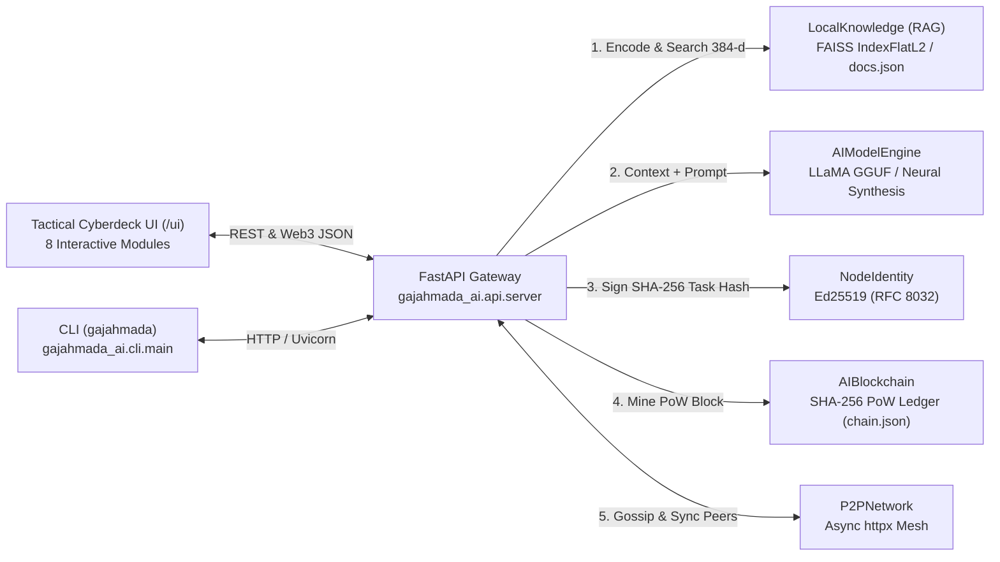

<div align="center">


# GajahMada

### **Sovereign Decentralized AI & Web3 Node Architecture**

*Autonomous Neural Inference · 384-d Semantic Vector RAG · SHA-256 Proof-of-Work Audit Ledger · Ed25519 Cryptographic Identity · P2P Mesh Topology*

[](https://python.org)
[](https://fastapi.tiangolo.com)
[](ARCHITECTURE.md)
[](gajahmada_ai/knowledge/rag.py)
[](vercel.json)

</div>

---

## 🖥️ Tactical Cyberdeck HUD Preview


> **Live Web Console (`/ui`):** Antarmuka *Bento Grid 100vh* bergaya *Tactical Cyberdeck* yang memvisualisasikan dan mengendalikan seluruh 8 modul arsitektur **GajahMada** secara real-time—mulai dari graf pengetahuan 3D, telemetri log sistem, konsol perintah LLM & slash-commands, matriks dependensi, siklus konsensus Web3, hingga penambangan blok Proof-of-Work.

---

## ✨ Sorotan & Kapabilitas Utama

1. **🧠 Dual-Mode Neural Inference (`AIModelEngine`):**
   - Mendukung eksekusi LLM lokal penuh berbasis **GGUF (`llama.cpp` / `llama-cpp-python`)** untuk privasi dan kedaulatan penuh di perangkat lokal.
   - Dilengkapi **Built-in Neural Synthesis Engine** sehingga node tetap merespons secara cerdas pada lingkungan ringan atau *serverless* (seperti **Vercel**) tanpa memerlukan GPU atau bobot model bergigabyte.
2. **📚 384-Dimensional Knowledge Expansion (`LocalKnowledge` RAG):**
   - Mengubah dokumen teks (`.txt`, `.md`, `.csv`, `.xml`, `.json`) menjadi vektor semantik **384-dimensi** menggunakan `SentenceTransformer (all-MiniLM-L6-v2)` atau *Deterministic 384-d Hash-Projection Embedder*.
   - Mendukung pencarian kemiripan kosinus/L2 berlatensi sub-milidetik melalui **FAISS (`IndexFlatL2`)** maupun *pure-Python L2 VectorStore* yang persisten di `docs.json`.
3. **⛓️ Web3 Proof-of-Work Audit Ledger (`AIBlockchain`):**
   - Setiap interaksi inferensi (`prompt + response`) di-hash dengan **SHA-256**, ditandatangani dengan kunci privat node, dan ditambang menggunakan algoritma **Proof-of-Work (`difficulty=2`)** ke dalam rantai blok persisten (`chain.json`).
4. **🔐 Kedaulatan Identitas Kriptografis (`NodeIdentity` — Ed25519 RFC 8032):**
   - Setiap node memiliki pasangan kunci asimetris **Ed25519** (`node_key.pem` dengan izin atomik `0600` di lokal, atau *deterministic seed* di Vercel Serverless).
   - Setiap blok dan pesan broadcast P2P dapat diverifikasi keaslian tanda tangannya secara kriptografis (`POST /security/sign-verify` & `POST /node/chain/verify`).
5. **🌐 Asynchronous P2P Mesh Networking (`P2PNetwork`):**
   - Penemuan peer, sinkronisasi topologi (`POST /node/sync`), dan siaran pesan *gossip* bertanda tangan Ed25519 (`POST /node/broadcast`) menggunakan `httpx` asinkron.
6. **☁️ 100% Kompatibel Localhost & Vercel Serverless:**
   - Otomatis mendeteksi lingkungan *read-only* (`VERCEL=1`) dan mengalihkan penyimpanan runtime ke `/tmp/knowledge_store` dengan *auto-seeding* 6 dokumen arsitektur inti pada saat *cold start*.

---

## 🧩 8 Modul Antarmuka Interaktif (`/ui`)

Setiap panel pada dashboard [interface/html/index.html](interface/html/index.html) terhubung langsung ke fungsi nyata pada backend:

| Panel | Nama Modul | Fungsi Nyata & Interaksi |
| :---: | :--- | :--- |
| **`01`** | **System Architecture & Knowledge Expansion** | • **Graf 3D Interaktif:** Memetakan 7 klaster paket `gajahmada_ai.*` dalam ruang 3D; klik klaster untuk menguji modul.<br>• **Module Configuration (Kiri):** Klik `node.name`, `ai.max_tokens`, `ai.temperature`, atau `chain.pow_diff` untuk mengubah konfigurasi server secara *live* (`POST /node/config`).<br>• **Web3 Server Arch (Kanan) & 6 Kartu Bawah (`6/6`):** Klik kartu `1. API SERVER`, `2. AI CORE`, `3. KNOWLEDGE`, `4. WEB3 CHAIN`, `5. P2P NETWORK`, `6. SECURITY`, atau `TEST ALL` untuk menjalankan benchmark & diagnostik langsung. |
| **`02`** | **System Logs** | Menarik *ring-buffer* log telemetri asli dari server (`GET /node/logs`), dilengkapi tombol **`SYNC`**, **`EXPORT`** (unduh file `.log`), dan **`CLEAR`** (`DELETE /node/logs`). |
| **`03`** | **Command Interface (Hero Console)** | Konsol utama percakapan LLM (`POST /ai/chat`) dengan *RAG context injection*, pencatatan blok PoW otomatis, bar tombol **`QUICK EXEC`**, mode layar penuh **`⛶ MAX`**, serta dukungan **Slash Commands** (`/status`, `/ingest`, `/search`, `/mine`, `/verify`, `/peers`). |
| **`04`** | **Module Dependencies** | Matriks 3 kolom (`APP MODULES`, `DEPENDENCIES`, `REST / WEB3 API`). Klik sel mana saja untuk memeriksa versi paket Python yang terinstal (`GET /node/dependencies`) atau menguji latensi HTTP endpoint terkait. |
| **`05`** | **Web3 Server Arch (Consensus Cycle)** | Cincin donat 6 segmen (`ingest` → `embed` → `infer` → `sign` → `mine` → `gossip`). Klik cincin atau tombol **`▶ RUN CYCLE`** untuk mengeksekusi siklus verifikasi 6 tahap secara berurutan ke backend. |
| **`06`** | **Modular Architecture Matrix** | Grid 4×4 berisi 16 komponen sistem (`AIModelEngine`, `LocalKnowledge`, `AIBlockchain`, `P2PNetwork`, `NodeIdentity`, dll.) dengan kursor pemindai otomatis. Klik komponen mana pun untuk menjalankan *live diagnostic probe*. |
| **`07`** | **Network Status (P2P Mesh)** | Visualisasi topologi *Hub & Spoke* node aktif. Klik **`⚡ BROADCAST`** untuk mengirim paket *heartbeat* bertanda tangan Ed25519 ke seluruh peer (`POST /node/broadcast`) atau **`+ PEER`** untuk mengelola koneksi mesh. |
| **`08`** | **System Performance & Ledger** | Menampilkan 7 indikator metrik nyata (`CPU USAGE`, `RAM ALLOC`, `DISK I/O READ`, `RAG VECTORS`, `ED25519 KEY`, `POW DIFFICULTY`, `WEB3 LEDGER`), dilengkapi tombol **`⛏ MINE BLOCK`** dan audit **`✓ CHAIN VALID`**. |

---

## 🏗️ Arsitektur Sistem & Alur Konsensus



### Struktur Direktori Proyek

```text
gajahmada/
├── main.py                      # Entry point utama (Localhost Uvicorn & Vercel ASGI)
├── config.yaml                  # Konfigurasi node, bootstrap peer, dan model AI
├── vercel.json                  # Konfigurasi build & routing Vercel Serverless
├── requirements.txt             # Dependensi inti ringan (Vercel & Localhost)
├── requirements-local.txt       # Dependensi ML penuh opsional (llama-cpp, faiss, sentence-transformers)
├── setup.py                     # Instalasi paket Python & CLI script `gajahmada`
├── run.sh / run.bat             # Script quick-start Linux/macOS & Windows
├── ARCHITECTURE.md              # Dokumentasi teknis arsitektur sistem
├── gajahmada_ai/
│   ├── api/server.py            # FastAPI server (16 endpoint REST, RAG, P2P, & Web3)
│   ├── core/engine.py           # AIModelEngine (LLaMA GGUF + Neural Synthesis + 384-d Embedder)
│   ├── knowledge/rag.py         # LocalKnowledge (FAISS IndexFlatL2 + JSON Vector Store)
│   ├── blockchain/chain.py      # AIBlockchain & Block (SHA-256 Proof-of-Work + Persistensi)
│   ├── network/p2p.py           # P2PNetwork (Peer validation, sync, & async broadcast)
│   ├── security/crypto.py       # NodeIdentity (Ed25519 keygen, signing, & RFC 8032 verification)
│   └── cli/main.py              # CLI commands: start, join, node-status, train-model
└── interface/html/              # Tactical Cyberdeck Web UI (disajikan di /ui)
    ├── index.html               # Layout Bento Grid 8 Modul + 3 Modal Interaktif
    ├── style.css                # Stylesheet Cyberdeck HUD 100vh
    ├── app.js                   # Engine visualisasi 3D, koreografi, & pengikat 16 API
    ├── logo.png                 # Logo resmi GajahMada
    └── screenshot.jpg           # Cuplikan layar dashboard GajahMada
```

---

## 🚀 Instalasi & Panduan Menjalankan

### 1. Mode Cepat (Localhost — Tanpa Perlu GPU / Model Berat)

#### Linux / macOS
```bash
pip install -r requirements.txt
./run.sh
```

#### Windows
```bat
pip install -r requirements.txt
run.bat
```

Buka browser di: **[http://localhost:8000/ui](http://localhost:8000/ui)**

---

### 2. Mode Penuh dengan Bobot Model LLaMA GGUF & FAISS Native (Opsional)

Jika Anda ingin menjalankan model GGUF lokal (misalnya `llama-2-7b-chat.Q4_K_M.gguf`) dan akselerasi C++ FAISS:

```bash
pip install -r requirements-local.txt

mkdir -p models
# Tempatkan file model GGUF Anda di ./models/llama-2-7b-chat.Q4_K_M.gguf

# Jalankan melalui CLI
python -m gajahmada_ai.cli.main start --config config.yaml
```

#### Perintah CLI (`gajahmada`)
```bash
# Menjalankan node server
python -m gajahmada_ai.cli.main start

# Menghubungkan node ke peer P2P lain
python -m gajahmada_ai.cli.main join http://127.0.0.1:8001

# Memeriksa status node & audit kriptografis blockchain
python -m gajahmada_ai.cli.main node-status

# Menambang blok konsensus & menyiarkan ke jaringan P2P
python -m gajahmada_ai.cli.main train-model --note "Audit Konsensus V2"
```

---

### 3. Deploy ke Vercel Serverless

Proyek ini telah dikonfigurasi agar seluruh 16 endpoint dan 8 panel UI berjalan langsung di **Vercel Serverless**:

```bash
npm i -g vercel
vercel --prod
```

---

## 📡 Referensi REST & Web3 API (16 Endpoints)

| Metode | Endpoint | Deskripsi |
| :---: | :--- | :--- |
| `GET` | `/` | Status utama node, mode (`full` / `serverless`), dan *uptime*. |
| `GET` | `/health` | Pemeriksaan kesehatan layanan (*health check*). |
| `POST` | `/ai/chat` | Eksekusi prompt LLM dengan konteks RAG 384-d + penambangan blok PoW bertanda tangan Ed25519. |
| `POST` | `/ai/ingest` | Meng-embed teks dokumen ke vektor 384-d dan menyimpannya ke *Knowledge Store*. |
| `POST` | `/ai/embedding` | Menghasilkan vektor embedding 384-dimensi yang dinormalisasi dari teks input. |
| `GET` | `/knowledge/stats` | Menampilkan jumlah dokumen RAG, dimensi vektor, tipe indeks, dan daftar pratinjau dokumen. |
| `POST` | `/knowledge/search` | Pencarian semantik *top-k* dokumen berdasarkan jarak vektor L2 384-d. |
| `DELETE` | `/knowledge/docs/{idx}` | Menghapus dokumen tertentu dari *vector store*. |
| `GET` | `/node/info` | Informasi lengkap node (`node_id` Ed25519, nama node, peer, tinggi blok, jumlah dokumen RAG). |
| `GET` | `/node/metrics` | Telemetri perangkat keras & sistem (`CPU %`, `RAM %`, `Disk Read MB`, status ledger). |
| `GET` | `/node/chain` | Mengambil seluruh daftar blok pada ledger Proof-of-Work beserta status validitasnya. |
| `POST` | `/node/chain/mine` | Menambang blok audit Proof-of-Work baru secara manual dengan tanda tangan Ed25519. |
| `POST` | `/node/chain/verify` | Mengaudit ulang seluruh hash SHA-256 PoW dan memverifikasi tanda tangan Ed25519 tiap blok. |
| `POST` | `/security/sign-verify` | Uji mandiri (*self-test*) pembuatan & verifikasi tanda tangan digital Ed25519 (RFC 8032). |
| `GET` | `/node/peers` | Daftar peer P2P yang terhubung. |
| `POST` | `/node/sync` | Mendaftarkan URL node peer baru ke dalam topologi mesh P2P. |
| `DELETE` | `/node/peers?peer=...` | Memutuskan tautan peer dari daftar mesh P2P. |
| `POST` | `/node/broadcast` | Menyiarkan pesan *gossip* bertanda tangan Ed25519 ke seluruh peer aktif. |
| `GET/POST` | `/node/config` | Membaca atau memperbarui konfigurasi runtime (`node_name`, `pow_difficulty`, `max_tokens`, `temperature`). |
| `GET` | `/node/dependencies` | Memeriksa versi Python dan status paket pustaka yang terinstal di server. |
| `GET/DELETE` | `/node/logs` | Mengambil atau membersihkan *ring-buffer* log telemetri server. |

---

## 💬 Perintah Cepat pada Command Interface (`Panel 03`)

Selain mengetik pertanyaan bahasa alami, Anda dapat menjalankan perintah sistem langsung di kotak input **Command Interface**:

- `/status` — Menampilkan laporan langsung CPU, RAM, Disk, jumlah dokumen RAG, peer P2P, dan tinggi rantai blok.
- `/ingest <teks pengetahuan>` — Langsung meng-embed teks ke vektor 384-d dan menyimpannya ke dalam basis pengetahuan RAG.
- `/search <kueri pencarian>` — Mencari dokumen paling relevan secara semantik dari *vector store* 384-d.
- `/mine <catatan audit>` — Menambang blok Proof-of-Work baru ke dalam Web3 Ledger.
- `/verify` — Menjalankan audit kriptografis penuh terhadap rantai blok SHA-256 dan tanda tangan Ed25519.
- `/peers` — Menampilkan daftar node peer P2P yang terhubung.
