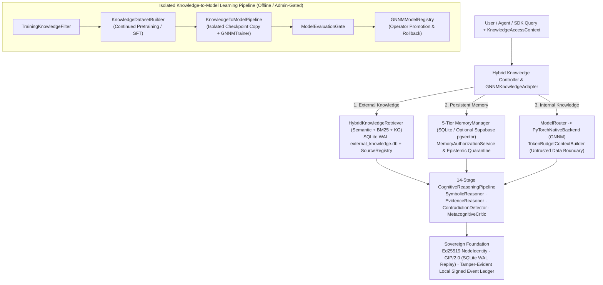
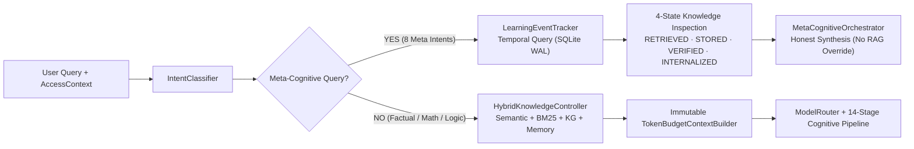
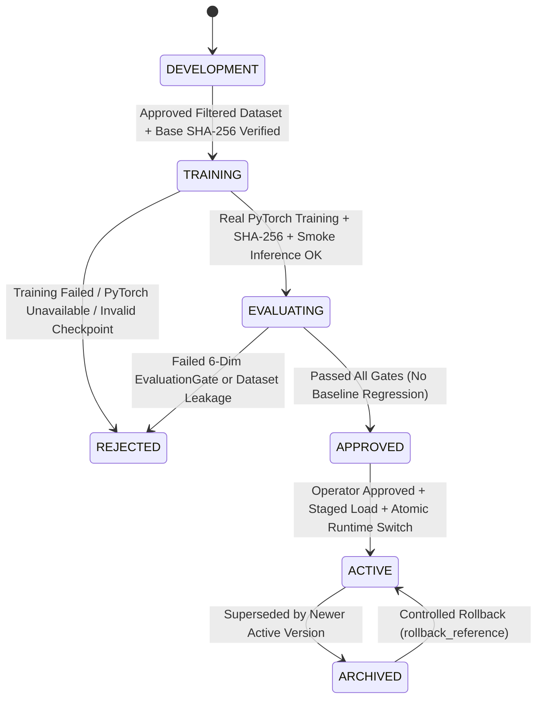
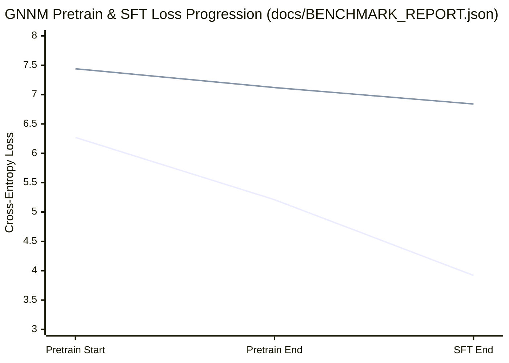
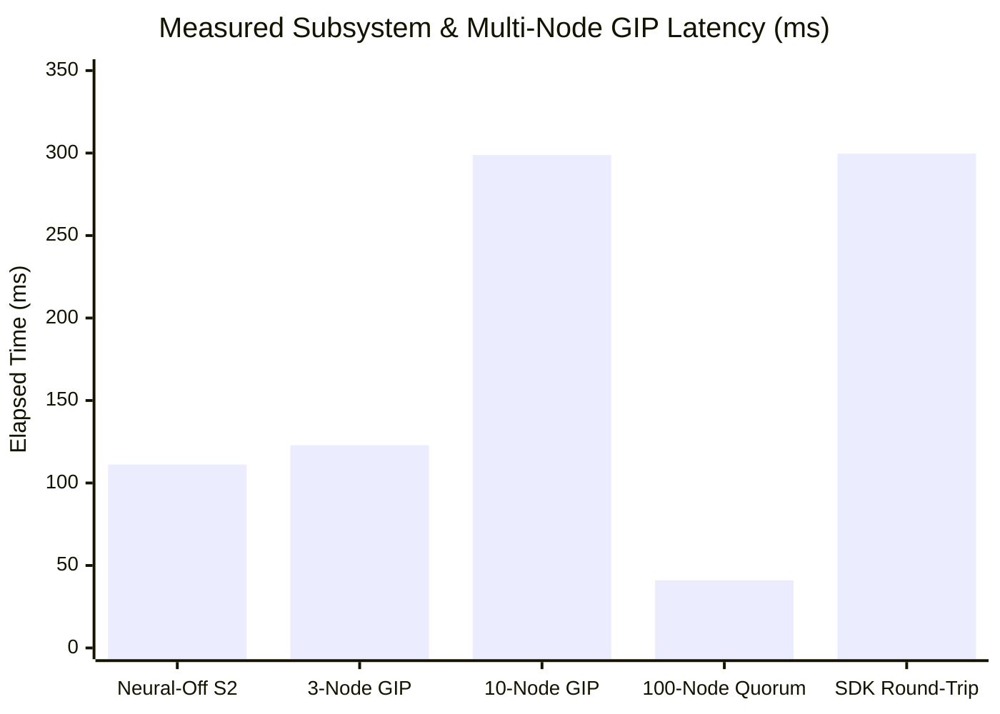

<div align="center">


# GajahMada AI 2.0

### Sovereign Hybrid Knowledge & Distributed Intelligence Platform

*GNNM Native Neural Model (Decoder-Only Transformer) · Hybrid External Knowledge Retrieval (Semantic + BM25 + Knowledge Graph) · 5-Tier Persistent Memory (`SQLite WAL` + Optional `Supabase pgvector`) · 14-Stage Hybrid Cognitive & Meta-Cognitive Engine · Isolated Knowledge-to-Model Learning Pipeline · GIP/2.0 Cryptographic Mesh · Tamper-Evident Local Signed Event Ledger*

[](LICENSE)
[](https://www.python.org/)
[](#automated-verification--benchmarks)
[](#installation--quick-start)
[](https://gajahmada.vercel.app/)

[Live Node](https://gajahmada.vercel.app/) · [Architecture](ARCHITECTURE.md) · [Hybrid Knowledge](docs/HYBRID_KNOWLEDGE_ARCHITECTURE.md) · [Learning Pipeline](docs/GNNM_LEARNING_PIPELINE.md) · [Memory Security](docs/MEMORY_SECURITY_MODEL.md) · [Embeddings](docs/EMBEDDING_ARCHITECTURE.md) · [Evaluation](docs/EVALUATION_FRAMEWORK.md) · [Model Registry](docs/MODEL_REGISTRY_AND_PROMOTION.md) · [Distributed Trust](docs/DISTRIBUTED_KNOWLEDGE_TRUST.md) · [GIP/2.0 RFC](docs/GIP_2_0_RFC.md)

</div>

---

## Overview

**GajahMada AI** is an open-source, offline-first **Sovereign Hybrid Intelligence** node engineered to operate without mandatory third-party cloud AI APIs. Rather than relying solely on static model weights or unstructured RAG scripts, GajahMada unifies **three logically separated knowledge systems** under a single authorization-aware control plane:

| Knowledge System | Storage & Lifecycle | Update Mechanism | Core Modules |
| :--- | :--- | :--- | :--- |
| **1. Internal Knowledge** | Embedded in **GNNM** (`GajahMada Native Neural Model`) Transformer weights (`models/gnnm-*`) | Isolated **Knowledge-to-Model Learning Pipeline** (Filter → Dataset → Trainer → Evaluation Gate → Operator-Approved Promotion) | `gajahmada_ai/gnnm/`, `gajahmada_ai/learning/`, `gajahmada_ai/neural/` |
| **2. External Knowledge** | Dynamically indexed multi-format documents (TXT, Markdown, HTML, JSON, CSV, DOCX, PDF) & Knowledge Graph persisted in `SQLite WAL` (`external_knowledge.db`) + `SourceRegistry` | Instant ingestion & chunking **without retraining** the model | `gajahmada_ai/knowledge/` (`ingestion`, `chunker`, `retriever`, `embedding`, `source_registry`) |
| **3. Persistent Memory** | Operational experiences, conversation context, verified facts, strategies, & contradictions across 5 tiers (`working`, `semantic`, `episodic`, `procedural`, `collective`) | Authorized memory operations, epistemic quarantine, & cryptographic `node_attestations` promotion | `gajahmada_ai/memory/`, `gajahmada_ai/storage/` |

Coordinating all three systems is the **Hybrid Knowledge Controller** (`HybridKnowledgeController`) and **`GNNMKnowledgeAdapter`**, which enforce retrieval-boundary access control (`KnowledgeAccessPolicy`), detect conflicting sources, construct prompt-injection-hardened token-budgeted contexts (`TokenBudgetContextBuilder`), and feed evidence into GajahMada's **14-stage Cognitive Reasoning Pipeline** and **ModelRouter**.

> **Live Web Interface ([gajahmada.vercel.app](https://gajahmada.vercel.app/)):**
> - **Homepage (`/`):** Focus Command Center floating over an interactive full-viewport 3D Network Graph with real-time neural thinking acceleration.
> - **Tactical Cyberdeck Dashboard (`/dashboard` & `/ui`):** 8-panel operational HUD (System Logs & Live Config, 3D Network Graph, Command Interface, Module Dependencies, Consensus Cycle, Architecture Matrix, P2P Mesh, and System Performance & Ledger) with a session-scoped **`🔑 AUTH`** control for authenticated operator actions.

---

## Core Architectural Capabilities

1. **GajahMada Native Neural Model (`gajahmada_ai/gnnm/` & `neural/`):**
   - Custom PyTorch Decoder-Only Transformer (**Pre-Norm RMSNorm + RoPE + Grouped/Multi-Head Causal Self-Attention + SwiGLU**) paired with a pure-Python lossless Byte-Level BPE tokenizer (`GNNMBPETokenizer`).
   - Verified from-scratch checkpoints trained locally on CPU: `GNNM-01-Tiny` (`918,656` params) and `GNNM-01-12M` (**`11,243,520` params**, 10M–50M tier), with scaling presets up to `GNNM-04-1B` (`~1.1B` params).
   - `PyTorchNativeBackend` enforces exact token-budget context allocation against each checkpoint's `max_seq_len` (zero arbitrary character truncation). When no neural checkpoint is loaded, `ModelRouter` honestly reports `neural_inference_active: False` while the deterministic Cognitive Engine stays 100% operational.

2. **Hybrid External Knowledge & Pluggable Offline Embeddings (`gajahmada_ai/knowledge/` — see [HYBRID_KNOWLEDGE_ARCHITECTURE.md](docs/HYBRID_KNOWLEDGE_ARCHITECTURE.md) & [EMBEDDING_ARCHITECTURE.md](docs/EMBEDDING_ARCHITECTURE.md)):**
   - **10-Step Ingestion (`KnowledgeIngestionPipeline`):** Parse → Normalize → Validate → SHA-256 Deduplicate → Extract Metadata → Structure/Token-Aware Chunking (`DocumentChunker`) → Embed → Persist in `SQLite WAL` (`external_knowledge.db`) → Track Lineage (`SourceRegistry`) → Log Status.
   - **Honest Offline Embeddings (`embedding.py`):** Preserves `HashEmbeddingProvider` (`deterministic-hash-384d`) as default offline fallback, adds `NativeSemanticEmbeddingProvider` (explicitly classified as `heuristic_semantic_projection`, `is_learned_model: False`), provides fail-closed `LocalLearnedEmbeddingProvider` / `FutureGNNMEmbeddingProvider` interfaces for future trained encoders, enforces strict encoder compatibility before cosine similarity, and supports reversible `EmbeddingMigrationManager` re-embedding.
   - **Concurrency-Safe Retrieval & Safe Context:** Combines cosine vector similarity, Okapi BM25, Knowledge Graph boosts, and Persistent Memory under fail-closed `KnowledgeAccessPolicy`. `GNNMKnowledgeAdapter` constructs an **immutable per-request** `TokenBudgetContextBuilder` (zero shared-state mutation across concurrent requests), isolating retrieved text in `<untrusted_retrieved_data>` delimiters with prompt-injection sanitization.

3. **Strict-Integrity Knowledge-to-Model Learning Pipeline (`gajahmada_ai/learning/` — see [GNNM_LEARNING_PIPELINE.md](docs/GNNM_LEARNING_PIPELINE.md), [EVALUATION_FRAMEWORK.md](docs/EVALUATION_FRAMEWORK.md), & [MODEL_REGISTRY_AND_PROMOTION.md](docs/MODEL_REGISTRY_AND_PROMOTION.md)):**
   - Completely decoupled from production inference and ingestion.
   - **`TrainingKnowledgeFilter`** rejects `UNVERIFIED`, `DISPUTED`, `REJECTED`, prompt-injection payloads, missing/restricted licenses, low-quality OCR, duplicates, and untrusted peer/agent inputs.
   - **`KnowledgeDatasetBuilder`** generates separate SHA-256 JSONL manifests for **Continued Pretraining** vs. **Supervised Fine-Tuning (SFT)**.
   - **`KnowledgeToModelPipeline`** enforces strict P0 training statuses (`CHECKPOINT_MISSING`, `TRAINING_NOT_EXECUTED`, `TRAINING_FAILED`, `CHECKPOINT_INVALID`, `EVALUATION_FAILED`, `APPROVED`): a candidate can enter `EVALUATING` **only** after real PyTorch training, SHA-256 checkpoint integrity verification, and real `GNNMInferenceEngine` smoke inference succeed (missing PyTorch returns `TRAINING_NOT_EXECUTED`, never `APPROVED`).
   - **6-Dimension `ModelEvaluationGate` (`gm-eval-v2.1`):** Evaluates functional stability, Indonesian/English/mixed language, grounded faithfulness & citation accuracy, abstention on unknown queries, reasoning, prompt-injection resilience, train/val leakage detection, and baseline regression deltas.
   - **Runtime-Coupled `GNNMModelRegistry`:** Enforces strict lifecycle transitions (`DEVELOPMENT` → `TRAINING` → `EVALUATING` → `APPROVED` → `ACTIVE` / `REJECTED` / `ARCHIVED`), verifies live on-disk SHA-256 before promotion, stages & smoke-tests candidates on a fresh `PyTorchNativeBackend`, and switches `ModelRouter` atomically with instant rollback.

4. **Security Hardening, Direct Memory Authorization & Tamper-Evident Ledger (`gajahmada_ai/security/`, `memory/`, `blockchain/` — see [MEMORY_SECURITY_MODEL.md](docs/MEMORY_SECURITY_MODEL.md) & [SECURITY_AUDIT.md](docs/SECURITY_AUDIT.md)):**
   - **Canonical `AccessContext` & Direct Memory Enforcement:** Immutable `AccessContext` (`actor_id`, `actor_role`, `organization_id`, `agent_id`, `session_id`, `request_id`) propagates from API → `CognitiveReasoningPipeline` → `HybridKnowledgeController` → `MemoryManager.retrieve()`, enforcing all 9 scopes (`PRIVATE`, `SESSION`, `AGENT`, `ORGANIZATION`, `LOCAL`, `SHARED`, `DISTRIBUTED_SHARED`, `COLLECTIVE`, `PUBLIC`) fail-closed and recording privacy-safe `MEMORY_ACCESS_DENIED` audit events without leaking private content.
   - **Zero Signing Oracle, Fail-Closed Auth & Observability:** `/security/sign-verify` uses an isolated ephemeral keypair; 256-bit rotatable admin key (`admin_api.key`, `0600`); fail-closed RBAC (`401`/`403`) on all mutating & internal endpoints; `LifecycleObservabilityLogger` (scrubbing prompts & hashing actor IDs) + honest per-subsystem health (`GET /api/v2/system/health/subsystems` reporting `HEALTHY | DEGRADED | UNAVAILABLE | NOT_CONFIGURED`).
   - **Fail-Closed Key Management & Tamper-Evident Local Signed Event Ledger (Schema v2):** Atomic `0600` private-key persistence (`KeyPersistenceError` on failure), persistent dual-signed rotation/revocation state (`node_key.pem.state.json`), and local hash-chained Ed25519 audit ledger (strict non-genesis verification, atomic writes, `LEDGER_CORRUPTED` halt + `recover_from_backup()`).

5. **GIP/2.0 Cryptographic Mesh, Organizational Trust & Ecosystem SDK (`gajahmada_ai/network/`, `sdk/` — see [DISTRIBUTED_KNOWLEDGE_TRUST.md](docs/DISTRIBUTED_KNOWLEDGE_TRUST.md) & [GIP_2_0_RFC.md](docs/GIP_2_0_RFC.md)):**
   - Full 8-namespace `GIP/2.0` protocol backed by an atomic SQLite WAL replay nonce store (`gip_replay.db`), explicit `PeerTrustState` lifecycle, SSRF guard, direct Ed25519 quorum verification (`QuorumConsensusManager`), multi-organization `FederationRegistry`, and `SignedKnowledgeEnvelope` (`count_independent_operators` deduplicating same-organization keys).
   - Official Python SDK (`sdk/gajahmada_sdk/`) with `GajahMadaClient`, `NodeKeyPair`, and `build_signed_gip_message`.

---

## System Architecture



### Meta-Cognitive vs. Factual Query Orchestration



### Model Governance & Runtime Promotion Lifecycle



### Repository Structure

```text
gajahmada/
├── main.py                              # Entry point (Localhost Uvicorn & Vercel ASGI)
├── config.yaml                          # Node, bootstrap peer, & native GNNM model configuration
├── config.federation.example.yaml       # Multi-organization sovereign federation node template
├── .env.example                         # Environment template for Supabase, auth, & GM_* feature flags
├── vercel.json                          # Vercel Serverless routing configuration
├── LICENSE                              # MIT Open-Source License
├── ARCHITECTURE.md                      # Detailed system, hybrid knowledge, & security architecture
├── run.sh / run.bat                     # Cross-platform quick-start scripts
├── supabase/
│   └── schema.sql                       # PostgreSQL + pgvector schema, match_knowledge RPC, & RLS
├── docs/
│   ├── HYBRID_KNOWLEDGE_ARCHITECTURE.md # Three-system hybrid knowledge design & maturity status
│   ├── GNNM_LEARNING_PIPELINE.md        # Strict P0 training integrity, filtering, & checkpoint checks
│   ├── MEMORY_SECURITY_MODEL.md         # Canonical AccessContext & 9-scope direct memory authorization
│   ├── EMBEDDING_ARCHITECTURE.md        # Hash/heuristic/learned embedding providers & migration
│   ├── MODEL_REGISTRY_AND_PROMOTION.md  # State machine, SHA-256 verification, & atomic runtime switch
│   ├── EVALUATION_FRAMEWORK.md          # 6-dimension EvaluationGate (gm-eval-v2.1) & leakage checks
│   ├── DISTRIBUTED_KNOWLEDGE_TRUST.md   # SignedKnowledgeEnvelope & org-level independence
│   ├── GNNM_ARCHITECTURE.md             # GNNM-01..04 Transformer blueprint & training status
│   ├── GIP_2_0_RFC.md                   # Formal GIP/2.0 wire protocol & interoperability RFC
│   ├── BENCHMARK_REPORT.json            # Reproducible ecosystem benchmark report (Stages 1-5)
│   ├── SECURITY_AUDIT.md                # Security controls & Round 1-3 + Master Hardening matrix
│   ├── ARCHITECTURE_V2.md               # 8-layer & 14-stage cognitive specification
│   ├── AUDIT_V2.md                      # Source code audit & capability classification
│   ├── MIGRATION_PLAN.md                # v1 -> v2 compatibility contract
│   └── ROADMAP.md                       # 5-stage sovereign strategic roadmap & results
├── scripts/
│   ├── train_gnnm.py                    # Scalable CLI Pretraining + Val Perplexity + SFT pipeline
│   ├── train_gnnm_01_tiny.py            # Quick-start local GNNM-01-Tiny pretraining script
│   ├── run_gip_network_simulation.py    # 3 -> 10 -> 100-node GIP distributed stress harness
│   └── run_ecosystem_benchmarks.py      # Reproducible Stages 1-5 benchmark runner
├── sdk/
│   └── gajahmada_sdk/                   # Official Python SDK (GajahMadaClient, NodeKeyPair, GIP helpers)
├── models/
│   ├── gnnm-01-tiny/                    # GNNM-01-Tiny metadata (918K params; model.pt gitignored)
│   └── gnnm-01-12m/                     # GNNM-01-12M metadata (11.24M params; model.pt gitignored)
├── gajahmada_ai/
│   ├── gnnm/                            # From-scratch Decoder-Only Transformer, BPE tokenizer, trainer, inference
│   ├── knowledge/                       # HybridKnowledgeController, GNNMKnowledgeAdapter, HybridKnowledgeRetriever (SQLite WAL),
│   │                                    # KnowledgeIngestionPipeline, DocumentChunker, TokenBudgetContextBuilder,
│   │                                    # EmbeddingProviders, SourceRegistry, KnowledgeAccessPolicy, LocalKnowledge (legacy RAG)
│   ├── learning/                        # TrainingKnowledgeFilter, KnowledgeDatasetBuilder, KnowledgeToModelPipeline,
│   │                                    # ModelEvaluationGate, GNNMModelRegistry, LearningExperimentManager
│   ├── memory/                          # 5-tier MemoryManager, MemoryAuthorizationService, KnowledgeGraph, Versioning
│   ├── neural/                          # ModelRouter, PyTorchNativeBackend (token-budgeted GNNM), OnnxBackend, InferenceBackend
│   ├── cognition/ & reasoning/          # 14-stage CognitiveReasoningPipeline, SymbolicReasoner, EvidenceReasoner, Contradictions
│   ├── storage/                         # RelationalMemoryStore (SQLite/PG), SupabaseKnowledgeStore, ObjectStore
│   ├── agents/ & execution/             # Planner, Researcher, Analyst, Verifier, Scheduler, SandboxedExecutor
│   ├── network/                         # GIP/2.0 (SQLite WAL replay), SignedKnowledgeEnvelope, FederationRegistry, PeerDiscovery, QuorumConsensus
│   ├── blockchain/                      # AIBlockchain Schema v2 tamper-evident local signed event ledger + atomic recovery
│   ├── security/                        # AccessContext, LifecycleObservabilityLogger, NodeIdentity (fail-closed Ed25519), AuthManager, SSRF, RateLimiter
│   ├── api/                             # FastAPI server.py (v1, UI, SEO/sitemap.xml) & v2_routes.py (/api/v2/*)
│   └── cli/                             # Sovereign Node CLI v1 & v2
├── interface/html/                      # Dual-Mode Web UI (/, /dashboard, /ui), Hybrid Knowledge & GNNM Lab Modals, SEO JSON-LD, & sitemap.xml
└── tests/                               # 64 Automated Tests across unit, knowledge, learning, cognition, memory, network, security, integration
```

---

## Installation & Quick Start

### Prerequisites

| Requirement | Minimum | Recommended |
| :--- | :--- | :--- |
| **OS** | Linux, macOS, or Windows 10/11 | Ubuntu 22.04+ / Debian / macOS |
| **Python** | Python `3.10+` | Python `3.12` (for prebuilt PyTorch CPU/CUDA wheels) |
| **Git** | Git `2.30+` | Latest |
| **RAM / Disk** | 2 GB RAM · 500 MB free disk | 8 GB+ RAM · 2 GB+ disk (for local GNNM checkpoints) |
| **Package Manager** | `pip` | [`uv`](https://docs.astral.sh/uv/) (for fast `.venv312` PyTorch setup) |

---

### Step 1 — Clone the Repository

```bash
git clone https://github.com/hoed/gajahmada-ai.git
cd gajahmada-ai
```

---

### Step 2 — Standard Local Offline Installation (Zero External APIs)

Runs the full FastAPI node, 14-Stage Hybrid Cognitive & Meta-Cognitive Engine, Hybrid External Knowledge Retrieval (`SQLite WAL`), 5-Tier Persistent Memory, GIP/2.0 Mesh, Tamper-Evident Local Signed Event Ledger, and Cyberdeck Web UI **without requiring PyTorch or any cloud API**:

#### Linux / macOS
```bash
python3 -m venv .venv
source .venv/bin/activate
pip install --upgrade pip
pip install -r requirements.txt

# Start the sovereign node (default port 8000)
./run.sh
```

#### Windows (PowerShell / CMD)
```powershell
python -m venv .venv
.venv\Scripts\activate
pip install --upgrade pip
pip install -r requirements.txt

# Start the sovereign node
run.bat
```

Once running, open:
- **Homepage (Focus Command Center + 3D Network):** `http://localhost:8000/`
- **Full 8-Panel Cyberdeck Dashboard (Hybrid Knowledge & GNNM Lab):** `http://localhost:8000/dashboard` (or `/ui`)
- **Interactive OpenAPI / Swagger Docs:** `http://localhost:8000/docs`
- **Subsystem Health Matrix:** `http://localhost:8000/api/v2/system/health/subsystems`

---

### Step 3 — Native `GNNM` PyTorch Runtime & From-Scratch Training (Optional)

To enable live local **GNNM** neural inference and isolated Knowledge-to-Model training, install PyTorch inside `.venv312` (Python 3.12). `./run.sh` automatically detects `.venv312/bin/python` when present.

#### Option A: CPU-Only (Works on any laptop/server)
```bash
# Install uv if not already installed
curl -LsSf https://astral.sh/uv/install.sh | sh

# Create Python 3.12 environment and install dependencies + PyTorch CPU
uv venv --python 3.12 .venv312
uv pip install --python .venv312/bin/python -r requirements.txt
uv pip install --python .venv312/bin/python torch --index-url https://download.pytorch.org/whl/cpu
```

#### Option B: NVIDIA CUDA GPU (Faster training & scaling to `GNNM-01-25M`..`GNNM-04-1B`)
```bash
uv venv --python 3.12 .venv312
uv pip install --python .venv312/bin/python -r requirements.txt
uv pip install --python .venv312/bin/python torch --index-url https://download.pytorch.org/whl/cu124
```

#### Train Your First Native `GNNM` Checkpoint From Scratch
```bash
# Fast smoke checkpoint (~918K params -> ./models/gnnm-01-tiny/)
.venv312/bin/python scripts/train_gnnm.py --preset GNNM-01-Tiny --steps 80 --sft-steps 40

# Stage 1 10M-50M tier checkpoint (~11.24M params -> ./models/gnnm-01-12m/)
.venv312/bin/python scripts/train_gnnm.py --preset GNNM-01-12M --vocab-size 2048 --steps 12 --sft-steps 6

# Launch node with native GNNM checkpoint active
./run.sh
```

---

### Step 4 — Operator Authentication (`🔑 AUTH`)

On first boot, GajahMada generates a cryptographically random 256-bit admin key and persists it with strict `0600` permissions:

```bash
# View your generated local admin key
cat knowledge_store/admin_api.key
```

- **Via Web Dashboard:** Click **`🔑 AUTH`** in the top header and paste your key (stored only in browser `sessionStorage`) to unlock protected operations (`🧠 HYBRID KNOWLEDGE` ingestion, `🎓 GNNM LAB` training/promotion/rollback, peer management, and block mining).
- **Via REST API / CLI:** Pass `-H "X-API-Key: <your-key>"` or `Authorization: Bearer <your-key>`.
- **Custom Key:** Set `GAJAHMADA_ADMIN_KEY` in `.env` before starting the server.

---

### Step 5 — Configuration, Feature Flags & Optional Supabase Cloud Store

Copy the environment template and customize as needed:

```bash
cp .env.example .env
```

Key environment variables:

```bash
# Hybrid Knowledge Architecture feature flags (all backward-compatible)
GM_HYBRID_KNOWLEDGE=true
GM_EXTERNAL_RETRIEVAL=true
GM_SEMANTIC_EMBEDDING=false            # true enables NativeSemanticEmbeddingProvider; false keeps 384-d hash fallback
GM_HASH_EMBEDDING_FALLBACK=true
GM_KNOWLEDGE_TRAINING=false
GM_KNOWLEDGE_VERIFICATION_REQUIRED=true
GM_KNOWLEDGE_MAX_RESULTS=5
GM_KNOWLEDGE_MAX_CONTEXT_TOKENS=1024
GM_KNOWLEDGE_ENABLE_BM25=true
GM_KNOWLEDGE_ENABLE_VECTOR_SEARCH=true
GM_KNOWLEDGE_ENABLE_GRAPH_SEARCH=true
GM_KNOWLEDGE_ENABLE_DISTRIBUTED_SOURCES=false

# Optional Supabase Cloud Persistence (PostgreSQL + pgvector 384-d + RLS)
# Run supabase/schema.sql in your Supabase SQL Editor first
SUPABASE_URL=https://<your-project>.supabase.co
SUPABASE_PUBLISHABLE_KEY=<your-publishable-key>
SUPABASE_SECRET_KEY=<your-service-role-key>
```

For multi-organization federation deployments (universities, research labs, communities), copy [config.federation.example.yaml](config.federation.example.yaml) to `config.yaml` and update your organization identity and bootstrap peers.

---

### Step 6 — Verify Installation & Run Tests

```bash
# Run the full automated test suite (64 tests)
python3 -m pytest -q

# Run the reproducible Stages 1-5 ecosystem benchmark suite
python3 scripts/run_ecosystem_benchmarks.py

# Check live node capability diagnostics
curl -s http://localhost:8000/api/v2/intelligence/diagnose | python3 -m json.tool
```

---

### Step 7 — Optional Serverless Deployment (Vercel)

```bash
npm i -g vercel
vercel --prod
```

Configure `GAJAHMADA_ADMIN_KEY`, `GAJAHMADA_ALLOWED_ORIGINS`, and optional `SUPABASE_*` variables in the Vercel Project Settings dashboard. The ASGI entrypoint (`main.py`) and routing (`vercel.json`) automatically serve `/`, `/dashboard`, `/ui`, `/api/v2/*`, `/sitemap.xml`, and `/robots.txt`.

---

## REST API Surface (v2 & Backward-Compatible v1)

| Method | Endpoint | Auth | Purpose |
| :--- | :--- | :---: | :--- |
| `GET` | `/api/v2/intelligence/diagnose` | Public | Honest capability report (`neural_inference_active`, `symbolic_reasoning_active`, memory stats). |
| `POST` | `/api/v2/intelligence/ask` | Optional | 14-stage hybrid cognitive reasoning (read-only for public; quarantined persistence for operators). |
| `GET` | `/api/v2/reasoning`, `/api/v2/reasoning/{id}` | **Required** | Authenticated internal reasoning traces & epistemic breakdowns. |
| `GET` / `POST` | `/api/v2/memory`, `PUT /api/v2/memory/{id}` | Read: Matrix / Write: **Required** | Visibility-enforced 5-tier persistent memory & immutable version history. |
| `POST` | `/api/v2/knowledge/ingest` | **Required** | 10-step external document ingestion (TXT/MD/HTML/JSON/CSV/DOCX/PDF) into SQLite WAL + `SourceRegistry`. |
| `POST` | `/api/v2/knowledge/hybrid-search` | Matrix | Authorization-enforced hybrid retrieval (Semantic + BM25 + KG + Memory) with conflict detection. |
| `GET` | `/api/v2/knowledge/sources` | **Required** | List registered external knowledge sources, hashes, licenses, and verification status. |
| `POST` | `/api/v2/knowledge/promote/{record_id}` | **Required** | Promote quarantined knowledge (`SOURCE_CORROBORATED` from sources; `INDEPENDENTLY_VERIFIED` requires `>= 2` Ed25519 `node_attestations`). |
| `GET` | `/api/v2/learning/registry` | **Required** | Inspect versioned `GNNMModelRegistry` checkpoints, statuses, and rollback references. |
| `POST` | `/api/v2/learning/train` | **Required** | Run isolated `KnowledgeToModelPipeline` training job (`continued_pretraining` or `sft`) + `ModelEvaluationGate`. |
| `POST` | `/api/v2/learning/promote/{version_id}` | **Required** | Operator-approved promotion of an `APPROVED` checkpoint to `ACTIVE` (audited & ledger-signed). |
| `POST` | `/api/v2/learning/rollback` | **Required** | Reversible rollback to the previous `ACTIVE` checkpoint. |
| `GET` / `POST` | `/api/v2/agents`, `/agents/run`, `/tasks/{id}/approve` | **Required** | Bounded autonomous agents with unforgeable human approval gates. |
| `POST` | `/api/v2/network/gip` | Ed25519 + Trust | 8-namespace GIP/2.0 receiver (SQLite WAL replay store, `PeerTrustState`, direct Ed25519 consensus). |
| `GET` / `POST` | `/api/v2/federation`, `/federation/organizations` | Read: Public / Write: **Required** | Multi-organization sovereign federation registry. |
| `GET` | `/api/v2/system/health`, `/health/subsystems` | Public (redacted) | Node health, honest 9-subsystem status (`HEALTHY \| DEGRADED \| UNAVAILABLE \| NOT_CONFIGURED`), & ledger integrity. |
| `GET` | `/sitemap.xml`, `/robots.txt`, `/manifest.json` | Public | Google Search Console sitemap, crawler directives, and PWA manifest for `https://gajahmada.vercel.app`. |

*All legacy v1 endpoints (`/ai/chat`, `/ai/embedding`, `/ai/ingest`, `/knowledge/search`, `/knowledge/stats`, `/node/info`, `/node/chain`, `/security/sign-verify`, etc.) remain 100% compatible with fail-closed RBAC on state-mutating routes.*

---

## Automated Verification & Benchmarks

Run the full automated test suite and reproducible benchmark runner:

```bash
python3 -m pytest -q
python3 scripts/run_ecosystem_benchmarks.py
```

| Test Suite | Coverage | File(s) | Result |
| :--- | :--- | :--- | :---: |
| **Core & Neural (6)** | Offline boot, local backend loading, honest capability reporting, closed-loop adaptation, signed ledger. | `tests/unit/test_core_and_neural.py` | ✅ **PASSED** |
| **GNNM Native Model (4)** | Analytical param count, lossless byte-level BPE, `.jsonl` dedup, SFT `-100` masking, Transformer forward pass. | `tests/unit/test_gnnm_foundation.py` | ✅ **PASSED** |
| **Hybrid Knowledge Architecture (8)** | Structure/token chunker, offline semantic/hash embeddings + reversible migration, token-budget context & prompt-injection defense, fail-closed access policy, SQLite WAL external chunk restart persistence, `GNNMKnowledgeAdapter`, v2 APIs, & GSC SEO/sitemap validation. | `tests/knowledge/test_hybrid_knowledge_architecture.py` | ✅ **PASSED** |
| **Knowledge-to-Model Learning (4)** | `TrainingKnowledgeFilter` (unverified/disputed/injection/license/OCR), Pretraining vs. SFT datasets, `ModelEvaluationGate`, `GNNMModelRegistry` promotion & rollback, & `/api/v2/learning/*` RBAC. | `tests/learning/test_knowledge_learning_pipeline.py` | ✅ **PASSED** |
| **Cognitive, Meta-Cognitive & Memory (9)** | 14-stage pipeline, Stage 2 neural-off 100% accuracy, 8 meta-cognitive intents + temporal `LearningEventTracker` (10 cases + `/ai/chat` regression), restart survival, versioning, contradiction preservation. | `tests/cognition/`, `tests/memory/` | ✅ **PASSED** |
| **GIP, Federation & Scale (7)** | 2/3/10/100-node GIP stress/Sybil/revocation tests, 4-org sovereign federation + Ed25519 `node_attestations`. | `tests/network/` | ✅ **PASSED** |
| **Security, Audit Rounds 1–3 & Master Hardening (23)** | Signing oracle removal, fail-closed RBAC, direct `MemoryManager` 9-scope cross-user/session/agent/org isolation, canonical `AccessContext`, concurrent immutable context budgets, `SignedKnowledgeEnvelope` org independence, privacy-safe observability, persistent SQLite replay guard, fail-closed key persistence, & non-genesis ledger validation. | `tests/security/` | ✅ **PASSED** |
| **API Compatibility, SDK & Benchmarks (3)** | Full v1/v2 compatibility, official Python SDK lifecycle, live cognitive benchmarks. | `tests/integration/`, `tests/benchmarks/` | ✅ **PASSED** |

**Total:** **64 passed, 0 failed** on Python 3.14 (`python3 -m pytest -q`) + live PyTorch E2E training, SHA-256 verification, evaluation gate, and atomic `ModelRouter` promotion/rollback verified on `.venv312` (`docs/BENCHMARK_REPORT.json`).

### Verified GNNM Training Loss Progression (From-Scratch CPU Runs)



### Verified Ecosystem Benchmark Latency (`docs/BENCHMARK_REPORT.json`)



---

## 5-Stage Sovereign Strategic Roadmap

| Stage | Milestone | Verified Current Status |
| :---: | :--- | :--- |
| **Stage 1** | **GajahMada Native Model (`GNNM`)** | **11.24M-Param Checkpoint Proven:** `GNNM-01-Tiny` (`918K`) and `GNNM-01-12M` (`11,243,520` params) trained & verified locally; token-budgeted `GNNMKnowledgeAdapter` and isolated `KnowledgeToModelPipeline` operational. *Scaling to `100M–1B` (`GNNM-02-100M`..`GNNM-04-1B`) requires larger GPU compute & curated corpora.* |
| **Stage 2** | **Native Cognitive Engine** | **Operational (100% Neural-Off Verified):** 14-stage reasoning, symbolic math/logic, evidence scoring, contradiction detection, and 5-tier memory run deterministically with zero neural weights loaded. |
| **Stage 3** | **GIP Distributed Intelligence** | **3, 10, & 100-Node Verified:** 3-node restart recovery, 10-node mesh replay/revocation blocking, and 100-node cryptographic quorum stress-tested in `scripts/run_gip_network_simulation.py`. |
| **Stage 4** | **Collective Knowledge Network** | **Federation Implemented & Verified:** Multi-organization sovereign node registry (`/api/v2/federation`), strict `PRIVATE`/`LOCAL` ownership isolation, and cross-org Ed25519 `node_attestations`. |
| **Stage 5** | **Independent AI Ecosystem** | **SDK, RFC & Open Benchmarks Shipped:** Official Python SDK (`sdk/gajahmada_sdk/`), formal `docs/GIP_2_0_RFC.md`, and reproducible benchmark suite (`docs/BENCHMARK_REPORT.json`). |

---

## Contributing & License

Contributions, security audits, multilingual corpora, and benchmark PRs are welcome at **[github.com/hoed/gajahmada-ai](https://github.com/hoed/gajahmada-ai)**.

GajahMada AI is open-source software licensed under the **[MIT License](LICENSE)**.
