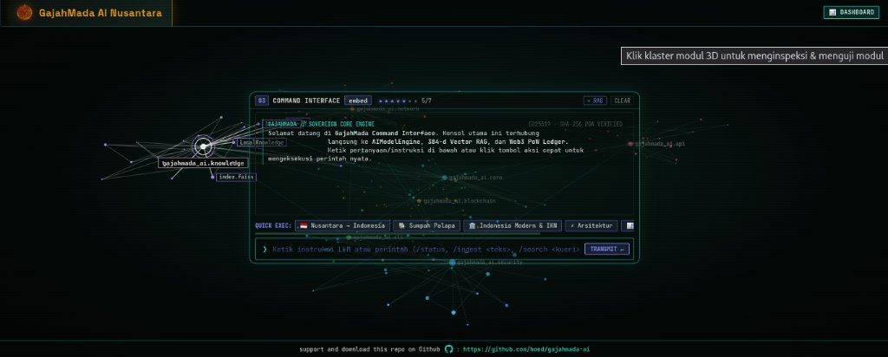

<div align="center">


# GajahMada AI Nusantara (v2.0)

### **Sovereign, Independent, Hybrid, Distributed Intelligence Architecture**

*14-Stage Hybrid Cognitive Pipeline · Sovereign From-Scratch Neural Model (`GNNM` Decoder-Only Transformer · ONNX) · Deterministic Symbolic & Evidence Reasoning · 5-Tier Persistent Memory (`SQLite` + Optional `Supabase pgvector`) · GIP/2.0 Cryptographic Mesh Protocol · Tamper-Evident Schema v2 Audit Ledger*

[](https://python.org)
[](gajahmada_ai/api/server.py)
[](docs/GNNM_ARCHITECTURE.md)
[](supabase/schema.sql)
[](gajahmada_ai/network/protocol.py)
[](tests/)
[](LICENSE)

[Overview](#-overview) · [Live UI](#-live-interface-preview) · [Architecture](#-8-layer-architecture) · [Quick Start](#-quick-start) · [Native Model (GNNM)](#-gajahmada-native-neural-model-gnnm) · [API Reference](#-rest--web3-api-reference) · [Security & Verification](#-verification--automated-test-suite-3333) · [License](#-license)

</div>

---

## 🌐 Overview

**GajahMada AI Nusantara** is an open-source, sovereign, hybrid distributed intelligence node designed to operate **without mandatory third-party cloud AI APIs**. Each node owns its cryptographic identity (**Ed25519**), private persistent memory (**SQLite ACID** + optional **Supabase `pgvector`**), hybrid **neural-symbolic reasoning engine**, **closed-loop strategy adaptation**, and **tamper-evident audit ledger**.

### 7 Verified Sovereign Architecture Principles

| # | Principle | Verified Implementation |
| :-: | :--- | :--- |
| **1** | **Independent Cognitive Engine per Node** | Every `SovereignPeerNode` executes its own 14-stage `CognitiveReasoningPipeline` completely offline. |
| **2** | **Private Persistent Memory per Node** | Local ACID SQLite (`gajahmada_v2.db`) with `PRIVATE`/`LOCAL` isolation enforced via `MemoryAuthorizationService`, GIP/2.0, and Supabase RLS. |
| **3** | **Active Neural-Symbolic Reasoning** | Combines **GajahMada Native Neural Model (`GNNM`)** (from-scratch PyTorch Decoder-Only Transformer), AST `SymbolicReasoner`, and `EvidenceReasoner` with honest capability reporting. |
| **4** | **Experience-Based Strategy Adaptation** | Closed-loop `record_outcome_and_adapt()` extracts verified `PROCEDURAL` strategies and tunes `retrieval_top_k` with regression verification and instant rollback. |
| **5** | **Open Protocol Cooperation (`GIP/2.0`)** | 8-namespace canonical JSON protocol signed with Ed25519, `PeerTrustState` lifecycle, nonce replay cache, and SSRF protection. |
| **6** | **Independent Cross-Node Verification** | `QuorumConsensusManager` verifies per-submission Ed25519 signatures and `provenance_hash`, enforcing policy `quorum_size >= 2` and rejecting unbacked majority claims. |
| **7** | **No Single Central Authority** | Zero mandatory master node; cryptographic keys, policies, peer revocation lists, and memory remain strictly sovereign per node. |

---

## 🖥️ Live Interface Preview

### 1. Homepage — Focus Command Center & Fullscreen 3D Network (`/`)


### 2. Full 8-Panel Tactical Cyberdeck Dashboard (`/dashboard` & `/ui`)


> **Dual-Mode Web Console (`/` & `/dashboard`):**
> - **Homepage (`/`):** A sleek **30%-opacity (no-blur) Command Center** floating over an edge-to-edge **3D Network & Architecture Graph** that smoothly accelerates (~16× angular velocity) while the Brain processes a query or crawl.
> - **Dashboard (`/dashboard` & `/ui`):** Full 8-panel Tactical Cyberdeck HUD (System Logs & Live Config, 3D Network Graph, Command Interface, Module Dependencies, Web3 Consensus Cycle, Modular Architecture Matrix, P2P Mesh, and System Performance & Ledger) with a session-scoped **`🔑 AUTH`** control for authenticated administrative actions.

---

## ✨ Core Capabilities

1. **14-Stage Hybrid Cognitive Reasoning Pipeline (`gajahmada_ai.cognition`, `reasoning`):**
   - Orchestrates `PERCEPTION` → `INTENT` → `MEMORY RETRIEVAL` → `DECOMPOSITION` → `HYPOTHESES` → `PARALLEL REASONING (Neural + Symbolic + Evidence)` → `EVIDENCE FUSION` → `METACOGNITIVE CRITIC` → `SUFFICIENCY` → `DECISION`.
   - Outputs structured `ReasoningResult` objects with `EpistemicBreakdown` separating verified facts, unverified claims, hypotheses, inferences, opinions, and unknown information.
   - **Concise by Default:** Delivers direct 1–3 sentence answers unless the prompt requests detailed elaboration (`detail`, `lengkap`, `rinci`, `step by step`, `in detail`, etc.).

2. **Sovereign From-Scratch Native Neural Model (`GNNM`) (`gajahmada_ai.gnnm`, `neural`):**
   - Primary neural execution via **GajahMada Native Neural Model (`GNNM`)** (`PyTorchNativeBackend` auto-discovering `./models/gnnm-*`) and optional **ONNX (`OnnxBackend`)** — zero dependency on third-party model weights.
   - **Honest Capability Reporting:** Reports `neural_inference_active: True` strictly when real `GNNM` model weights are loaded; never masquerades rule-based synthesis as neural inference.

3. **5-Tier Memory, Knowledge Quarantine & Optional Supabase `pgvector` (`gajahmada_ai.memory`, `storage`):**
   - Five persistent tiers: **Working**, **Semantic**, **Episodic**, **Procedural**, and **Collective**, backed by local SQLite (`gajahmada_v2.db`) with SHA-256 integrity hashes, immutable version history, contradiction preservation, and Knowledge Graph extraction.
   - **6-State Epistemic Model:** `UNVERIFIED`, `MODEL_ASSESSED`, `SOURCE_CORROBORATED`, `INDEPENDENTLY_VERIFIED`, `DISPUTED`, and `REJECTED`. Unverified model outputs, web crawls, and peer `GIP-KNOWLEDGE` enter **`LOCAL` Quarantine** first and require traceable `independent_sources` + contradiction checks via `POST /api/v2/knowledge/promote/{record_id}` before entering `COLLECTIVE` memory.
   - **Optional Supabase Cloud Persistence (`supabase/schema.sql`):** Content-addressed `knowledge_records` (`vector(384)` + `match_knowledge` RPC) and `ledger_blocks` protected by **Row Level Security (RLS)** (public keys can only `SELECT` `COLLECTIVE` rows; all public writes are blocked with `401 / 42501`).

4. **Security Hardening & Tamper-Evident Local Signed Event Ledger (`gajahmada_ai.security`, `blockchain`):**
   - **Zero Signing Oracle:** `POST /security/sign-verify` uses an isolated ephemeral self-test keypair + domain-separated server nonce (`oracle_protected: True`), never exposing the node's private key.
   - **Fail-Closed RBAC, Internal Endpoint Protection & Visibility Matrix:** Cryptographically random 256-bit admin key (`admin_api.key`, `0600`), RBAC (`401`/`403`) across all v1/v2 state-mutating endpoints and internal operational endpoints (`/api/v2/reasoning`, `/api/v2/agents`), active `SlidingWindowRateLimiter` (`429`), configurable CORS, unforgeable approvals, and an explicit fail-closed visibility matrix (`PRIVATE`/`LOCAL` → `admin`/`operator` only; `SHARED` → authenticated roles; `COLLECTIVE`/`PUBLIC` → public read).
   - **Fail-Closed Key Management:** Atomic `0600` private-key persistence (`KeyPersistenceError` on failure) and restart-persistent dual-signed rotation certificates & revocation lists (`node_key.pem.state.json`), synchronizable via `GIP-IDENTITY`.
   - **Tamper-Evident Local Signed Event Ledger (Schema v2):** Local hash-chained, Ed25519-signed audit ledger (not a public BFT distributed consensus blockchain) with canonical JSON hashing over every field (`event_type`, `event_ref`, `metadata`, `timestamp`, `node_id`, `previous_hash`), strict full-envelope Ed25519 verification on every non-genesis block (`index > 0`, no unsigned or spoofed-genesis bypass), atomic writes (`tmp + fsync + .bak + os.replace`), and explicit `LEDGER_CORRUPTED` halt + `recover_from_backup()`.

5. **Full 8-Namespace `GIP/2.0` Mesh Protocol (`gajahmada_ai.network`):**
   - Operational handlers for `IDENTITY`, `DISCOVERY`, `CAPABILITY`, `TASK`, `KNOWLEDGE`, `VERIFY`, `CONSENSUS`, and `SYNC` at `POST /api/v2/network/gip`, backed by an atomic, restart-persistent SQLite WAL replay nonce store (`gip_replay.db`).
   - Enforces explicit **`PeerTrustState`** (`UNKNOWN → PENDING → AUTHENTICATED → TRUSTED → REVOKED`), SSRF validation on discovery endpoints, direct Ed25519 verification + independent evidence checks inside `QuorumConsensusManager`, and cryptographic multi-node `node_attestations` for `INDEPENDENTLY_VERIFIED` knowledge promotion.

---

## 🏗️ 8-Layer Architecture

```mermaid
flowchart TD
    UI["Homepage Command Center (/) + 8-Panel Dashboard (/dashboard, /ui) & CLI"] <--> API["FastAPI Gateway<br/>/api/v2/* & Legacy v1 Routes (Fail-Closed RBAC + Rate Limit)"]
    API --> L8["LAYER 8 — INTELLIGENCE GOVERNANCE<br/>RBAC Auth · Execution Policies · Trust Policies · Closed-Loop Learning & Rollback"]
    L8 --> L7["LAYER 7 — COLLECTIVE INTELLIGENCE<br/>Multi-Node Task Delegation · Independent Per-Submission Verification · Policy Quorum"]
    L7 --> L6["LAYER 6 — AUTONOMOUS AGENT RUNTIME<br/>Planner · Researcher · Analyst · Verifier · Scheduler · Unforgeable Human Approval"]
    L6 --> L5["LAYER 5 — HYBRID REASONING ENGINE<br/>GNNM Native Transformer + AST Symbolic + Evidence + Critic"]
    L5 --> L4["LAYER 4 — 5-TIER MEMORY & QUARANTINE ENGINE<br/>SQLite + Optional Supabase pgvector (RLS) · MemoryAuthorizationService · Versioning"]
    L4 --> L3["LAYER 3 — PERCEPTION & OPEN KNOWLEDGE CRAWLER<br/>Input Normalization · Wikipedia · DuckDuckGo · Open-Meteo · Al-Qur'an · Direct URL"]
    L3 --> L2["LAYER 2 — DISTRIBUTED INFRASTRUCTURE (GIP/2.0)<br/>8 Namespaces · PeerTrustState · Ed25519 Envelopes · Replay Protection · SSRF Guard"]
    L2 --> L1["LAYER 1 — SOVEREIGN FOUNDATION<br/>Ed25519 Identity & Key Rotation · Schema v2 Canonical PoW Ledger · Atomic Recovery"]
```



### Repository Structure

```text
gajahmada/
├── main.py                              # Entry point (Localhost Uvicorn & Vercel ASGI)
├── config.yaml                          # Node, bootstrap peer, & native GNNM model configuration
├── .env.example                         # Environment template for optional Supabase & auth
├── vercel.json                          # Vercel Serverless routing configuration
├── LICENSE                              # MIT Open-Source License
├── ARCHITECTURE.md                      # Detailed system & security architecture reference
├── run.sh / run.bat                     # Cross-platform quick-start scripts
├── supabase/
│   └── schema.sql                       # PostgreSQL + pgvector schema, match_knowledge RPC, & RLS
├── docs/
│   ├── ARCHITECTURE_V2.md               # 8-layer & 14-stage cognitive specification
│   ├── GNNM_ARCHITECTURE.md             # GajahMada Native Neural Model (GNNM-01..04) blueprint
│   ├── AUDIT_V2.md                      # Source code audit & capability classification
│   ├── SECURITY_AUDIT.md                # Security controls & threat mitigation matrix
│   ├── MIGRATION_PLAN.md                # v1 -> v2 compatibility contract
│   └── ROADMAP.md                       # Phased roadmap & benchmark results
├── scripts/
│   ├── train_gnnm.py                    # Scalable CLI Pretraining + Val Perplexity + SFT pipeline
│   └── train_gnnm_01_tiny.py            # Quick-start local GNNM-01-Tiny pretraining script
├── models/
│   └── gnnm-01-tiny/                    # From-scratch GNNM checkpoint metadata (config.json, tokenizer.json, metrics.json; model.pt gitignored)
├── gajahmada_ai/
│   ├── api/                             # FastAPI server.py (v1 + UI host) & v2_routes.py (/api/v2/*)
│   ├── cognition/                       # 14-stage CognitiveReasoningPipeline & EpistemicBreakdown
│   ├── gnnm/                            # From-scratch Decoder-Only Transformer (config, tokenizer, dataset, model, trainer, inference)
│   ├── neural/                          # ModelRouter, PyTorchNativeBackend (GNNM), OnnxBackend, InferenceBackend ABC
│   ├── reasoning/                       # SymbolicReasoner (AST/Logic), EvidenceReasoner, ContradictionDetector
│   ├── memory/                          # 5-tier MemoryManager, MemoryAuthorizationService, KnowledgeGraph, Versioning
│   ├── storage/                         # RelationalMemoryStore (SQLite/PG), SupabaseKnowledgeStore, ObjectStore
│   ├── knowledge/                       # LocalKnowledge (384-d RAG), open_knowledge.py crawler, indonesia_corpus.py
│   ├── agents/ & execution/             # Planner, Researcher, Analyst, Verifier, Scheduler, SandboxedExecutor
│   ├── learning/                        # FeedbackCollector, ExperienceExtractor, StrategyAdapter, LearningExperimentManager
│   ├── network/                         # GIP/2.0 protocol (SQLite WAL replay store), PeerDiscoveryRegistry, CollectiveCoordinator, QuorumConsensus
│   ├── blockchain/                      # AIBlockchain Schema v2 tamper-evident local signed event ledger + atomic recovery
│   ├── security/                        # NodeIdentity (Ed25519, fail-closed key/state persistence), AuthManager (RBAC), SSRF guard, RateLimiter, AuditLogger
│   └── cli/                             # CLI v1 & v2 (`gajahmada`)
├── interface/html/                      # Dual-Mode Web UI: Homepage (/) & 8-Panel Dashboard (/dashboard, /ui)
└── tests/                               # 39 Automated Tests across unit, cognition, memory, network, security, integration, benchmarks
```

---

## 🚀 Quick Start

### 1. Local Offline Mode (Zero External APIs)

```bash
pip install -r requirements.txt
./run.sh        # Linux / macOS (Windows: run.bat)
```

Open in your browser:
- **Homepage (Focus Command Center + 3D Network):** `http://localhost:8000/`
- **Full 8-Panel Tactical Cyberdeck Dashboard:** `http://localhost:8000/dashboard` (or `/ui`)

> **Operator Authentication:** On first boot, a random 256-bit admin key is saved to `knowledge_store/admin_api.key` (permissions `0600`) or read from `GAJAHMADA_ADMIN_KEY`. In the Dashboard, click **`🔑 AUTH`** in the header to store your key in browser `sessionStorage` for protected administrative actions.

### 2. Local Native `GNNM` Neural Runtime (`.venv312` + PyTorch CPU/CUDA)

```bash
uv venv --python 3.12 .venv312
uv pip install --python .venv312/bin/python -r requirements.txt
uv pip install --python .venv312/bin/python torch --index-url https://download.pytorch.org/whl/cpu

# Train your own GNNM-01-Tiny checkpoint from scratch into ./models/gnnm-01-tiny/
.venv312/bin/python scripts/train_gnnm.py --preset GNNM-01-Tiny --steps 80 --sft-steps 40

# ./run.sh automatically selects .venv312/bin/python and loads ./models/gnnm-01-tiny
./run.sh
```

### 3. Optional Supabase Persistence (`PostgreSQL + pgvector` + RLS)

1. Execute [supabase/schema.sql](supabase/schema.sql) in your Supabase SQL Editor (enables `pgvector`, creates `knowledge_records`, `ledger_blocks`, `match_knowledge` RPC, and enforces RLS).
2. Copy `.env.example` to `.env` (or configure Vercel Environment Variables):
   ```env
   SUPABASE_URL=https://<project-ref>.supabase.co
   SUPABASE_PUBLISHABLE_KEY=<your-publishable-key>
   SUPABASE_SECRET_KEY=<your-secret-key>
   GAJAHMADA_ADMIN_KEY=<your-random-256bit-admin-key>
   ```
   *(If setting `DATABASE_URL` with special characters in the password, URL-encode `@` → `%40` and `#` → `%23`.)*
3. Without `.env`, every node operates 100% independently in local-first SQLite mode.

---

## 🧠 GajahMada Native Neural Model (`GNNM`)

GajahMada includes its own **from-scratch Decoder-Only Transformer** (`gajahmada_ai/gnnm/`) with zero external model weights required ([docs/GNNM_ARCHITECTURE.md](docs/GNNM_ARCHITECTURE.md)):

- **Architecture:** Pre-Norm `RMSNorm` + Rotary Positional Embeddings (`RoPE`) + Grouped/Multi-Head Causal Self-Attention + `SwiGLU` + `std=0.02` initialization + repetition-penalized autoregressive decoding.
- **Tokenizer:** Pure-Python lossless **Byte-Level BPE (`GNNMBPETokenizer`)** supporting Indonesian, English, regional scripts, Arabic, math, and code with zero `<unk>` loss.
- **Training Pipeline:** Streaming `.jsonl`/`.txt` corpus deduplication (`SHA-256`), causal pretraining, validation perplexity evaluation, and Supervised Fine-Tuning (SFT) with `-100` prompt loss masking.
- **Auto-Discovery:** Trained checkpoints in `./models/gnnm-*` are automatically loaded by `PyTorchNativeBackend` and surfaced in `ModelRouter`.

```bash
uv pip install --python .venv312/bin/python torch --index-url https://download.pytorch.org/whl/cpu

# Fast local CPU proof-of-concept (Pretrain + Val Perplexity + SFT + metrics.json)
.venv312/bin/python scripts/train_gnnm.py --preset GNNM-01-Tiny --steps 80 --sft-steps 40

# Scale to GNNM-01-25M on CUDA GPU with custom multilingual .jsonl/.txt corpus
.venv312/bin/python scripts/train_gnnm.py --preset GNNM-01-25M --corpus-dir ./data/corpus --vocab-size 8192 --seq-len 256 --steps 5000 --sft-steps 500
```

---

## 💻 CLI Reference

```bash
python -m gajahmada_ai.cli.main init
python -m gajahmada_ai.cli.main node start --config config.yaml
python -m gajahmada_ai.cli.main intelligence diagnose
python -m gajahmada_ai.cli.main intelligence ask "Compute sqrt(144) + 25 * 4"
python -m gajahmada_ai.cli.main memory inspect
python -m gajahmada_ai.cli.main agent run "Verify Sumpah Palapa 1336 historical provenance"
python -m gajahmada_ai.cli.main network status
python -m gajahmada_ai.cli.main system health
```

---

## 📡 REST & Web3 API Reference

### GajahMada 2.0 API (`/api/v2/*`)

| Method | Endpoint | Auth | Description |
| :---: | :--- | :---: | :--- |
| `GET` | `/api/v2/intelligence/diagnose` | Public | Honest capability report (`gajahmada-native` GNNM, `onnx`, symbolic, memory, agents). |
| `POST` | `/api/v2/intelligence/ask` | Optional | 14-stage cognitive reasoning (public requests are read-only; authenticated operators persist to `LOCAL` Quarantine). |
| `GET` | `/api/v2/reasoning/{id}` | Public | Inspect step-by-step reasoning trace, hypotheses, evidence, and contradictions. |
| `GET` | `/api/v2/memory` | Filtered | Memory stats, records, & contradictions filtered by `MemoryAuthorizationService` (`PRIVATE` hidden from public). |
| `POST/PUT` | `/api/v2/memory` / `/{id}` | **Required** | Store or correct versioned memory records with SHA-256 provenance & contradiction checks. |
| `GET` | `/api/v2/memory/{id}/versions` | Guarded | Immutable version history (`403` for unauthorized access to `PRIVATE` records). |
| `POST` | `/api/v2/memory/backup` | **Required** | Export content-addressed SHA-256 memory snapshot. |
| `GET` | `/api/v2/knowledge` | Filtered | Knowledge Graph relations & contradictions filtered by `MemoryAuthorizationService`. |
| `POST` | `/api/v2/knowledge/promote/{id}` | **Required** | Promote quarantined record to `SOURCE_CORROBORATED` / `INDEPENDENTLY_VERIFIED` (`COLLECTIVE`) after validating `independent_sources` & contradictions. |
| `POST` | `/api/v2/agents/run` | **Required** | Submit autonomous agent objective (`human_approved` always forced `False` on submission). |
| `POST` | `/api/v2/agents/tasks/{id}/approve` | **Required** | Authenticated human approval for `WAITING` tasks + signed ledger event. |
| `POST` | `/api/v2/network/gip` | Ed25519 + Trust | 8-namespace GIP/2.0 receiver with `PeerTrustState`, SSRF guard, replay cache, & per-submission verified consensus. |
| `POST` | `/api/v2/nodes/register` | **Required** | Register a `TRUSTED` peer with SSRF validation. |
| `POST` | `/api/v2/nodes/{node_id}/trust` | **Required** | Update peer trust state (`PENDING`, `AUTHENTICATED`, `TRUSTED`, `REVOKED`). |
| `GET` | `/api/v2/system/health` | Public | Full diagnostics including ledger status (`HEALTHY` / `LEDGER_CORRUPTED`), audit integrity, & strategy version. |
| `POST` | `/api/v2/system/rotate-key` | **Required** | Rotate node Ed25519 key with dual-signed rotation certificate. |
| `POST` | `/api/v2/system/learning/experiment` | **Required** | Evaluate learning adaptation against regression suite with automatic rollback on failure. |

### Backward-Compatible v1 API (Fail-Closed Mutations)

| Method | Endpoint | Auth | Description |
| :---: | :--- | :---: | :--- |
| `GET` | `/`, `/dashboard`, `/ui`, `/health` | Public | Dual-mode Web UI (`/` & `/dashboard`) and health check. |
| `POST` | `/ai/chat` | Public | Hybrid 14-stage chat + RAG + Schema v2 `record_event()` ledger + quarantined Q&A persistence. |
| `POST` | `/ai/ingest`, `/knowledge/crawl` | **Required** | Vector assimilation and internet knowledge crawling into `LOCAL` Quarantine. |
| `DELETE` | `/knowledge/docs/{idx}`, `/node/logs`, `/node/peers` | **Required** | Protected administrative deletion endpoints. |
| `POST` | `/node/chain/mine`, `/node/sync`, `/node/broadcast`, `/node/config` | **Required** | Protected ledger mining, SSRF-checked peer sync, GIP broadcast, and runtime config updates. |
| `POST` | `/security/sign-verify` | Public | **Oracle-protected** Ed25519 self-test using an isolated ephemeral keypair + server nonce. |
| `GET` | `/node/info`, `/node/metrics`, `/node/chain`, `/knowledge/stats` | Public | Read-only node telemetry, ledger inspection, and knowledge statistics. |

---

## 🧪 Verification & Automated Test Suite (33/33)

Run the entire verification suite with:

```bash
pytest -v
```

| Suite | Coverage | File | Status |
| :--- | :--- | :--- | :---: |
| **Core & Neural (Tests 1–3, 14, +2)** | Offline boot without cloud APIs, local native neural loading, honest unavailability reporting, regression-guarded learning, closed-loop strategy adaptation, signed ledger. | `tests/unit/test_core_and_neural.py` | ✅ **PASSED** |
| **Cognitive Pipeline (Tests 4–6)** | LLM-independent AST math/logic, 14-stage `ReasoningResult` & `EpistemicBreakdown`, evidence provenance references. | `tests/cognition/test_cognitive_pipeline.py` | ✅ **PASSED** |
| **Memory Persistence (Tests 7–8)** | Restart survival, immutable version history, backup restore, contradiction preservation. | `tests/memory/test_memory_persistence.py` | ✅ **PASSED** |
| **GIP & Collective (Tests 9–11)** | Offline node operation, 2-node signed GIP/2.0 exchange + replay rejection, 3-node collective quorum. | `tests/network/test_gip_and_collective.py` | ✅ **PASSED** |
| **Security & Governance (Tests 12–13, +1)** | Unauthenticated admin rejection (`401`), malicious peer command/memory isolation, SSRF & predictable seed prevention. | `tests/security/test_security_and_governance.py` | ✅ **PASSED** |
| **Audit Remediation P0–P5 + Round 3 (16 Tests)** | Signing oracle elimination, fail-closed v1/v2 & internal endpoint auth, explicit visibility matrix (`PRIVATE`/`LOCAL`/`SHARED`/`COLLECTIVE`/`PUBLIC`), cryptographic `node_attestations` promotion, direct Ed25519 consensus + evidence independence, persistent SQLite GIP replay protection, fail-closed key persistence + persisted rotations/revocations, strict non-genesis ledger verification + `LEDGER_CORRUPTED` recovery, & 3-node restart persistence. | `tests/security/test_audit_remediation.py` | ✅ **PASSED** |
| **GNNM Native Model (4 Tests)** | Parameter estimator, lossless multilingual byte-level BPE, `.jsonl` deduplication, SFT `-100` prompt masking, & Transformer forward/init-loss check. | `tests/unit/test_gnnm_foundation.py` | ✅ **PASSED** |
| **API Compatibility & Benchmarks** | Full v1/v2 API compatibility & live cognitive benchmark execution. | `tests/integration/`, `tests/benchmarks/` | ✅ **PASSED** |

---

## 🗺️ 5-Stage Sovereign Strategic Roadmap & Honest Maturity Status

GajahMada explicitly separates **verified local pipeline foundations** from **future large-scale milestones** so auditors and partners can inspect exact capabilities directly in code:

| Stage | Milestone | Engineering Scope & Current Verified Status |
| :---: | :--- | :--- |
| **Stage 1** | **GajahMada Native Model (`GNNM`)** | **In Progress (Pipeline Proven):** Custom from-scratch Decoder-Only Transformer (`gajahmada_ai/gnnm/`), lossless Byte-Level BPE tokenizer, streaming corpus/SFT trainer (`scripts/train_gnnm.py`), and verified `GNNM-01-Tiny` checkpoint (`models/gnnm-01-tiny/`). *Not yet a large-scale frontier LLM* — next scaling tiers are `GNNM-01-25M` (10M–50M) → `GNNM-02-100M` → `GNNM-03-300M` → `GNNM-04-1B` as compute & curated corpora scale. |
| **Stage 2** | **Native Cognitive Engine** | **Operational:** 14-stage hybrid reasoning, deterministic `SymbolicReasoner`, `EvidenceReasoner`, `ContradictionDetector`, and 5-tier persistent memory operate fully even when no neural checkpoint is loaded (`neural_inference_active: False`). |
| **Stage 3** | **GIP Distributed Intelligence** | **3-Node Verified → Scaling to 10 / 100 Nodes:** 8-namespace signed `GIP/2.0`, SQLite WAL replay protection, `PeerTrustState`, direct Ed25519 quorum verification, and 3-node restart persistence are tested; next milestone is 10-node and 100-node WAN stress testing (partition recovery, conflict resolution, and BFT finality). |
| **Stage 4** | **Collective Knowledge Network** | **Foundation Ready:** Cryptographic `node_attestations`, explicit visibility isolation (`PRIVATE`/`LOCAL`/`SHARED`/`COLLECTIVE`/`PUBLIC`), and per-node Ed25519 identity allow universities, researchers, communities, and organizations to operate sovereign nodes while retaining full local data ownership. |
| **Stage 5** | **Independent AI Ecosystem** | **Planned:** Public Python/TypeScript SDKs, formal GIP/2.0 RFC specification, open evaluation benchmarks, and third-party interoperability standards. |

---

## 🤝 Contributing & License

Contributions, security audits, multilingual corpus tools, and benchmark PRs are welcome! Please open an issue or pull request at **[github.com/hoed/gajahmada-ai](https://github.com/hoed/gajahmada-ai)**.

This project is open-source software licensed under the **[MIT License](LICENSE)**.
