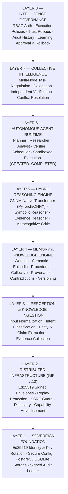

# GAJAHMADA 2.0 — Sovereign Hybrid Distributed Intelligence Architecture (`ARCHITECTURE_V2.md`)

---

## 1. Architectural Vision & Scientific Boundaries

**GajahMada 2.0** is a sovereign, independent, hybrid, distributed intelligence system.
- **Provider Independence:** GajahMada does **not** depend on OpenAI, Gemini, Claude, or any centralized cloud AI API. External providers are optional, disabled by default, and isolated behind adapters.
- **Offline First:** Core operation (perception, symbolic reasoning, evidence evaluation, memory persistence, local neural/deterministic inference, agent planning, and cryptographic audit logging) functions 100% offline without internet connectivity.
- **Honest Capability Reporting:** GajahMada never pretends a rule-based fallback is an active neural LLM. Every response and diagnostic endpoint explicitly reports active capabilities (`neural_inference_active`, `symbolic_reasoning_active`, `evidence_reasoning_active`, `active_backend`).
- **Scientific Boundary:** GajahMada makes zero claims of consciousness, sentience, or human-equivalent general intelligence. It implements measurable hybrid reasoning, persistent multi-tier memory with provenance, bounded autonomous task execution, and verifiable peer-to-peer collective coordination.

---

## 2. Eight-Layer Architecture Map



---

## 3. Existing (v1) vs. Target (v2.0) Architecture Comparison

| Subsystem | Existing Implementation (v1) | GajahMada 2.0 Architecture |
| :--- | :--- | :--- |
| **1. Identity & Crypto** | `security/crypto.py`: Ed25519 keygen with hardcoded Vercel fallback seed; no key rotation or peer revocation. | `security/crypto.py`, `auth.py`, `policies.py`: Non-deterministic Ed25519 keygen, key rotation, revocation registry, RBAC token + signature auth. |
| **2. Audit Ledger** | `blockchain/chain.py`: SHA-256 PoW chain recording raw `task_hash` strings; `is_chain_valid()` ignores signatures. | `blockchain/chain.py`: Signed event & audit ledger verifying Ed25519 signatures for typed events (`NODE_REGISTERED`, `TASK_CREATED`, `EVIDENCE_SUBMITTED`, `RESULT_VERIFIED`, `KNOWLEDGE_ACCEPTED`, `MODEL_VERSION_CHANGED`). |
| **3. Inference Engine** | `core/engine.py`: Legacy external runtime check + hardcoded regex Indonesian history fallback; `ML_AVAILABLE = True` hardcoded. | `gnnm/` (`GNNMTransformer`, `GNNMBPETokenizer`, `GNNMTrainer`, `GNNMInferenceEngine`) & `neural/` (`interfaces.py`, `pytorch_backend.py`, `onnx_backend.py`, `model_registry.py`, `router.py`): Native **GNNM** pluggable `InferenceBackend` with hardware-aware loading, honest capability reporting, and zero fake neural claims. |
| **4. Reasoning Pipeline** | Single `engine.generate(prompt, context)` function call. | `cognition/` + `reasoning/`: 14-stage Cognitive Reasoning Pipeline combining Neural, Symbolic (logic rules, constraints, AST math), Evidence (provenance, contradiction detection), and Metacognitive Critic into a structured `ReasoningResult`. |
| **5. Memory & Knowledge** | `knowledge/rag.py`: Flat JSON array `docs.json` + 384-d vectors; no metadata, versioning, or contradiction tracking. | `memory/` + `storage/`: 5 memory tiers (`working`, `semantic`, `episodic`, `procedural`, `collective`), PostgreSQL (`pgvector`) primary schema + durable SQLite/JSON local store, entity graph relations, provenance, contradiction preservation, versioning, and backup/export. |
| **6. Autonomous Agents** | None (`models/` and `plugins/` are empty files). | `agents/` + `execution/`: `PlannerAgent`, `ResearcherAgent`, `AnalystAgent`, `VerifierAgent`, `TaskScheduler` with explicit lifecycle states (`CREATED`, `PLANNED`, `APPROVED`, `RUNNING`, `WAITING`, `COMPLETED`, `FAILED`, `CANCELLED`), execution budgets, human approval gates, and sandboxed tools. |
| **7. P2P & Collective** | `network/p2p.py`: Unauthenticated URL list; `/node/broadcast` sends `POST /health`. | `network/protocol.py`, `transport.py`, `discovery.py`, `coordinator.py`, `synchronization.py`, `consensus.py`: GIP v2.0 typed signed messages, replay protection, SSRF guard, distributed task delegation, independent peer verification, and conflict resolution. |
| **8. Learning** | CLI command `train-model` only mines an empty PoW block. | `learning/`: 3-level controlled learning (`feedback.py`, `experience.py`, `evaluator.py`, `adaptation.py`, `experiments.py`, `datasets.py`) with regression testing, policy approval, and instant rollback. |

---

## 4. Cognitive Reasoning Pipeline Specification

Every query or objective processed by GajahMada 2.0 passes through the native cognitive orchestration pipeline:

```text
INPUT
  ↓
1. PERCEPTION (cognition/perception.py)
   Normalizes text, detects language, extracts entities, numerical expressions, and formal claims.
  ↓
2. INTENT CLASSIFICATION (cognition/intent.py)
   Classifies intent: mathematical/symbolic, factual/historical, analytical, diagnostic, or autonomous objective.
  ↓
3. MEMORY RETRIEVAL (memory/manager.py & retrieval.py)
   Retrieves relevant semantic, episodic, procedural, and collective records with provenance & confidence.
  ↓
4. PROBLEM DECOMPOSITION (cognition/decomposition.py)
   Breaks complex questions/objectives into ordered, verifiable sub-questions and constraints.
  ↓
5. HYPOTHESIS GENERATION (cognition/hypotheses.py)
   Forms candidate hypotheses with explicit assumptions and required evidence criteria.
  ↓
6. PARALLEL HYBRID REASONING
   ├── A. Neural Reasoning (neural/router.py) -> Native GNNM (PyTorch/ONNX) inference (if active & loaded)
   ├── B. Symbolic Reasoning (reasoning/symbolic.py & constraints.py) -> Deterministic math, formal logic rules, deduction
   └── C. Evidence Reasoning (reasoning/evidence.py & contradictions.py) -> Provenance weighting, claim verification, contradiction detection
  ↓
7. EVIDENCE FUSION & METACOGNITIVE CRITIC (cognition/metacognition.py & reasoning/evaluator.py)
   Evaluates reasoning quality, detects unsupported claims, separates verified facts from hypotheses/unknowns, computes confidence & uncertainty.
  ↓
8. SUFFICIENCY EVALUATION & DECISION (cognition/decision.py)
   Determines whether evidence is sufficient or triggers additional investigation / reports bounded uncertainty.
  ↓
9. RESPONSE OR AUTHORIZED EXECUTION -> MEMORY UPDATE -> OUTCOME EVALUATION
```

### Structured `ReasoningResult` Schema
Every reasoning invocation produces an auditable `ReasoningResult` (Pydantic model):
- `reasoning_id: str`
- `objective: str`
- `interpretation: str`
- `assumptions: List[str]`
- `hypotheses: List[HypothesisItem]`
- `evidence: List[EvidenceReference]`
- `contradictions: List[ContradictionRecord]`
- `reasoning_steps: List[ReasoningStepSummary]` *(concise auditable summaries, never raw private chain-of-thought)*
- `epistemic_breakdown: EpistemicBreakdown` *(explicitly separating `verified_facts`, `unverified_claims`, `hypotheses`, `inferences`, `opinions`, `unknown_information`)*
- `conclusion: str`
- `confidence: float` ($0.0 \le c \le 1.0$)
- `uncertainty: float` ($0.0 \le u \le 1.0$)
- `verification_status: Literal["VERIFIED", "PARTIALLY_VERIFIED", "UNVERIFIED", "CONTRADICTED"]`
- `capabilities_used: CapabilityReport` *(explicitly reporting whether neural, symbolic, and evidence engines were active)*
- `memory_references: List[str]`
- `execution_requirements: List[str]`

---

## 5. Target Repository Structure

```text
gajahmada_ai/
├── core/               # Legacy compatibility bridge + Runtime Lifecycle & Diagnostics
│   ├── engine.py       # Preserves AIModelEngine interface while delegating to v2 subsystems
│   └── lifecycle.py    # Node runtime lifecycle, capability diagnostics, config management
├── cognition/          # Cognitive Orchestration Pipeline
│   ├── models.py       # ReasoningResult, EpistemicBreakdown, HypothesisItem, EvidenceReference
│   ├── perception.py   # Input normalization, entity & claim extraction
│   ├── intent.py       # Intent classification
│   ├── decomposition.py# Problem decomposition
│   ├── hypotheses.py   # Hypothesis & assumption generation
│   ├── metacognition.py# Metacognitive critic & sufficiency evaluation
│   ├── decision.py     # Decision synthesis & epistemic separation
│   └── reasoning.py    # End-to-end CognitivePipeline orchestrator
├── neural/             # Provider-Independent Neural Inference Abstraction
│   ├── interfaces.py   # InferenceBackend ABC, ModelMetadata, GenerationResult
│   ├── model_registry.py# Local model registration, capability metadata, version control
│   ├── gnnm/           # GajahMada Native Neural Model (GNNM) from-scratch PyTorch Transformer & BPE tokenizer
│   ├── onnx_backend.py # ONNX Runtime backend
│   ├── pytorch_backend.py# PyTorch native research backend
│   └── router.py       # Task-based model router & honest capability reporter
├── reasoning/          # Symbolic, Constraint & Evidence Reasoning
│   ├── symbolic.py     # Propositional/first-order rule deduction & deterministic math
│   ├── constraints.py  # Constraint satisfaction & boundary verification
│   ├── inference.py    # Hybrid symbolic-evidence inference combiner
│   ├── evidence.py     # Source reliability, evidence scoring, claim verification
│   ├── contradictions.py# Contradiction detection & preservation
│   └── evaluator.py    # Reasoning quality & epistemic accuracy evaluator
├── memory/             # 5-Tier Persistent Memory & Knowledge Engine
│   ├── models.py       # MemoryRecord, MemoryType, VerificationStatus, VisibilityPolicy
│   ├── manager.py      # Unified MemoryManager orchestrating all 5 tiers
│   ├── working.py      # Bounded context-window working memory
│   ├── semantic.py     # Semantic fact & vector memory
│   ├── episodic.py     # Temporal event & interaction experience memory
│   ├── procedural.py   # Validated strategies, workflows, and tool procedures
│   ├── collective.py   # Multi-node synchronized knowledge preserving original node provenance
│   ├── knowledge_graph.py# Relational entity & relation graph
│   ├── provenance.py   # Cryptographic hash & source provenance tracker
│   ├── retrieval.py    # Hybrid vector + relational + keyword retrieval
│   ├── versioning.py   # Immutable version history & rollback
│   └── consolidation.py# Working-to-semantic/episodic consolidation & deduplication
├── storage/            # Persistent Storage Layer
│   ├── interfaces.py   # StorageBackend ABC
│   ├── postgres.py     # PostgreSQL + pgvector primary relational & vector store (with SQLite local fallback)
│   ├── vector_store.py # High-speed L2/Cosine vector index (pgvector / FAISS / NumPy)
│   ├── object_store.py # Content-addressed artifact & backup store
│   └── migrations/     # SQL schema migrations (001_initial_v2_schema.sql)
├── agents/             # Autonomous Agent Runtime (Layer 6)
│   ├── base.py         # BaseAgent, ExecutionState (CREATED..CANCELLED), ExecutionBudget
│   ├── planner.py      # Objective decomposition & DAG plan generation
│   ├── researcher.py   # Memory & evidence investigation agent
│   ├── analyst.py      # Symbolic & quantitative analysis agent
│   ├── verifier.py     # Independent verification & contradiction checking agent
│   └── scheduler.py    # Bounded task scheduler with human approval gates
├── execution/          # Controlled Sandboxed Tool Execution
│   └── sandbox.py      # Resource-limited, policy-guarded execution environment
├── learning/           # Controlled Learning & Self-Improvement (Levels 1, 2, 3)
│   ├── feedback.py     # Outcome & operator feedback recording
│   ├── experience.py   # Episodic-to-procedural experience extraction
│   ├── evaluator.py    # Regression benchmark & safety evaluator
│   ├── adaptation.py   # Policy-approved strategy adaptation & rollback
│   ├── experiments.py  # Versioned learning experiments & Level-3 local fine-tune manager
│   └── datasets.py     # Curated verification & regression datasets
├── network/            # GajahMada Intelligence Protocol (GIP v2.0) & Collective Intelligence
│   ├── p2p.py          # Backward-compatible P2PNetwork enhanced with SSRF guard
│   ├── protocol.py     # GIP-IDENTITY, DISCOVERY, CAPABILITY, TASK, KNOWLEDGE, VERIFY, CONSENSUS, SYNC schemas
│   ├── transport.py    # Authenticated HTTP/HTTPS transport & libp2p abstraction
│   ├── discovery.py    # Peer discovery, capability exchange, allowlist/revocation
│   ├── coordinator.py  # Distributed task negotiation, delegation, & independent verification
│   ├── synchronization.py# Permission-aware collective memory synchronization
│   └── consensus.py    # Quorum acknowledgement & evidence-weighted conflict resolution
├── blockchain/         # Signed Event & Cryptographic Audit Ledger
│   └── chain.py        # AIBlockchain evolved with typed LedgerEvents & Ed25519 signature verification
├── security/           # Sovereign Security Layer
│   ├── crypto.py       # Hardened Ed25519 NodeIdentity, key rotation, revocation
│   ├── auth.py         # API key, Bearer token, & Ed25519 signature authentication + RBAC
│   ├── policies.py     # Execution, memory trust, and permission boundary policies
│   ├── ssrf.py         # SSRF URL/IP validator
│   ├── rate_limit.py   # Sliding-window rate limiter
│   └── audit.py        # Persistent security event logger
├── api/                # REST & Web3 Gateway
│   ├── server.py       # Preserves all v1 routes + mounts /api/v2/* routers
│   └── v2_routes.py    # /api/v2/{intelligence,reasoning,memory,agents,network,nodes,knowledge,system}
└── cli/                # Sovereign Node CLI
    └── main.py         # Preserves v1 commands + adds v2 commands (init, node, intelligence, reasoning, memory, network, agent, system)
```
